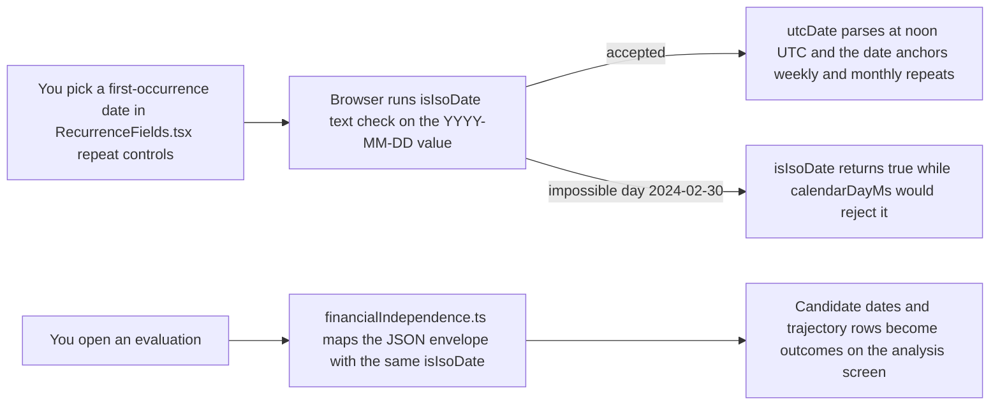
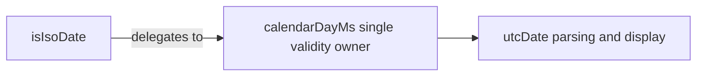

## Scenario

When you add a recurring transaction or edit a schedule's repeat rule, the schedule editor `frontend/src/components/editors/RecurrenceFields.tsx` shows Google Calendar-style repeat controls: a first occurrence date you picked, a repeat interval, and day, week, month, or year units. The browser reads that start date and, only after a small text check called `isIsoDate` accepts it, turns the date into a weekday that anchors weekly repeats and a day of the month that anchors monthly repeats. A start date is stored and sent as an ISO date, meaning `YYYY-MM-DD`: a four-digit year, a two-digit zero-padded month, and a two-digit zero-padded day. `utcDate` in `frontend/src/domain/format.ts` parses that text at noon UTC, so the date means the same calendar day in every timezone. When you open an evaluation, the browser reads the JSON evaluation envelope returned by the API — JSON is a text format for named values — and maps it in `frontend/src/api/financialIndependence.ts`; the same `isIsoDate` check decides which candidate dates, trajectory rows, and milestone dates become real rows and outcomes on the analysis screen. Both calls to `isIsoDate` run in the browser before you see a result: one while the repeat controls render, the other while the evaluation envelope is mapped.

The stricter helper `calendarDayMs` in `frontend/src/domain/calendarDay.ts` already serves other editors and snapshot code. It parses the same date text and then round-trips the parsed fields through UTC to reject impossible days: the browser's built-in `Date` silently rolls `2024-02-30` into `2024-03-01`, while `calendarDayMs` builds a UTC value from the year, month, and day and checks that reading the value back reproduces those fields. `isIsoDate` only applies a text pattern and a parse check, so `isIsoDate("2024-02-30")` returns true. The `isIsoDate` call is the one guarding evaluation dates and the repeat-rule anchor, so `isIsoDate` and `calendarDayMs` can disagree about whether a given day is real.

## Executive summary

The frontend has two ways to decide whether a `YYYY-MM-DD` value is a real calendar day. `calendarDayMs` round-trips the parsed UTC date and rejects a day that `Date` silently rolls into the next month, with a comment recording why. `isIsoDate` only applies a text pattern and a parse check, so `isIsoDate("2024-02-30")` returns true even though `utcDate` turns that value into March 1.

The loose check is the one used on external evaluation dates and as a recurrence gate, which is exactly where an impossible day changes which occurrences a rule produces. The maintenance cost is two competing definitions of validity that can drift apart.

The proposed action is to make `isIsoDate` delegate to `calendarDayMs` and delete the pattern-plus-parse implementation, leaving one calendar date validity owner in the frontend, while `utcDate` keeps parsing and display.

## Recommended action

Make `isIsoDate` call `calendarDayMs` and remove its pattern-plus-parse body. Nothing new needs to be created: `calendarDayMs` already exists and carries the reasoning in its comment. `utcDate` remains responsible for parsing and display and does not change.

## Before and after

Before: `isIsoDate` validates with a text pattern plus a parse check and accepts impossible days such as `2024-02-30`. `calendarDayMs` is a separate, stricter owner of calendar validity.

After: `isIsoDate` delegates to `calendarDayMs`, so the same rule applies everywhere and impossible days are rejected.

## Expected improvement

One calendar date validity owner instead of two, so the external evaluation-date check and the recurrence gate can no longer disagree about what a real day is. This is a structural improvement to consistency, not a measured improvement; no benchmark or timing was run.

## Alternatives considered

- Leave as is: rejected by the finding because the two checks already disagree on impossible days and can drift further. The Decision below records the separate reason this change stays out of scope.
- Replace both checks with a native or library date validator: this would fix validity but introduces a new mechanism rather than reusing the one already present. The Decision points toward this only if a real guard is ever needed.

## Downside of rejecting

The loose check stays in use on external evaluation dates and as a recurrence gate, so an impossible day can still pass validation and change which occurrences a rule produces, while `calendarDayMs` continues to say the same value is invalid.

## Verification

Verify that `isIsoDate` rejects `2024-02-30`, `2025-02-29`, and `2026-04-31` while still accepting `2024-02-29`. The recurrence and financial-independence suites must keep producing the same occurrences for real dates. These are proposed acceptance checks; no result was recorded.

References: `frontend/src/domain/format.ts:45-54`; `frontend/src/domain/calendarDay.ts:1-21`; `frontend/src/api/financialIndependence.ts:25-26`; `frontend/src/domain/recurrence.ts:401`; `frontend/src/components/editors/RecurrenceFields.tsx:64,137`.

## Decision

Rejected. Strengthening the check changes validation behavior, and deleting it changes behavior too, because unparseable strings would start passing and the rule editor would stop flagging a bad start date. Neither satisfies the rule that only behavior-neutral changes are made here, so existing behavior stays. If date validity ever needs a real guard, it should come from a native or library mechanism rather than another custom implementation.
