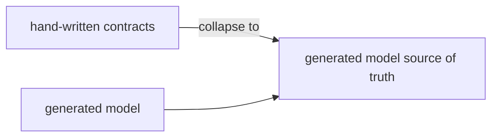

## Executive summary

Server payloads are declared twice. The hand-written contract file declares roughly fifty interfaces while the generated model tree declares the same shapes from the OpenAPI snapshot, a checked-in description of the API that the client is generated from. The two disagree: generated `FinancialModel` uses `Account[] | null` where the hand-written one uses non-null `BackendAccount[]`.

Because of that gap, endpoint calls cross between the two with `as never` or `as unknown as` casts and lose type checking at five write sites. The `/v1/flows` mirror is the same problem in one place: its header claims VIS-01 has not landed and that generation cannot emit the types, but the snapshot and generated client now provide `FlowGraph`, `FlowsOutputBody`, and `buildFlowGraph`.

The generated tree is rebuilt at container start, so the durable risk is a snapshot change desyncing the hand-written set without a compile error. The recommendation is to make the generated model the single source of truth.

## Recommended action

Reduce the hand-written contract file to aliases or re-exports over `./generated/model/...` plus genuinely client-owned values. Remove the `as never` bridges with typed adapters where normalization is real. Delete the hand-written flow contract, envelope, key guard, and wrapper in favour of generated `buildFlowGraph`. Keep the client-owned flow constants, `flowNodeById`, `flowNodeName`, narrow `FlowKind`/`FlowMovement` aliases, and a guard for the generated nullable arrays and string kind fields. No new payload definitions are created; the generated model already describes them.

## Before and after

Before: two definitions of each server payload exist, the hand-written set and the generated set, with `as never` and `as unknown as` bridges at write sites to reconcile them.

After: generated model types are the one source; the hand-written file re-exports them, the casts are replaced by typed adapters, and the hand-written flow layer is replaced by `buildFlowGraph`.

## Expected improvement

A snapshot change can no longer silently desync a second hand-written set of payload types, and the five write sites regain checking instead of relying on unchecked casts. This is a structural improvement to type safety, not a measured improvement; no benchmark or timing was run.

## Alternatives considered

- Leave as is: rejected because the two definitions already disagree and a snapshot change can desync them without any compile error.
- Keep the hand-written set and drop the generated types: rejected because the generated tree is rebuilt at container start and already provides the current shapes, including the flows types the mirror claims are unavailable.

## Downside of rejecting

The duplicate definitions keep drifting, the write sites keep relying on casts that hide type errors, and the flows mirror keeps carrying a stale header and a hand-written wrapper when generated equivalents exist.

## Verification

Regenerate the client and typecheck with the casts removed, then add a parity test over key sets and a round-trip test for `cycleStartDay`, `paydayDay`, and `savingsTarget`. The Flows page must still render the Sankey, filter, table, and edge panel, and a malformed graph must still surface a user-facing error.

Implemented in commit `d78d9e6a`. The client was regenerated from the committed snapshot and typecheck passed. Compile-time key-set parity assertions and the two settings round-trip tests were added. The full frontend suite passed with 817 tests, and lint reported zero violations. Browser rendering of the Flows page and the user-visible malformed-graph message were not checked in a browser; the guard and error path are covered by unit tests.

References: `frontend/src/api/contracts.ts:38-621`; `frontend/src/api/generated/model/financialModel.ts:15-30`; `frontend/src/api/flows.ts:8-16,28-179`; `frontend/src/api/generated/endpoints.ts:2009-2038`; `frontend/src/state/useFlowGraph.ts:3-4,96-106`; `as never` at `frontend/src/api/serverModelImport.ts:49`, `frontend/src/state/workspaceWrites.ts:252`, `frontend/src/state/useRemoteProjection.ts:146`, `frontend/src/state/useSafeSpendingSettings.ts:173`.
