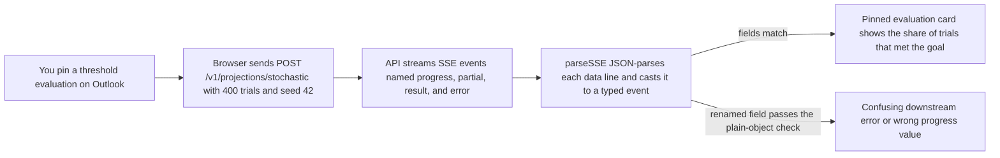
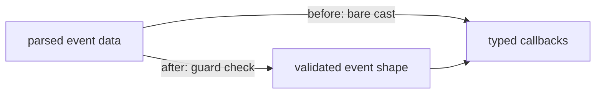

## Scenario

When a pinned threshold evaluation is shown on the Outlook forecast, or when the Evaluations page has saved evaluations to score, the page asks the API for a stochastic range: the result of running the saved financial model through 400 simulated trials. The range contains percentile net-worth points over time and, for each pinned evaluation, the share of those 400 trials in which the goal was met. The pinned evaluation card on Outlook shows that share. The browser sends a `POST /v1/projections/stochastic` request whose JSON body carries projection settings, a run count of 400, and a fixed seed of 42. A seed is the starting state of the random-number generator; the browser sets it in `frontend/src/state/useRemoteProjection.ts`. Keeping the seed and run count fixed makes the simulation repeatable, so the same settings, run count, and seed produce the same range instead of a different random answer each time. The browser does not send the financial model over the wire; the API resolves the saved model from its store.

Running 400 trials takes long enough that waiting for one reply would leave the pinned evaluation card blank, so the API keeps the connection open and sends Server-Sent Events — a long-lived text response whose updates the browser splits into messages. Each message, called an event, is one block of text ending in a blank line: an `id:` line, an `event:` line naming `progress`, `partial`, `result`, or `error`, and a `data:` line holding one line of JSON, a text format for named values. The API sends a progress update, then partial ranges, then a final result or an error. The browser feeds the text to `parseSSE`, a hand-written reader in `frontend/src/api/sse.ts` that splits the stream into blocks, JSON-parses each `data` line, and routes each event to an `onProgress`, `onPartial`, `onResult`, or `onError` callback.

The generated API client is TypeScript code produced by Orval from `frontend/openapi.snapshot.json`, the checked-in OpenAPI document that declares each endpoint's request and reply. That document declares the `/v1/projections/stochastic` response only as `text/event-stream` with a string schema, meaning it declares only that the body is text. It declares no types for the individual events or for the JSON values inside them, so the generator emits only a function that returns the raw HTTP response and no types for the events. That is why the hand-written reader exists: it does the work the generated client was never told about. A guard is a small runtime shape check; `frontend/src/domain/guards.ts` already has guards that verify a value before treating it as a particular type. Today `parseBlock` checks only that the parsed `data` value is a plain object, and `eventPayload<T>` casts that object to a typed event shape without checking its fields — a cast is an instruction to the type checker to treat a value as a chosen type without verifying it — so a renamed field reaches typed callbacks and surfaces as a confusing downstream error rather than at the boundary, the point where external data enters the client.

## Executive summary

Server-sent events, the stream of JSON events the server sends to the browser, are the one external JSON boundary in the client that parses data and then casts it straight to a typed domain shape. `parseBlock` checks only that `data` is an object, and `dispatchEvent` passes it through `eventPayload<T>`, a bare `as T` cast, to typed callbacks. Consumers immediately read nested fields such as progress fraction, result, and error.

The backend declares the `/v1/projections/stochastic` response as text and writes event payloads without a declared schema, so the generated client has no description to check against. A field rename or malformed event therefore reaches domain code as a valid-looking object and fails as a confusing downstream error or a wrong progress value. The recommendation is to validate each payload once at the parse boundary.

## Recommended action

Validate each event payload once where it is parsed, using the existing guards in `domain/guards.ts` to narrow `unknown` to the corresponding event shape, meaning to check its runtime shape before treating it as that type. Cover the `progress`, `partial`, `result`, and `error` events. Invoke the typed callbacks only after that check, and report a shape mismatch through `SSEParseError` so the existing parse-error path handles it. No new guard mechanism is needed; the guards already exist.

## Before and after

Before: parsed event data goes through a bare cast straight into typed callbacks, with no runtime check of the payload shape.

After: a guard validates the payload once at the parse boundary; only a validated shape reaches typed callbacks, and a mismatch is reported through the existing parse-error path.

## Expected improvement

A malformed or renamed event is reported at the boundary as a parse error instead of surfacing later as a confusing downstream error or a wrong progress value. This is a structural improvement to boundary safety, not a measured improvement; no benchmark or timing was run.

## Alternatives considered

- Leave as is: rejected because the cast gives a valid-looking object to domain code with no check, which is exactly how a field rename becomes a confusing downstream failure.
- Generate a schema for the stream: rejected because the backend sends arbitrary payloads and the spec types the stream as a plain string, so there is no schema to generate from today.

## Downside of rejecting

A field rename or malformed event keeps reaching domain code unchecked, producing confusing downstream errors or wrong progress values, and the existing parse-error path is never used for these shape failures.

## Verification

Verify that a malformed result event whose data object contains only an unrelated field fires `onParseError` and runs no typed callback, while valid progress, partial, result, and error events still drive the stream to a completed range. `sse.test.ts` and the stochastic query tests cover the valid paths. These are proposed acceptance checks; no result was recorded.

References: `frontend/src/api/sse.ts:53-69,107-116`; `frontend/src/state/stochasticProjectionQuery.ts:62-81`; `backend/internal/api/projections/stochastic.go:40-53`; `backend/internal/api/projections/routes.go:46`.
