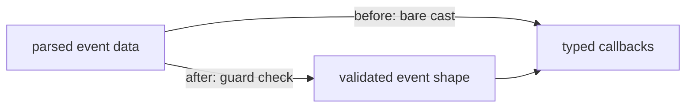

## Executive summary

Server-sent events, the stream of JSON events the server sends to the browser, are the one external JSON boundary in the client that parses data and then casts it straight to a typed domain shape. `parseBlock` checks only that `data` is an object, and `dispatchEvent` passes it through `eventPayload<T>`, a bare `as T` cast, to typed callbacks. Consumers immediately dereference nested fields such as `data.progress.fraction`, `data.result`, and `data.error`.

The backend marshals arbitrary `any` payloads and the OpenAPI spec types the stream as a plain string, so no generated schema protects this path. A field rename or malformed event therefore reaches domain code as a valid-looking object and fails as a confusing downstream error or a wrong progress value. The recommendation is to validate each payload once at the parse boundary.

## Recommended action

Validate each event payload once where it is parsed, using the existing guards in `domain/guards.ts` to narrow `unknown` to the corresponding event shape, meaning to check its runtime shape before treating it as that type. Cover the `progress`, `partial`, `result`, and `error` events. Invoke the typed callbacks only after that check, and report a shape mismatch through `SSEParseError` so the existing parse-error path handles it. No new guard mechanism is needed; the guards already exist.

## Before and after

Before: parsed event data goes through a bare cast straight into typed callbacks, with no runtime check of the payload shape.

After: a guard validates the payload once at the parse boundary; only a validated shape reaches typed callbacks, and a mismatch is reported through the existing parse-error path.

## Expected improvement

A malformed or renamed event is reported at the boundary as a parse error instead of surfacing later as a confusing downstream error or a wrong progress value. This is a structural improvement to boundary safety, not a measured improvement; no benchmark or timing was run.

## Alternatives considered

- Leave as is: rejected because the cast gives a valid-looking object to domain code with no check, which is exactly how a field rename becomes a confusing downstream failure.
- Generate a schema for the stream: rejected because the backend sends arbitrary `any` payloads and the spec types the stream as a plain string, so there is no schema to generate from today.

## Downside of rejecting

A field rename or malformed event keeps reaching domain code unchecked, producing confusing downstream errors or wrong progress values, and the existing parse-error path is never used for these shape failures.

## Verification

Verify that a malformed event such as `{"event":"result","data":{"foo":1}}` fires `onParseError` and runs no typed callback, while valid progress, partial, result, and error events still drive the stream to a completed range. `sse.test.ts` and the stochastic query tests cover the valid paths. These are proposed acceptance checks; no result was recorded.

References: `frontend/src/api/sse.ts:53-69,107-116`; `frontend/src/state/stochasticProjectionQuery.ts:62-81`; `backend/internal/api/projections/stochastic.go:40-53`; `backend/internal/api/projections/routes.go:46`.
