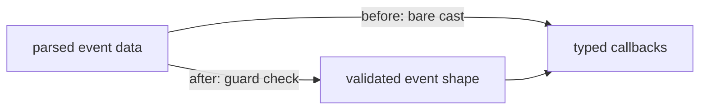

## Scenario

When you open the Outlook forecast, or change a scenario on the Evaluations, account detail, or purchase planner screens, the app asks the API for a stochastic projection, a range of outcomes produced by running the model many times with varied inputs. That calculation can take long enough that waiting for a single reply would leave the screen blank, so the API keeps the connection open and sends several small updates while it works. The updates travel as server-sent events, a long-lived text stream whose blocks describe one event each: first a progress update, then partial ranges, then a final result or an error. An event's payload, the data carried by that event, is a line of JSON, a text format for named values. The browser makes the request when the page needs the projection, receives the stream while the server is still computing, and feeds it to a small text reader, called a parser, that splits the stream into events.

The generated API client describes the stream only as plain text, so it cannot describe or check the JSON inside each event. That is why the reader exists and why its payloads need their own check. The project already has small runtime shape checks, called guards, that verify a value before treating it as a particular type. Today the reader relies instead on a cast, an instruction to the type checker to treat a value as a chosen type without verifying it, so a renamed field reaches typed callbacks and surfaces as a confusing downstream error rather than at the boundary, the point where external data enters the client.

## Executive summary

Server-sent events, the stream of JSON events the server sends to the browser, are the one external JSON boundary in the client that parses data and then casts it straight to a typed domain shape. `parseBlock` checks only that `data` is an object, and `dispatchEvent` passes it through `eventPayload<T>`, a bare `as T` cast, to typed callbacks. Consumers immediately read nested fields such as progress fraction, result, and error.

The backend marshals arbitrary payloads and the OpenAPI spec types the stream as a plain string, so no generated schema protects this path. A field rename or malformed event therefore reaches domain code as a valid-looking object and fails as a confusing downstream error or a wrong progress value. The recommendation is to validate each payload once at the parse boundary.

## Recommended action

Validate each event payload once where it is parsed, using the existing guards in `domain/guards.ts` to narrow `unknown` to the corresponding event shape, meaning to check its runtime shape before treating it as that type. Cover the `progress`, `partial`, `result`, and `error` events. Invoke the typed callbacks only after that check, and report a shape mismatch through `SSEParseError` so the existing parse-error path handles it. No new guard mechanism is needed; the guards already exist.

## Before and after

Before: parsed event data goes through a bare cast straight into typed callbacks, with no runtime check of the payload shape.

After: a guard validates the payload once at the parse boundary; only a validated shape reaches typed callbacks, and a mismatch is reported through the existing parse-error path.

## Expected improvement

A malformed or renamed event is reported at the boundary as a parse error instead of surfacing later as a confusing downstream error or a wrong progress value. This is a structural improvement to boundary safety, not a measured improvement; no benchmark or timing was run.

## Alternatives considered

- Leave as is: rejected because the cast gives a valid-looking object to domain code with no check, which is exactly how a field rename becomes a confusing downstream failure.
- Generate a schema for the stream: rejected because the backend sends arbitrary payloads and the spec types the stream as a plain string, so there is no schema to generate from today.

## Downside of rejecting

A field rename or malformed event keeps reaching domain code unchecked, producing confusing downstream errors or wrong progress values, and the existing parse-error path is never used for these shape failures.

## Verification

Verify that a malformed result event whose data object contains only an unrelated field fires `onParseError` and runs no typed callback, while valid progress, partial, result, and error events still drive the stream to a completed range. `sse.test.ts` and the stochastic query tests cover the valid paths. These are proposed acceptance checks; no result was recorded.

References: `frontend/src/api/sse.ts:53-69,107-116`; `frontend/src/state/stochasticProjectionQuery.ts:62-81`; `backend/internal/api/projections/stochastic.go:40-53`; `backend/internal/api/projections/routes.go:46`.
