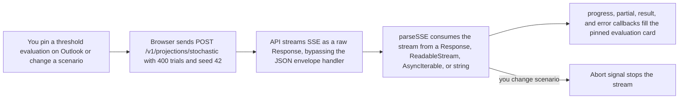
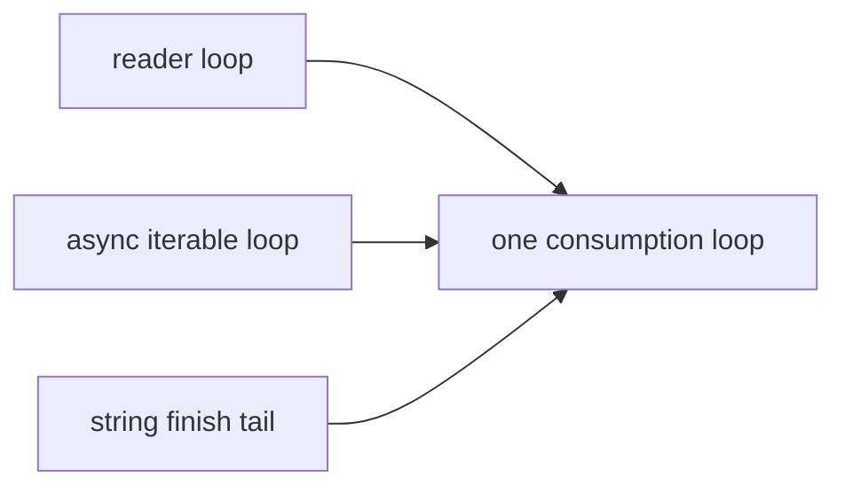

## Scenario

The Outlook forecast with a pinned threshold evaluation and the Evaluations page with evaluations to score each start a stochastic projection when the view needs a range. The range is the result of 400 simulated trials of the saved financial model: percentile net-worth points and a success share for each pinned evaluation. The pinned evaluation card on Outlook displays that success share. The browser sends a `POST /v1/projections/stochastic` request carrying projection settings, a run count fixed at 400, and a seed fixed at 42 that makes the random draws repeat. These are fixed values in `frontend/src/state/useRemoteProjection.ts`, not examples. The API replies with Server-Sent Events, a long-lived text stream of small updates rather than one finished reply, because running 400 trials is too slow to leave the pinned evaluation card blank while it runs. The generated client is TypeScript code produced by Orval from `frontend/openapi.snapshot.json`, the checked-in OpenAPI document that declares each endpoint's request and reply. That document declares the `/v1/projections/stochastic` response as `text/event-stream` with a string schema rather than as a JSON object, so the generator emits only a function that returns the raw HTTP response — the object representing the network reply — and no types for the events inside it. This stream therefore bypasses the JSON envelope handler used by ordinary endpoints. The projection query passes that response to `parseSSE` in `frontend/src/api/sse.ts`, a text reader that splits incoming text into complete blocks, parses each block into an event, and calls a progress, partial, result, or error callback.

That reader accepts several input forms: an HTTP `Response` with a byte reader in the browser, a `ReadableStream` or an `AsyncIterable` — an object that yields byte chunks over time — and a plain string in tests that replay recorded events. An abort signal, a handle that lets the caller cancel work, stops the stream when the user changes a scenario. With several input forms, the same consumption work was written more than once: a reader, an async iterable, and a whole string each walk through checking for cancellation, feeding text to the parser, mapping a parse failure to `SSEParseError` or `SSETransportError`, and finishing the parser. A change to cancellation or error handling therefore has to be applied to each copy.

## Executive summary

`parseSSE` accepts strings, `Response`, `ReadableStream`, and `AsyncIterable`. Its `consumeReader` and `consumeAsyncIterable` repeat the same loop: abort check, feed, parse-error check, `catch` mapping to `SSEParseError` or `SSETransportError`, and a `parser.finish()` tail. The string branch repeats that finish tail, so the step exists three times.

Inside `SSEParser`, `feed` and `finish` repeat the same `parseBlock` error conversion and dispatch. The exports `push`, `end`, and `createSSEParser` are unused aliases of `feed`, `finish`, and the constructor. A change to abort or error semantics currently has to be made in several places. The recommendation is one consumption loop for every transport.

## Recommended action

Wrap a reader or `Response` as an async iterable of chunks and keep one consumption loop for all transports, with a single finish helper. Factor the parsed-block application so `feed` and `finish` call it instead of duplicating the error conversion and dispatch. Delete the three unused aliases `push`, `end`, and `createSSEParser`. No new behaviour is introduced.

## Before and after

Before: reader, async iterable, and string transports each carry a copy of the loop or its finish tail, and `feed` and `finish` duplicate the parsed-block handling.

After: one consumption loop serves all transports with one finish helper, and `feed` and `finish` share one parsed-block application.

## Expected improvement

Abort and error semantics live in one place instead of several, so a future change is made once and applies to every transport. This is a structural improvement to maintainability, not a measured improvement; no benchmark or timing was run.

## Alternatives considered

- Leave as is: rejected because the repeated loop and finish tail mean an abort or error change must be applied in several places and can be missed in one.
- Consolidate only the transport loops and keep the aliases: rejected because the unused aliases and the duplicated parsed-block handling remain as separate places that can drift.

## Downside of rejecting

The three copies of the loop or finish tail stay, so abort or error changes keep needing parallel edits and can be applied inconsistently across transports, and the unused aliases continue to suggest public entry points that do nothing distinct.

## Verification

Verify with cases for `Response`, `ReadableStream`, and `AsyncIterable`, including abort mid-stream and malformed JSON, that callback order, error classes, and `releaseLock` cleanup stay identical after the consolidation. `sse.test.ts` already covers strings and incremental feed/finish. These are proposed acceptance checks; no result was recorded.

References: `frontend/src/api/sse.ts:145-197,199-210,212-263,271-276`.
