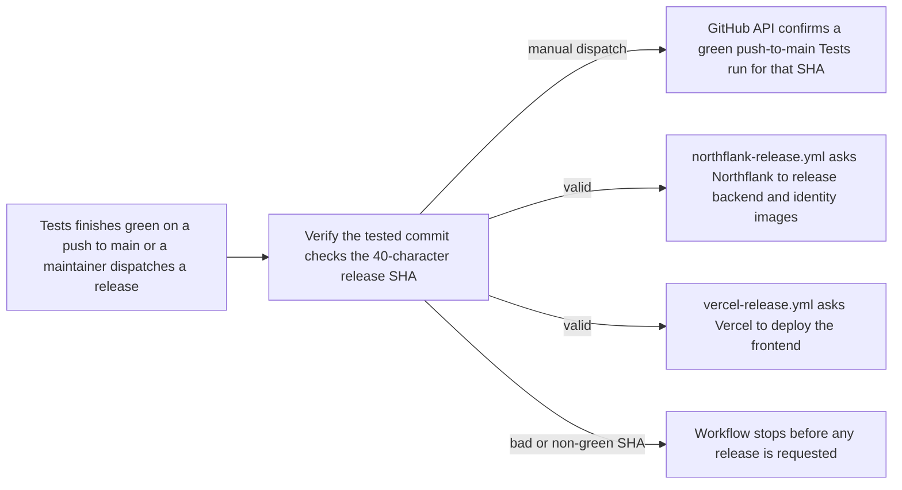
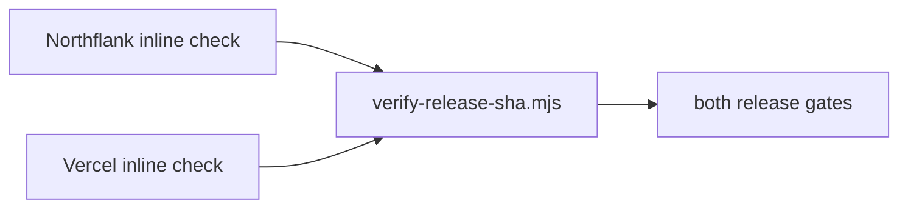

## Scenario

Production releases here start from automation rather than a screen. Two workflows in `.github/workflows/` handle them: `Request Northflank release` (`northflank-release.yml`), which asks Northflank — the provider hosting this project's API — to release the backend and identity images, and `Deploy frontend to Vercel` (`vercel-release.yml`), which asks Vercel — the provider hosting the frontend site — to deploy that site. Each workflow starts when the `Tests` workflow finishes green on a push to `main`, or when a maintainer starts it by hand; a hand-started run is called a `workflow_dispatch`. Before either workflow asks its provider to release, a step named `Verify the tested commit` checks that the release SHA — the 40-character identifier of the exact commit to ship, taken from the head of the green `Tests` run or from the checked-out commit on manual dispatch — is well formed and, on manual dispatch, asks the GitHub API whether a green push-to-main `Tests` run exists for that SHA. Only after that check does the workflow call Northflank or Vercel.

The data crossing this boundary is event context: the triggering run's conclusion, branch, and commit identifier, handed to a short inline `node` script as environment variables, which are named values the Actions runner passes to a process. The check exists because a release must ship the exact commit that passed tests; it is a security gate on production. The smaller `code-guard` job that runs just before it is repeated in the same three workflows, but its logic already lives in `scripts/ci-code-gate.mjs`, so the duplication that matters here is the release verification itself.

## Executive summary

Both production release workflows carry a verbatim inline node step named Verify the tested commit. It validates the 40-character release SHA and, on manual dispatch, queries the GitHub API for a green push-to-main `Tests` run before any release is requested. This is a security gate on production releases.

The two copies have already drifted: the Northflank copy declares `GITHUB_REPOSITORY` in its step environment while the Vercel copy omits it and relies on GitHub's implicit default. A later fix to the SHA check, API query, or dispatch-ref rule applied in one file silently leaves the other gate running old logic. The smaller `code-guard` job is likewise repeated in three workflows, though its logic is already centralized in `scripts/ci-code-gate.mjs`.

The recommendation is one checked-in script that both release workflows invoke.

## Recommended action

Move the shared verification into one checked-in script, for example `scripts/verify-release-sha.mjs`, that reads the event context from environment variables and performs the SHA-format, dispatch-ref, and green-main-`Tests` checks. Replace the two inline blocks with short steps that invoke it with the same environment, and keep `GITHUB_REPOSITORY` consistent in both callers. The checks themselves are reused as written; no new release gate is invented.

## Before and after

Before: two verbatim inline Verify the tested commit steps, one per release workflow, already differing on `GITHUB_REPOSITORY`.

After: both workflows call one script with the same environment, so a fix to the SHA, API, or dispatch-ref logic applies to both gates at once.

## Expected improvement

A single edit updates the release SHA gate in both workflows, removing the drift that has already begun between them. This is a structural improvement to consistency, not a measured improvement; no benchmark or timing was run.

## Alternatives considered

- Leave as is: rejected because the two security-gate copies have already drifted and a fix in one would silently leave the other running old logic.
- Also centralize the repeated `code-guard` job: not taken as part of this change because its logic is already in a script; the finding records the repetition but the recommended action is the release verification only.

## Downside of rejecting

The two production release gates keep evolving independently. A fix to the SHA check, API query, or dispatch-ref restriction applied in one workflow leaves the other enforcing stale rules, and the `GITHUB_REPOSITORY` inconsistency between them remains.

## Verification

Verify with actionlint on all four workflows, then exercise both workflows with `workflow_dispatch` off main and with a non-green SHA, confirming both fail before requesting a release, and confirm a green main SHA passes both. Keep the SHA regex, the green-main-run requirement, and the dispatch-ref restriction unchanged. These are proposed acceptance checks; no result was recorded.

References: `.github/workflows/northflank-release.yml:64-101`; `.github/workflows/vercel-release.yml:66-102`; repeated `code-guard` at `.github/workflows/images.yml:21-51`, `.github/workflows/northflank-release.yml:22-51`, `.github/workflows/vercel-release.yml:22-52`.
