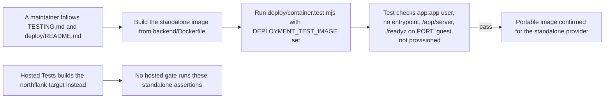
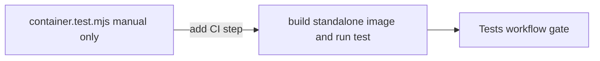

## Scenario

The backend is shipped to a hosting provider as a container image — a packaged filesystem plus startup settings such as the default command and the healthcheck that reports readiness. The standalone image is built from `backend/Dockerfile` and boots through `deploy/api-boot.sh`, which runs schema setup and starts the API server without creating the configured guest before authorized access. A maintainer building for a standalone provider follows the deployment guides `TESTING.md` and `deploy/README.md`, builds the image from that Dockerfile, and runs `deploy/container.test.mjs` — a `node:test` file — against the named image to check that it is portable: it runs as a non-root `app:app` user, has no entrypoint — a command an image always runs before its command, which would block command overrides — defaults to `/app/server`, exposes its readiness probe on the provider-assigned `PORT`, and boots with schema setup only. A readiness probe, also called a healthcheck, is the command that reports whether the service is ready; here it requests `/readyz` on `PORT`. The test reads the image metadata and a readiness response, launches the image with disposable state and no external network, then checks that an unauthenticated session request is denied and that the configured guest is not provisioned at boot. The image name crosses the boundary through an environment variable called `DEPLOYMENT_TEST_IMAGE`.

This is internal verification work rather than a user screen. The callers are the deployment guides and a maintainer following them, plus the hosted `Tests` workflow, which builds the `northflank` target of `backend/Dockerfile` and runs `deploy/northflank/container.test.mjs` instead. The `e2e` gate builds the standalone image but runs user journeys rather than image-metadata or no-guest-at-boot assertions, so a regression in `backend/Dockerfile` or `deploy/api-boot.sh` can pass every hosted gate.

## Executive summary

`deploy/container.test.mjs` asserts image-level properties of the standalone backend image that nothing else checks: a non-root `app:app` user, no entrypoint, `/app/server` as the default command, the healthcheck target, and schema-only boot that does not provision the configured guest. An entrypoint is the command an image runs by default.

The test is gated on `DEPLOYMENT_TEST_IMAGE` and invoked only manually from `TESTING.md` and `deploy/README.md`. The `Tests` workflow builds the northflank target and runs the northflank container test instead, and the e2e gate builds the standalone image but does not assert those image-metadata invariants or the no-guest-at-boot behavior. A Dockerfile or `api-boot.sh` regression that breaks them can therefore pass every hosted gate.

The recommendation is a CI step that builds the standalone image and runs the existing test.

## Recommended action

Add a CI step that builds the standalone backend image and runs `node --test deploy/container.test.mjs` with `DEPLOYMENT_TEST_IMAGE` set. The `ml` job already builds from the same Dockerfile, so the smallest change is a second build of the default target followed by this test, or an e2e step against the image that gate already builds. The `deploy/analysis-migration.test.mjs` steps can share the same wiring. No new assertions are written; the test already exists.

## Before and after

Before: the image metadata and no-guest-at-boot assertions run only when invoked manually with `DEPLOYMENT_TEST_IMAGE` set.

After: a hosted gate builds the standalone image and runs that same test on a code push, so the assertions run without manual invocation.

## Expected improvement

A Dockerfile or `api-boot.sh` regression that breaks the non-root user, command, healthcheck, or no-guest-at-boot behavior is caught by a hosted gate instead of passing every gate. This is a structural improvement to coverage, not a measured improvement; no benchmark or timing was run.

## Alternatives considered

- Leave as is: rejected because these invariants are then checked only manually and a regression can pass every hosted gate.
- Replace the existing northflank container test: rejected because the finding asks to keep it unchanged; the standalone image has distinct properties the northflank target does not cover.

## Downside of rejecting

The standalone image's user, command, healthcheck, and no-guest-at-boot behavior remain verified only on demand, so a Dockerfile or `api-boot.sh` change that breaks them can reach a release with every hosted gate green.

## Verification

Verify that the new step is green on a code push and that deliberately restoring an entrypoint or making boot provision the guest turns it red. Keep the existing northflank container test and the e2e gate unchanged. These are proposed acceptance checks; no result was recorded.

References: `deploy/container.test.mjs:10-68,63-64`; `.github/workflows/tests.yml:98-112`; `TESTING.md:180`; `deploy/README.md:124`.
