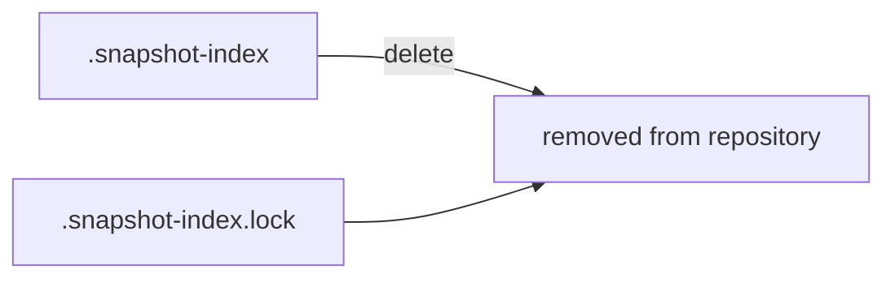

## Executive summary

`.snapshot-index` is a 39 KB binary Git index snapshot and `.snapshot-index.lock` is a zero-byte file, both tracked at the repository root. No tracked source references either name. Their last change added an obsolete layout, `package-lock.json`, `biome.json`, `components.json`, a root-level `src/App.tsx`, and `.github/workflows/ci.yml`, none of which exist in the current checkout.

They are dead weight that invites a reader to treat an old baseline as current state. The recommendation is simply to delete both files.

## Recommended action

Delete both files from the repository. No new code is written and no callers need updating, because no tracked source references either name.

## Before and after

Before: two tracked files at the repository root preserve a Git index snapshot and an empty lock file from an obsolete layout.

After: the pair is removed; there is no replacement and nothing points at them.

## Expected improvement

The repository no longer carries a stale baseline that a reader could mistake for current state. This is a structural improvement to clarity, not a measured improvement; no benchmark or timing was run.

## Alternatives considered

- Leave as is: rejected because the files have no tracked caller and describe a layout that no longer exists, so they can only mislead.
- Refresh the snapshot to the current layout: rejected because the finding records no consumer of the files, so there is nothing to refresh for.

## Downside of rejecting

The obsolete snapshot and its lock file remain at the repository root, continuing to invite a reader to treat a layout that no longer exists as the current baseline.

## Verification

Verify that no tracked file references the names and that the full test dispatcher `scripts/test --gate --no-browser --without-backend` is unaffected. Evidence gap: an external snapshot tool not represented in this repository could read these paths by convention; confirm with whoever owns that tooling if such a tool is known to exist. These are proposed acceptance checks; no result was recorded.

References: `.snapshot-index` and `.snapshot-index.lock` at the repository root; added by commit `32252b84`.
