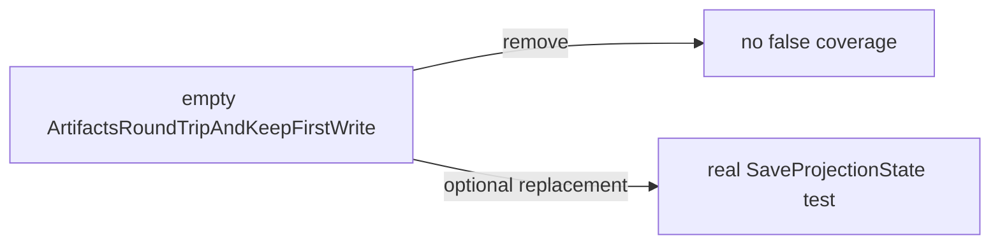

## Scenario

The persistence layer has a shared conformance suite, a set of Go tests in `backend/internal/store/storetest/contract.go` that every Store implementation must pass to earn the `Store` name. A Store is the interface in `backend/internal/store/store.go` for saving and loading model data through operations such as `SaveProjectionState` and `GetProjectionState`. A developer adding or swapping a backend starts this internal path through `go test`; the SQLite adapter's `TestStoreConformance` calls `storetest.Run` with its own store factory, and that call is what runs the suite. The suite exercises the Store interface through public methods only, with no SQL or file paths, so a replacement backend can prove it behaves the same way. Each check is a named Go subtest, a `t.Run` block whose name `go test` reports separately, and the list of names is what callers read to judge coverage.

One of those names, `ArtifactsRoundTripAndKeepFirstWrite`, refers to a retired artifact model; the current seam persists projection state, slices, rows, and evaluation outputs instead. The subtest body is empty, so the test runner reports the name as a passing check without checking anything, and that pass appears in the green result before a developer reviews the report. The data crossing the boundary here is the Store interface itself — calls such as saving and getting projection state — not a network payload.

## Executive summary

The Store conformance suite, the shared set of tests every Store implementation must pass, advertises a check named `ArtifactsRoundTripAndKeepFirstWrite`, but its body is empty. The suite is the contract gate callers use to judge any Store implementation, so an always-passing entry gives false coverage.

The name refers to the retired artifact model; the current persistence seam exposes projection state, slices, rows, and evaluation outputs instead. The recommendation is to remove the empty check, and replace it with a real test only if first-write persistence still matters today.

## Recommended action

Remove the empty `t.Run` block, where `t.Run` is a named subtest in Go. If first-write persistence still matters for the current projection state, replace it with a real conformance test against `SaveProjectionState` or `GetProjectionState` that asserts the current upsert behavior rather than the retired artifact rule. No new seam is introduced; the current persistence path already provides the operations such a test would use.

## Before and after

Before: the conformance suite lists `ArtifactsRoundTripAndKeepFirstWrite` as a named check whose body is empty, so it always passes.

After: the empty entry is gone; if the behavior still matters, a real test against the projection-state seam replaces it and can actually fail.

## Expected improvement

The conformance suite no longer reports coverage it does not provide, so callers judging a Store implementation are not misled by an entry that can never fail. This is a structural improvement to test integrity, not a measured improvement; no benchmark or timing was run.

## Alternatives considered

- Leave as is: rejected because an always-passing entry in a contract gate gives false coverage.
- Rename the empty check to match the current model: rejected because renaming an empty body does not make it test anything; it must be removed or given a real implementation.

## Downside of rejecting

The conformance suite keeps advertising a named check that never tests anything, so a Store implementation could pass that entry regardless of its behavior and callers would read false coverage into the gate.

## Verification

Verify that `go test ./backend/internal/store/adapters/sqlite/...` stays green and the conformance test list no longer contains an always-passing entry. If a replacement is added, it must fail against a deliberately broken `SaveProjectionState` implementation. These are proposed acceptance checks; no result was recorded.

References: `backend/internal/store/storetest/contract.go:79-80`; consumers of the validated allow-list at `backend/cmd/server/main.go:41-42,113`; current seam at `backend/internal/store/store.go:174-188` and `backend/internal/store/adapters/sqlite/projection_unified.go:36-61`.
