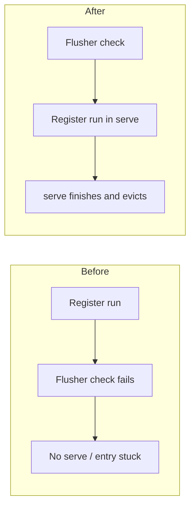

## Scenario

On the Outlook forecast, a pinned net-worth-threshold card needs a projected range of outcomes, and on the Evaluations page the app needs a scored range for the listed evaluations. The browser asks the API when those views load, before the card or chart can display anything. The request is `POST /v1/projections/stochastic` with operation `project-stochastic`, built by the frontend hook `useRemoteProjection` in `frontend/src/state/useRemoteProjection.ts`. The request body is JSON carrying the financial model, any overrides, the projection settings, and a `config` object with a run count and a seed. That hook fixes the seed at 42 and the run count at 400. A seed is a fixed input to the simulation's random draws: when the model, overrides, settings, run count, and seed are all the same, the simulation produces the same range, so a second request can reuse the first calculation instead of drawing new random numbers.

The calculation runs many simulated trials, so the API does not answer with one JSON body. It keeps the connection open and sends a stream of Server-Sent Events: a long-lived text response whose events carry a progress update, cumulative partial ranges, and finally a `result` or `error` event. The stream exists because one waiting reply would leave the chart blank for the whole calculation; the browser reads and draws partial ranges as they arrive.

The client code that calls this endpoint is generated by Orval from `frontend/openapi.snapshot.json`, a checked-in export of the API's own `/openapi.json` document. The backend's `OPENAPI_SNAPSHOT` export test in `backend/internal/api/openapi_test.go` writes that file, and `frontend/orval.config.ts` reads it to generate `frontend/src/api/generated/endpoints.ts`. For `project-stochastic` the export declares only a `text/event-stream` response with a `string` schema; it declares no progress, partial, result, or error event shapes. The generated client can therefore only return the raw response, and the hand-written `parseSSE` reader in `frontend/src/api/sse.ts` splits the text into events for the query in `frontend/src/state/stochasticProjectionQuery.ts`. The `Projection-Source` response header is metadata sent alongside the stream that tells the browser whether the range was `computed` by this request or `shared` from a calculation another request started.

To avoid repeating the simulation, the API keeps `sharedStochasticRegistry`, an in-memory map in `backend/internal/api/projections/runs.go` keyed by a JSON result key built from the resource ID together with the model, overrides, settings, run count, and seed. Two requests are identical for this purpose only when those five request fields are exactly equal; no hashing is involved. The first request for a key is the owner and starts the simulation; every later request with the same five fields joins the owner's run and is labelled `shared` in `Projection-Source`. The bug is the order of operations: the handler calls `getOrStartSharedRun` before it returns the stream response, so the registry entry exists before the stream body runs. That body first checks whether the HTTP writer implements `http.Flusher`, meaning it can push bytes straight to the browser. On a writer that cannot flush, the handler writes `streaming unsupported` and returns before calling the `serve` callback, which is the only place that starts the owner's computation and calls `run.finish` to close the run and evict the key.

## Executive summary

The `project-stochastic` handler `stochasticSSE` registers a `sharedStochasticRun` in the package-global `sharedStochasticRegistry` before it returns the streaming response. A `sharedStochasticRun` is the in-flight computation that two requests with the same model, overrides, settings, run count, and seed share, and the registry is the map from that result key to the run. The owner is the first request for a key, the one that actually starts the computation.

The problem is ordering. The run is registered immediately, but the stream's preamble runs later, when Huma invokes the `Body` of `stochasticStream`, and its first step is a check for `http.Flusher`. On a writer that cannot flush, the handler writes `streaming unsupported` and returns without ever calling the `serve` callback. That callback is the only place that starts the owner's computation and calls `run.finish`, which closes `done` and evicts the key.

So a run registered for a non-writable stream stays in the registry forever, and a later request with the same model, overrides, settings, run count, and seed joins a run that can never finish or produce a result. The fix is to move `getOrStartSharedRun` and the owner decision into `serve`, after the flusher check, and set the `Projection-Source` header there.

## Recommended action

Move `getOrStartSharedRun` and the owner decision into the `serve` closure after the flusher check, and set `Projection-Source` from inside that closure. A non-writable stream then never registers a run. The smaller alternative is a cleanup callback that removes `resultKey` whenever `stochasticStream` returns before invoking `serve`, but that still registers the run before knowing the stream is writable.

## Before and after

| | Before | After |
|---|---|---|
| Registration | Before the stream response is returned | Inside `serve`, after the flusher check |
| Owner decision | Made at registration time | Made inside `serve` |
| `Projection-Source` | Set outside the stream body | Set from inside the closure |
| Non-writable stream | Leaves a permanent registry entry | Never registers a run |

## Expected improvement

The registry no longer accumulates entries for streams that cannot be written, and no later request with the same model, overrides, settings, run count, and seed can attach to a run that will never produce a result. This is a structural correctness improvement. No benchmarks were run, so no speed or size benefit is claimed.

## Alternatives considered

- **Leave as is** — keeps the failure: any non-flushing writer leaves a stale entry and a later request with the same model, overrides, settings, run count, and seed waits on a run that never finishes.
- **Cleanup callback on early return** — smaller change, but it still registers the run before the stream is known to be writable and relies on every early-return path calling the callback.

## Downside of rejecting

A client whose writer is not an `http.Flusher` leaves a `sharedStochasticRun` in `sharedStochasticRegistry` that nothing will finish or evict. A subsequent request carrying the same model, overrides, settings, run count, and seed joins it, reads `Projection-Source: shared`, and never gets its own range. The existing shared/owner tests cover only the happy path, so nothing catches this today.

## Verification

Use a writer that is not an `http.Flusher`. After the first request, a second request carrying the same model, overrides, settings, run count, and seed must not report `Projection-Source: shared`, must complete with its own result, and the registry must have no entry for that key. This is a proposed acceptance check; the finding does not record a real result yet.

References: `backend/internal/api/projections/stochastic.go:82-91,107,174-180`; `backend/internal/api/projections/runs.go:38-50,97-104`; `backend/internal/api/projections/stochastic_test.go:87-99`.
