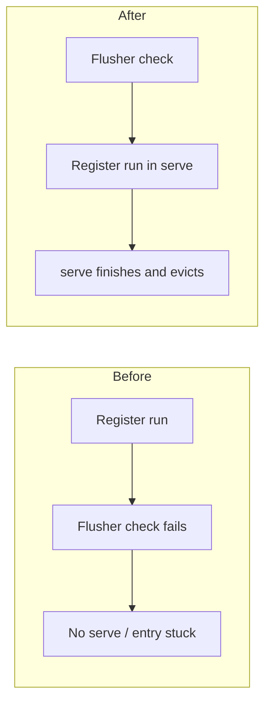

## Scenario

When a pinned threshold card is shown on the Outlook forecast, or when the Evaluations page has evaluations to score, the screen asks the API for a projected range of outcomes. The browser posts a JSON request carrying the financial model and a fixed seed. That calculation runs many simulations, so instead of waiting for one reply the API keeps the connection open and sends a series of small text updates: a progress update, partial ranges, then a final result or an error. This is a stream of Server-Sent Events, meaning a long-lived text response whose updates the browser splits into messages with a small text reader. The generated client is code produced from the checked-in API description, and that description declares this reply only as text with a string schema. It declares no event or payload shapes, so the generator emits no types for the updates and the hand-written reader does that work. The browser makes the request when the view needs the range, before the chart or card can display it. Because identical seeded requests produce identical work, the API keeps a registry, a map keyed by the request's result key, so a second request can join the first instead of recomputing it. The request that starts the computation is the owner, and a request that joins is labelled `shared` in the `Projection-Source` response header. The registry entry is currently created before the stream body runs. That body first checks whether the writer can push bytes straight to the browser, and on a writer that cannot it stops before running the part that starts the owner's computation and removes the entry.

## Executive summary

`stochasticSSE` serves a probabilistic projection result by registering a shared run in a package-global registry before it returns the streaming response. A run is the in-flight computation that two requests with the same seed can share, and the registry is the map keyed by that seed's result key. The owner is the request that actually starts the computation.

The problem is ordering. The run is registered immediately, but the stream's preamble runs later, when Huma invokes `Body`, and its first step is a check for `http.Flusher`. On a writer that cannot flush, the handler writes `streaming unsupported` and returns without ever calling the `serve` callback. That callback is the only place that starts the owner's computation and calls `run.finish`, which closes `done` and evicts the key.

So a run registered for a non-writable stream stays in the registry forever, and a later identical seeded request joins a run that can never finish or produce a result. The fix is to move registration and the owner decision into `serve`, after the flusher check, and set the `Projection-Source` header there.

## Recommended action

Move `getOrStartSharedRun` and the owner decision into the `serve` closure after the flusher check, and set `Projection-Source` from inside that closure. A non-writable stream then never registers a run. The smaller alternative is a cleanup callback that removes `resultKey` whenever `stochasticStream` returns before invoking `serve`, but that still registers the run before knowing the stream is writable.

## Before and after

| | Before | After |
|---|---|---|
| Registration | Before the stream response is returned | Inside `serve`, after the flusher check |
| Owner decision | Made at registration time | Made inside `serve` |
| `Projection-Source` | Set outside the stream body | Set from inside the closure |
| Non-writable stream | Leaves a permanent registry entry | Never registers a run |

## Expected improvement

The registry no longer accumulates entries for streams that cannot be written, and no later seeded request can attach to a run that will never produce a result. This is a structural correctness improvement. No benchmarks were run, so no speed or size benefit is claimed.

## Alternatives considered

- **Leave as is** — keeps the failure: any non-flushing writer leaves a stale entry and a later identical request waits on a run that never finishes.
- **Cleanup callback on early return** — smaller change, but it still registers the run before the stream is known to be writable and relies on every early-return path calling the callback.

## Downside of rejecting

A client whose writer is not an `http.Flusher` leaves a run in the registry that nothing will finish or evict. A subsequent request with the same seed joins it, reads `Projection-Source: shared`, and never gets its own result. The existing shared/owner tests cover only the happy path, so nothing catches this today.

## Verification

Use a writer that is not an `http.Flusher`. After the first request, a second identical seeded request must not report `Projection-Source: shared`, must complete with its own result, and the registry must have no entry for that key. This is a proposed acceptance check; the finding does not record a real result yet.

References: `backend/internal/api/projections/stochastic.go:82-91,107,174-180`; `backend/internal/api/projections/runs.go:38-50,97-104`; `backend/internal/api/projections/stochastic_test.go:87-99`.
