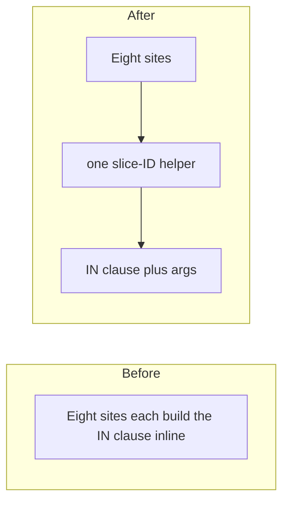

## Scenario

The SQLite adapter in `backend/internal/store/adapters/sqlite` is the layer that turns store calls into SQL for the app's local database. When the API builds or reads a projection, it stores the engine's output per slice. A slice is one partition of the projection window, identified by a slice ID; a revision is the version number of a saved row, incremented on each write, and built rows carry the revision they were built at so the reader can assemble a result from only the current slices. The artifacts stored per slice are generated transactions, timeline rows, and Monte Carlo statistics.

No browser screen calls these storage methods directly. The projection build and read code calls the artifact methods, and the sync ingest step calls account provisioning; both run before a projection result or a newly provisioned account appears on screen. During provisioning, the ingest step asks the adapter to resolve linked bridge accounts by looking up bridge account IDs in the `account_links` table and then checking the resolved model account IDs in the `accounts` table.

SQL cannot take a varying-length list of IDs directly, so the adapter builds an `IN` clause, meaning a condition that matches a column against a supplied list, with one `?` placeholder per ID. Each `?` is filled by an argument value when the query runs, and the arguments must stay in the same order as the placeholders. The helper exists so the loop that turns a list of slice IDs into a comma-separated placeholder list and a matching ordered argument list is written once instead of being copied into every storage call.

## Executive summary

Every projection artifact is stored per slice, where a slice is one partition of the user's projection window identified by a slice ID. Six projection methods and two queries in account provisioning each allocate a `placeholders` slice and an `args` slice, fill them from the slice IDs, and join them into a SQL `IN` clause. The `?` in such a clause is a placeholder that a supplied argument fills at execution time.

This is an adapter-wide idiom rather than a one-off. Adding another slice-scoped artifact table means copying the loop again, and any change to placeholder or argument handling has to be applied at every one of the eight sites. The fix is a single private helper in the SQLite adapter that turns a list of slice IDs into the comma-separated `?` list and the matching argument list.

## Recommended action

Add one private helper in the SQLite adapter that converts `[]string` slice IDs into a comma-separated `?` list plus a `[]any` of the same values, and call it from all six projection methods and both provisioning queries. No SQL text and no query ordering changes.

## Before and after

| | Before | After |
|---|---|---|
| Slice filtering | Each of eight sites builds `placeholders` and `args` inline | Each site calls one helper |
| Change surface | Placeholder or argument edits repeated eight times | One helper to edit |
| New artifact table | Copy the loop again | Call the helper |

## Expected improvement

Slice filtering has one implementation, so placeholder and argument handling is defined once and a new slice-scoped table reuses it instead of copying it. This is a structural DRY improvement. No benchmarks were run, so no speed or size benefit is claimed.

## Alternatives considered

- **Leave as is** — every new slice-scoped table duplicates the loop, and a placeholder or argument fix must land in eight places, so the sites can drift apart.
- **Extract only inside the projection methods** — leaves the two provisioning queries as copies, so the idiom still lives in more than one place.

## Downside of rejecting

The same placeholder-and-argument loop exists in eight places. A future change to how slice IDs become placeholders or arguments has to be repeated everywhere, and a missed site produces SQL that filters on the wrong slices. Adding a new artifact table means writing the loop again.

## Verification

The existing projection conformance and integration tests must pass unchanged, which proves argument order and slice filtering are preserved. This is a pure extraction, so add no new behavioral assertions.

References: `backend/internal/store/adapters/sqlite/projection_unified.go:312-326,362-368,412-418,442-448,471-477,488-494`; `backend/internal/store/adapters/sqlite/sync.go:253-259,283-289`.
