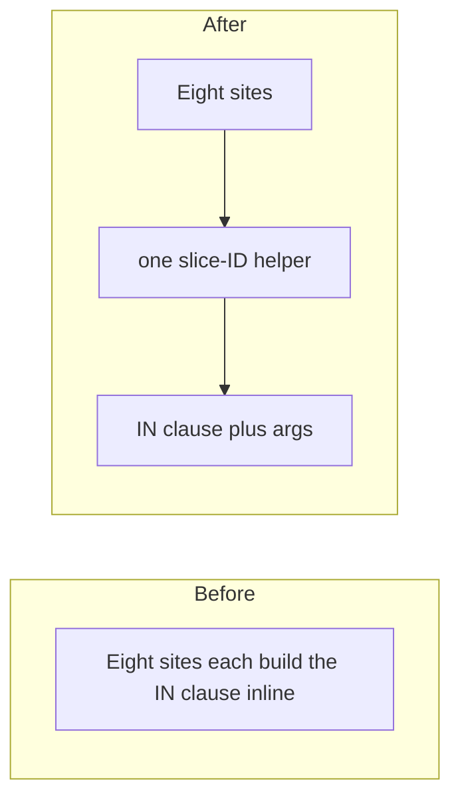

## Executive summary

Every projection artifact is stored per slice, where a slice is one partition of the user's data identified by a slice ID. Six projection methods and two queries in account provisioning each allocate a `placeholders` slice and an `args` slice, fill them from the slice IDs, and join them into a SQL `IN` clause. The `?` in such a clause is a placeholder that a supplied argument fills at execution time.

This is an adapter-wide idiom rather than a one-off. Adding another slice-scoped artifact table means copying the loop again, and any change to placeholder or argument handling has to be applied at every one of the eight sites. The fix is a single private helper that turns a list of slice IDs into the comma-separated `?` list and the matching argument list.

## Recommended action

Add one private helper in the SQLite adapter that converts `[]string` slice IDs into a comma-separated `?` list plus a `[]any` of the same values, and call it from all six projection methods and both provisioning queries. No SQL text and no query ordering changes.

## Before and after

| | Before | After |
|---|---|---|
| Slice filtering | Each of eight sites builds `placeholders` and `args` inline | Each site calls one helper |
| Change surface | Placeholder or argument edits repeated eight times | One helper to edit |
| New artifact table | Copy the loop again | Call the helper |

## Expected improvement

Slice filtering has one implementation, so placeholder and argument handling is defined once and a new slice-scoped table reuses it instead of copying it. This is a structural DRY improvement. No benchmarks were run, so no speed or size benefit is claimed.

## Alternatives considered

- **Leave as is** — every new slice-scoped table duplicates the loop, and a placeholder or argument fix must land in eight places, so the sites can drift apart.
- **Extract only inside the projection methods** — leaves the two provisioning queries as copies, so the idiom still lives in more than one place.

## Downside of rejecting

The same loop exists in eight places. A future change to how slice IDs become placeholders or arguments has to be repeated everywhere, and a missed site produces SQL that filters on the wrong slices. Adding a new artifact table means writing the loop again.

## Verification

The existing projection conformance and integration tests must pass unchanged, which proves argument order and slice filtering are preserved. This is a pure extraction, so add no new behavioral assertions.

References: `backend/internal/store/adapters/sqlite/projection_unified.go:312-326,362-368,412-418,442-448,471-477,488-494`; `backend/internal/store/adapters/sqlite/sync.go:253-259,283-289`.
