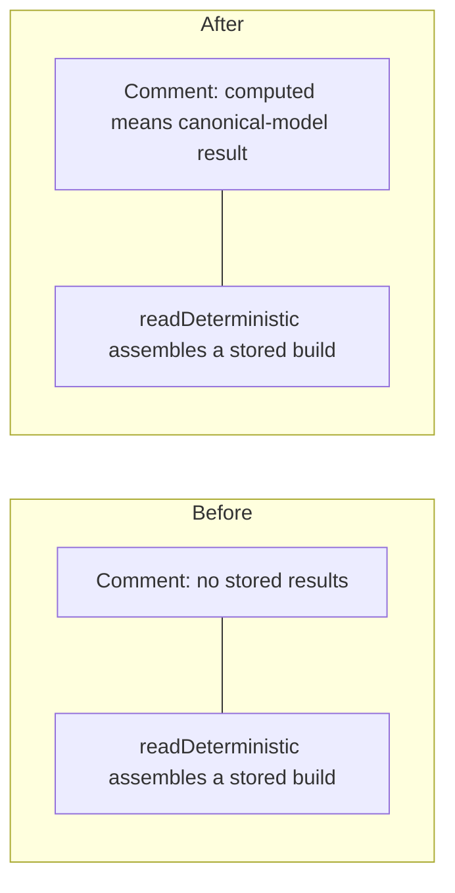

## Scenario

The Outlook forecast and the Evaluations page read a single-shot projection to draw the net-worth chart and current amounts, and the browser asks for it when those views load, before anything can be displayed. The API replies with a JSON body and one response header named `Projection-Source`, meaning a small piece of metadata sent alongside the body, whose value is deliberately one word: `computed` or `shared`. The header tells the client whether the number came from its own calculation or from a calculation another request already started. The manual checks in `TESTING.md` state that a deterministic request, meaning a canonical request with no request-supplied model and no overrides, always reports `computed`. Canonical requests try to assemble the answer from stored slices, timeline rows, and evaluation outputs that an earlier build produced; only when that stored build is missing or stale does the API compute directly. `shared` is reserved for a browser that attaches to an in-flight stochastic run started elsewhere. A short comment beside the `computed` constant is the only in-code explanation of this rule, and the wording this finding targets says stored results do not exist. That would lead a maintainer to treat the read-and-build path as dead code and remove it. The fix changes the comment only; the header values stay as they are.

## Executive summary

The `Projection-Source` header tells the client where a projection result came from and is deliberately single-valued: `computed` or `shared`. The constant for `computed` is documented as "Every projection computes directly: no stored results exist." That comment is wrong. The file's own canonical read path first tries `readDeterministic`, which assembles a result from stored slices, rows, and evaluation outputs and labels that cache hit `computed`.

`TESTING.md` states deterministic requests always report `computed`, so this is not a request to change the wire contract. It is a stale comment that would lead a maintainer to treat the whole read-and-build path as dead code. The fix is to correct the comment to describe what the code actually does.

## Recommended action

Rewrite the comment so it says `computed` marks a result derived from the canonical model, whether computed on this request or assembled from a stored build, and that only `shared` marks attachment to an in-flight stochastic run. Leave the constant values and the `TESTING.md` statement unchanged.

## Before and after

| | Before | After |
|---|---|---|
| Comment | Claims no stored results exist | Says `computed` covers fresh computation and a stored build |
| Code | `readDeterministic` assembles a stored build | Unchanged |
| Header values | `computed` / `shared` | Unchanged |

## Expected improvement

The comment no longer contradicts the live read path, so a maintainer is less likely to delete code that deterministic results depend on. This is a documentation-only, structural improvement with no behavior change. No benchmarks were run, so no speed or size benefit is claimed.

## Alternatives considered

- **Leave as is** — the comment keeps implying the read-and-build path is dead, inviting someone to remove it.
- **Change the header contract** — rejected, because the header is deliberately single-valued and `TESTING.md` relies on deterministic requests reporting `computed`.

## Downside of rejecting

The stale comment stays in place. A maintainer reading it can conclude the stored-build orchestration is unnecessary and remove it, which would break the deterministic results that currently come from assembled stored slices, rows, and evaluation outputs.

## Verification

Run `go test ./backend/internal/api/projections/...` and grep to confirm no source still claims stored results do not exist. No header value should change.

References: `backend/internal/api/projections/deterministic.go:15-19,66-88`; `backend/internal/api/projections/stochastic.go:174-177`; `TESTING.md:305,323`.
