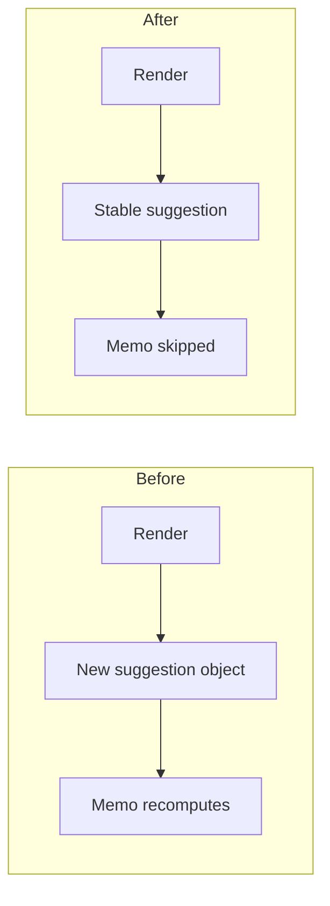

## Executive summary

`TransactionDetail` memoizes `insightSuggestions` so that `buildInsightSuggestions` does not walk analysis findings on every editor keystroke. A memo is a cached value that only recomputes when one of its listed dependencies changes. The memo lists `statementSuggestion` as a dependency.

That dependency is unstable. `useStatementPaymentReview` rebuilds `suggestion` in the render body — the code that runs on every render — when the matcher builds a new object and then spreads it again to attach `accountName`. When a statement-payment match exists for the open transaction, `statementSuggestion` gets a new identity on every render, so the memo recomputes in exactly the case it was written to protect. The other dependencies are stable.

This is structural render cost, not a profiled re-render, and the work is bounded because the findings query is scoped to one transaction. The fix is to memoize the suggestion derivation inside `useStatementPaymentReview` on its inputs.

## Recommended action

Memoize the `suggestion` derivation inside `useStatementPaymentReview` on `query.data`, `selection`, `readOnly`, `transactionId`, and `accounts`, so the returned reference stays stable when nothing changed. Keep the `statementSuggestion` dependency in `TransactionDetail`, because a genuine statement change must still invalidate insights.

## Before and after

| | Before | After |
|---|---|---|
| `suggestion` identity | New object every render while a match is active | Stable while its inputs are unchanged |
| `insightSuggestions` memo | Recomputes each render in the protected case | Skips recomputation when inputs are unchanged |
| Real statement change | Invalidates insights | Still invalidates insights |

## Expected improvement

The insights memo actually protects the findings walk when a statement-payment match is active, instead of recomputing on every keystroke. This is a structural render-cost improvement. No profiling was run and the findings scope is one transaction, so no measured re-render or speed benefit is claimed.

## Alternatives considered

- **Leave as is** — the memoized walk still runs on every render with an active match, which defeats the memo's purpose.
- **Remove the `statementSuggestion` dependency** — rejected, because a genuine statement change must still produce updated insights, and dropping the dependency would leave them stale.

## Downside of rejecting

With an active statement-payment match, each editor keystroke rebuilds the suggestion object and re-runs `buildInsightSuggestions` over the transaction's findings. The cost is bounded, but the memo provides no protection in the very case it was added for.

## Verification

Add a rerender test holding the inputs fixed: while a match is active, the `suggestion` reference and the `insightSuggestions` array identity must stay unchanged. Choosing another statement, toggling read-only, changing the resolved account name, or a refetch that changes matches must still produce a new suggestion and updated insights.

References: `frontend/src/components/activity/TransactionDetail.tsx:801-807,808-826,824`; `frontend/src/components/activity/useStatementPaymentReview.ts:29-74,77-82`.
