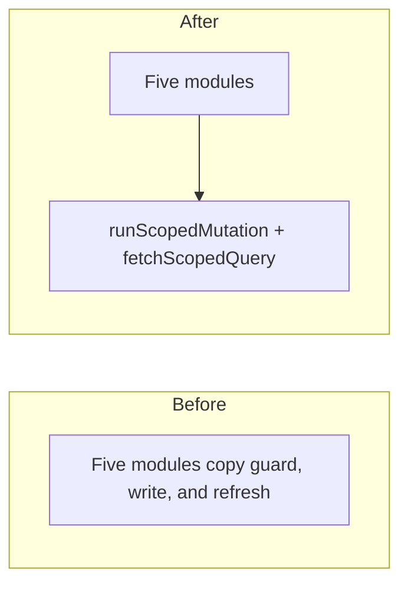

## Scenario

Several settings and review screens read and write data through the shared TanStack Query client. The screens are the Gmail panel, sync settings, integrations, evaluation pins, Safe Spending settings, and purchases. Each screen's state module issues its reads when the screen loads and its writes when you change a setting or pin an evaluation. The named requests include the Gmail credential read `getGmailCredential`, the sync credential read `getSyncCredential`, the account-link read `listAccountLinks`, and the pinned-evaluation read `getPinnedEvaluations`; each returns JSON from its endpoint before the screen shows the updated value. A scope is the workspace resource the data belongs to, and a mutation is a write request that changes server state. The cache is the browser's stored copy of those results, kept under a query key that includes the scope.

A read or write can finish after you have switched to another workspace resource, so each module captures the scope when the request starts and, when the result arrives, checks that the captured scope is still `getUserScope()`. This identity guard, provided today by `assertCurrentScope` in `frontend/src/state/scopedState.ts` and called from the state modules, keeps the old resource's data from being published into the newly selected resource. The helper the finding calls for exists because the same guard and publish lifecycle, together with the mutation wrapper and the refresh wrapper around it, were written out separately in several state modules, so a fix to the guard has to land in each one.

## Executive summary

Five state modules independently rebuild the same three operations against the shared query client, where a scope is the workspace resource the data belongs to and a mutation is a write operation. The `current(scope, signal)` identity guard — a check that the scope is still the one that started a request when the async result arrives — is written verbatim in Gmail and sync settings and nearly verbatim in workspace resources.

`runMutation` captures the scope, returns null when pending, builds a mutation with a `mutationKey` and a `scope: { id: JSON.stringify(key) }` marker, executes, guards the result, and notifies with a fixed error message. Gmail and sync settings carry byte-for-byte copies, while pinned evaluations, safe-spending settings, and the `write` helper in workspace writes rebuild the same skeleton inline to add optimistic values or rollback. `refreshX(force)` returns when pending, optionally invalidates with `refetchType: "none"`, then fetches, and appears twice each in Gmail and sync settings plus integrations, pinned evaluations, and purchases.

The fix is one helper module exposing the guard, the write lifecycle, and the refresh lifecycle.

## Recommended action

Add one helper module exposing `runScopedMutation({ key, mutationFn, onError })` and `fetchScopedQuery(options, force)` with the identity guard inside it. Make the two `runMutation` functions delegate first, then convert the inline builders and the six `refreshX` functions. The endpoint call and the refresh or error policy stay at each call site.

## Before and after

| | Before | After |
|---|---|---|
| Identity guard and lifecycle | Copied across five modules | Implemented once in a helper module |
| `runMutation` | Two byte-for-byte copies plus inline rebuilds | Delegate to `runScopedMutation` |
| `refreshX` | Six near-identical functions | Delegate to `fetchScopedQuery` |
| Endpoint and policy | At the call sites | Still at the call sites |

## Expected improvement

The guard and the write/refresh lifecycle have one implementation, so a fix applies everywhere and a new scope-aware write gets correct behavior without copying a skeleton. This is a structural DRY and safety improvement. No benchmarks were run, so no speed or size benefit is claimed.

## Alternatives considered

- **Leave as is** — a guard or lifecycle fix must land in five modules, and a missed copy can publish a result from an old scope into the newly selected resource.
- **Helper that also owns the endpoint and policy** — rejected, because endpoint calls and refresh or error decisions differ by call site and should stay local.

## Downside of rejecting

The identity guard exists in several copies. When the guard needs a fix, one copy can be missed, and then a write or refresh that finishes after the user switches resources can publish the old resource's result into the new scope. Users would see data from the wrong resource.

## Verification

The existing Gmail, sync, pins, purchases, and safe-spending tests must pass unchanged. Add a case that switches resource mid-write and mid-refresh and asserts no result is published to the new scope, plus a case that a forced refresh replaces data inside the 30-second stale window while a normal refresh serves cache. Keep mutation visibility intact where `isMutating` or `useMutationState` reads these keys.

References: `frontend/src/state/gmail.ts:31-34,52-67,69-98,182-196`; `frontend/src/state/syncSettings.ts:42-45,97-122,124-153`; `frontend/src/state/integrations.ts:45-59`; `frontend/src/state/pinnedEvaluations.ts:46-59,66-93`; `frontend/src/state/useSafeSpendingSettings.ts:152-219,221-239`; `frontend/src/state/workspaceWrites.ts:162-205`; `frontend/src/state/purchaseWrites.ts:155-166`; `frontend/src/state/workspaceResources.ts:61-64`.
