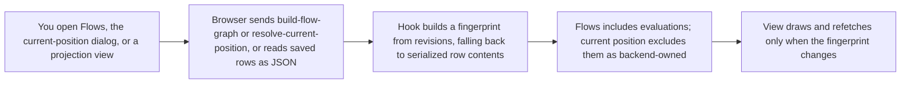
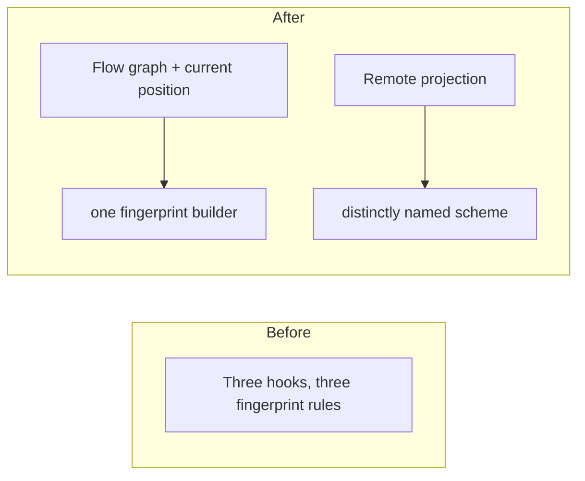

## Scenario

The Flows page draws a time-bounded money-flow graph, a dialog shows the current position, and the Outlook, Evaluations, account detail, and purchase planner views show a projection. When those screens load, the browser asks the API for the saved rows each screen needs and cannot draw anything until the replies arrive. The Flows page sends `POST /v1/flows` with operation `build-flow-graph` for the graph, the current-position dialog sends `POST /v1/position` with operation `resolve-current-position`, and the projection views read balances, checkpoints, schedules, transactions, purchases, and the evaluation summary as JSON through their hooks.

Each hook then builds a fingerprint, meaning a short key that changes when the underlying saved rows change, from those rows. A revision is the version number of a saved row, incremented on each write, and the key uses the revision when present and otherwise falls back to the row contents serialized into text. The fingerprint is used as a client cache key: it makes the screen refetch when the saved rows change and reuse the cached answer otherwise. The helper the finding calls for exists because three hooks need the same revision-and-fallback rule. The Flows graph includes evaluations in its fingerprint, while current position excludes them because current position is a backend-owned replay of recorded history and must not move when evaluation preferences change; that exclusion is currently expressed by copying the builder. The remote projection keeps a third, deduplicated variant of the rule for its own cache, so it needs a distinct name rather than being merged with the other two.

## Executive summary

Three hooks derive which saved model is in view by building a fingerprint — a short key that changes when the underlying saved row changes. `useFlowGraph` and `useCurrentPosition` each define a `take(revision, content, name)` closure inside a `useMemo` that concatenates `name:revision` parts with `|` and falls back to `JSON.stringify(content)` when there are no revisions. A revision is the version number of a saved row. `useRemoteProjection` computes model identity a third way, by filtering revisions, deduplicating and sorting them, and joining with `|`.

Today the difference is intentional: current position excludes evaluations, which are backend-owned, but that exclusion is expressed by copying the function rather than by an explicit input. The fix is one shared fingerprint builder in `projectionSource.ts` that takes the chosen row set.

## Recommended action

Move the fingerprint builder into `projectionSource.ts` as one function taking the row set, and have both hooks call it with their chosen rows. Express the evaluation exclusion in `useCurrentPosition` as an argument, not a modified copy. Leave `useRemoteProjection`'s deduplicated revision scheme alone because it serves a different cache, but give it a distinct name so the three are not mistaken for one scheme.

## Before and after

| | Before | After |
|---|---|---|
| Flow graph and current position | Each copies the `take` closure | Both call one shared builder with their row set |
| Evaluation exclusion | Hidden in a copied guard | An explicit argument |
| Remote projection | Third, deduplicated scheme under a similar name | Same scheme, distinctly named |

## Expected improvement

The revision-and-fallback rule lives in one place, and the intentional evaluation exclusion becomes an explicit argument instead of a hidden difference between copies. This is a structural clarity improvement. No benchmarks were run, so no speed, render, or bundle benefit is claimed.

## Alternatives considered

- **Leave as is** — the rule exists in three copies, so a change to how a saved model is identified must be made three times, and the exclusion stays hidden in a copied guard.
- **Unify all three hooks** — rejected, because `useRemoteProjection` needs a deduplicated revision scheme for a different cache; only its name should change.

## Downside of rejecting

The fingerprint rule stays duplicated across three hooks. A future change to revision handling can be applied unevenly, and the evaluation exclusion remains an implicit difference in a copied guard that is easy to remove accidentally, which would make current position react to backend-owned evaluations.

## Verification

With fixed saved rows, both hook keys must change on the same row revision, and toggling an evaluation must change the flow-graph key but not the current-position key. Confirm no extra refetch appears in either hook on an unrelated render.

References: `frontend/src/state/useFlowGraph.ts:57-70`; `frontend/src/state/useCurrentPosition.ts:62-80`; `frontend/src/state/useRemoteProjection.ts:611-620`.
