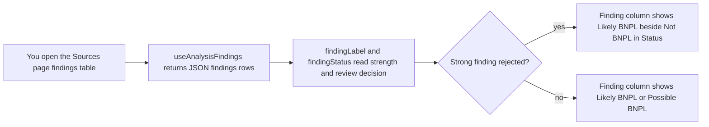
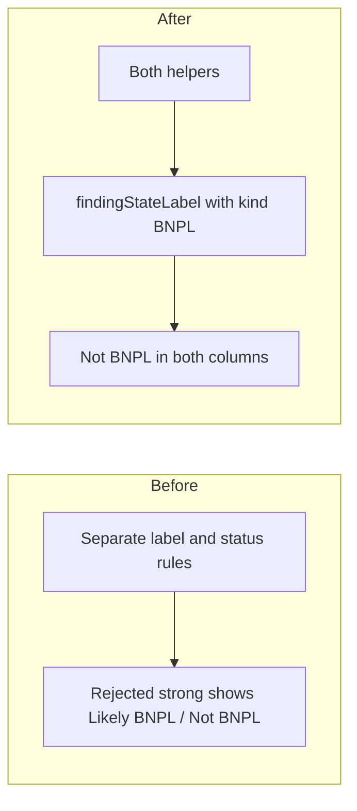

## Scenario

You open the Sources page and view the detected transaction findings table, which includes buy-now-pay-later (BNPL) rows. When the page opens, the browser sends the analysis-findings query (`useAnalysisFindings`) and the findings arrive as JSON; each record carries a strength, a status, a review decision, dismissal and staleness flags, and sometimes a judgment state. The table has a Finding column and a Status column, and the wording appears once the findings request completes. A finding is a detected result about a transaction, and the table's helpers `findingLabel` and `findingStatus` in `frontend/src/domain/analysisFindings.ts` translate that state into plain words such as "Likely BNPL" or "Not BNPL". A single shared wording owner, `findingStateLabel` in `frontend/src/domain/paymentFindings.ts`, already serves the review chips and dialogs, so the table helpers exist to give the table the same vocabulary as those surfaces. The BNPL table kept its own pair of helpers that look only at strength and review decision, so a rejected strong finding reads "Likely BNPL" in the Finding column beside "Not BNPL" in the Status column, and a judgment state never appears in the Finding column.

## Executive summary

A finding is a detected result such as a BNPL, or buy-now-pay-later, row. Prior finding 045 consolidated finding wording into `findingStateLabel` and is implemented, but the BNPL table kept a separate pair of helpers. `findingLabel` checks only `confirmed` and `strength`, so it has no branch for rejected, dismissed, stale, or judgment states, while `findingStatus` beside it does branch on those fields. The BNPL pair also ignores `judgment`, which the shared owner handles.

The result is a contradictory row: a rejected strong BNPL finding shows "Likely BNPL" in the Finding column and "Not BNPL" in the Status column. The fix is to make both helpers delegate to the shared owner.

## Recommended action

Make `findingLabel` and `findingStatus` delegate to `findingStateLabel`, passing a finding with `kind` set to the display string `"BNPL"`. Keep the badge as "BNPL" for confirmed findings and the column as "Active" for plain unanswered active rows with two local overrides, because those strings already read correctly. Keep "Likely BNPL" and "Possible BNPL" for unanswered strong and moderate findings, as the analyses documentation relies on them.

## Before and after

| | Before | After |
|---|---|---|
| Two columns | Separate rules in `findingLabel` and `findingStatus` | Both delegate to `findingStateLabel` with kind `BNPL` |
| Rejected strong finding | "Likely BNPL" beside "Not BNPL" | "Not BNPL" in both columns |
| Judgment states | Ignored in the Finding column | Handled by the shared owner |
| Badge and active wording | "BNPL" / "Active" | Preserved by local overrides |

## Expected improvement

Wording has one owner, so rejected, dismissed, stale, and judgment states stay consistent across the two columns and cannot drift the way the copied pair did. This is a structural consistency improvement. No measured UI or performance benefit was claimed.

## Alternatives considered

- **Leave as is** — a rejected strong row keeps showing a likely label next to a not-BNPL status, and judgment states never appear in the Finding column.
- **Copy the shared branches into the BNPL pair** — rejected, because it reintroduces the divergence that finding 045 removed.

## Downside of rejecting

The row stays contradictory: a rejected strong finding reads "Likely BNPL" in one column and "Not BNPL" in the other, and a judgment-based state is never reflected in the Finding column. Users see two different answers on the same row.

## Verification

A rejected strong finding must render "Not BNPL" in both columns. Existing confirmed, likely, and possible cases in `analysisFindings.test.ts` and all of `paymentFindings.test.ts` must pass unchanged, and 045's list-chip and dialog parity must remain intact.

This finding records a real result: implemented in commit `c2a5c58c`. Both helpers delegate to the shared owner with kind `BNPL`; local overrides keep the confirmed badge as `BNPL` and the plain active status as `Active`. A rejected strong finding now reads `Not BNPL` in both columns. It was verified with frontend typecheck, the focused finding tests, and an exhaustive state-precedence comparison against the previous helpers.

References: `frontend/src/domain/analysisFindings.ts:18-31`; `frontend/src/domain/paymentFindings.ts:58-112`; `frontend/src/pages/sources/AnalysisFindings.tsx:121-139`; `audit-findings/045-finding-state-wording.md:8-14`.
