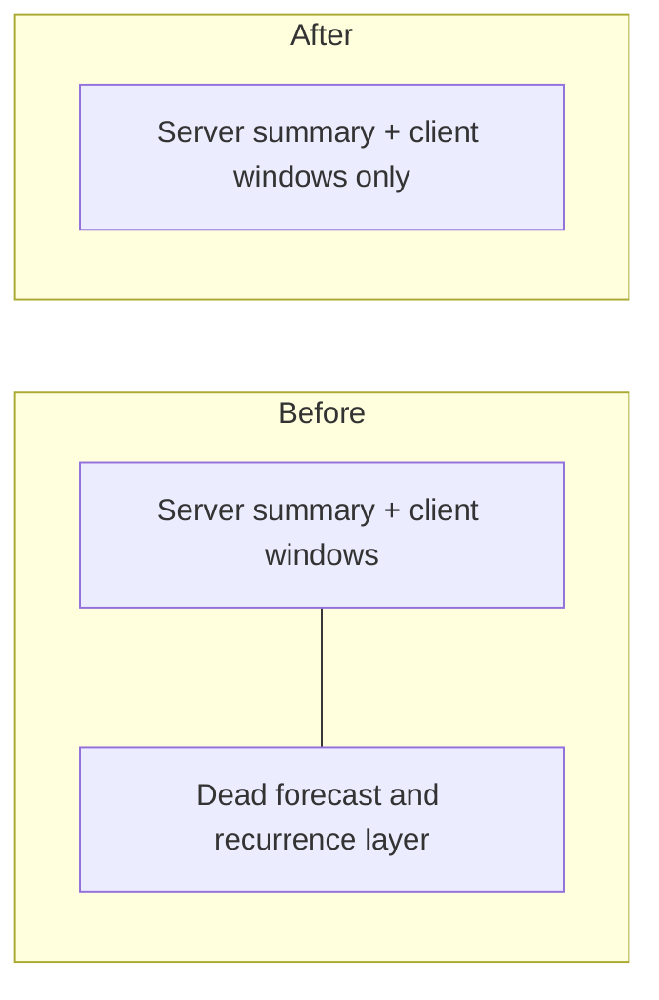

## Scenario

The Safe Spending section of the Outlook page answers how much you can spend next cycle and shows the cards, the bills still to cover, and an expected-pay figure. When you open Outlook, the browser asks the API for a Safe Spending summary and displays the returned JSON before showing those amounts. The API computes the amounts from one evidence cut, meaning the snapshot of posted and pending facts used for that single calculation, and the paid or pending state of each schedule occurrence. The client only decides display windows, such as which payment period a bill belongs to. Before the server became the sole owner of the amounts, the client also summed windowed totals and re-expanded recurring schedules, meaning it turned a repeating schedule into its individual future occurrences, to forecast income. Those functions and the recurrence helpers they called stayed in the domain layer after the takeover. This is an internal path: no screen calls them, their only callers are their own tests, and a stale grooming inventory still describes callers that no longer exist. They matter because they offer a second way to compute the same income figure, which can disagree with the server's `expectedPay` after any change to recurrence rules.

## Executive summary

Safe Spending answers how much the user can spend. `safeSpending.ts` states the current rule: every amount comes from the server summary and only time windows stay on the client. Several pre-takeover windowed sums and forecasts survived with no production caller.

`mandatoryTransactions`, `monthEndIso`, `nextMonthRange`, and `DEFAULT_CYCLE_STATEMENT_DAY` appear only in their own tests, and all of `safeSpendingMath.ts` is dead once those go. `expectedMonthlyIncome` re-expands schedules for a calendar month — the figure the server now returns as `expectedPay` from `forecastPaydays` — and it is the sole production consumer of `scheduleExpansion.ts`, a thin wrapper over `recurrenceOccurrenceDates`, which is a client copy of backend recurrence expansion. Those recurrence functions and their tests have no other caller. `safeSpendingHistory.ts` and `recurringBillIncreases.ts` are also test-only, and the latter is the last consumer of `groupByDate`. A stale grooming inventory still describes callers that no longer exist.

The fix is to delete the dead layer.

## Recommended action

Delete the listed functions and constants from `safeSpending.ts`, delete `safeSpendingMath.ts`, `safeSpendingHistory.ts`, `recurringBillIncreases.ts`, `scheduleExpansion.ts`, and the `expectedMonthlyIncome` export from `safeSpendingIncome.ts`, and delete the four recurrence expansion functions and their tests from `recurrence.ts`. The replacing owners are `SafeSpendingSummary`, backend `forecastPaydays`, and live `scheduleHistoryTransactions` for recorded-evidence rows. Keep every selection helper and the live `paymentCapacity.ts` window logic, which the server-ownership comment explicitly reserves to the client.

## Before and after

| | Before | After |
|---|---|---|
| Amounts | Server summary plus a dead client forecast layer | Server summary only |
| Income forecast | Client `expectedMonthlyIncome` re-expands schedules | Server `expectedPay` from `forecastPaydays` |
| Recurrence | Client copy in `recurrence.ts` and `scheduleExpansion.ts` | Removed; backend owns expansion |
| Client windows | Live `paymentCapacity.ts` logic | Unchanged |

## Expected improvement

The frontend domain surface shrinks and every Safe Spending amount has one authoritative owner, the server, so the client copy cannot drift from backend recurrence expansion. This is a structural simplification. Deadness is from static call graphs at this checkout, not runtime observation, and no bundle or speed savings were measured, so none are claimed.

## Alternatives considered

- **Leave as is** — dead forecast and recurrence copies remain and can drift from backend `forecastPaydays`, while the stale grooming inventory keeps pointing at callers that no longer exist.
- **Keep the client forecast as a fallback** — rejected, because the server-ownership comment makes the server the sole owner; a fallback would recreate two income figures.

## Downside of rejecting

The dead layer keeps a second way to compute income on the client. If a maintainer calls the stale client figure instead of the server's `expectedPay`, the two can disagree after any change to recurrence rules, producing two different income numbers for Safe Spending.

## Verification

A repo-wide grep for each symbol must return nothing outside historical docs. Typecheck and the unit suite must pass with no component import changed, and the live selection hook and Safe Spending Outlook views must still resolve cards, bills, and income. Deadness comes from static call graphs at this checkout, not runtime observation.

References: `frontend/src/domain/safeSpending.ts:14-15,17,20-41,75-146`; `frontend/src/domain/safeSpendingMath.ts:1-84`; `frontend/src/domain/safeSpendingIncome.ts:40-79`; `frontend/src/domain/safeSpendingHistory.ts:1-47`; `frontend/src/domain/recurringBillIncreases.ts:1-20`; `frontend/src/domain/scheduleExpansion.ts:1-45`; `frontend/src/domain/recurrence.ts:338-351,358-380,390-475`; `backend/internal/safespending/payday_income.go:69-107`; `tasks/to-groom/long-chaining/frontend-monthly-obligations.md:8,12`.
