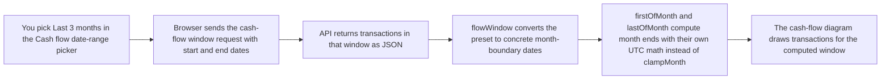

## Scenario

Open the Cash flow screen and pick a preset from the date-range picker above the diagram — `This month`, `Last month`, `Last 3 months`, `Year to date`, or `Last 12 months`. The browser then sends the cash-flow window request carrying the chosen start and end dates, and the API returns the transactions that fall in that window as JSON, a text format for structured data. A preset is a control value the user selects: it is a friendly label that the frontend domain layer — plain functions in `frontend/src/domain/` that shape data for display — converts into concrete dates in `frontend/src/domain/flowWindow.ts`.

That conversion has to land on the first and last day of a month even at year ends and in leap years. `clampMonth` in `frontend/src/domain/format.ts` already owns the rule for the forecast-horizon label in `horizonDate`: it takes a year, a zero-based month, and a day, builds the date in UTC, and clamps the day to the month's real last day. The numbers `1` and `31` are sentinels passed to `clampMonth`; `1` returns the first day, and `31` is clamped down to the 28th or the 29th in February. UTC is a time standard that does not shift with the viewer's time zone, and `clampMonth` anchors at 12:00 UTC so a calendar date never becomes the previous day locally.

The flow-window helpers `firstOfMonth` and `lastOfMonth` in `flowWindow.ts` instead repeated that UTC math with their own code, so month-end correctness lived in two files. Two more exports, `firstDayOfMonthIso` and `lastDayOfMonthIso`, existed only so the `flowWindow` test could assert those boundaries; no screen called them. Both helpers and both wrappers are internal to the frontend domain layer.

## Executive summary

Two frontend helpers compute the first and last day of a month with their own UTC math, duplicating the clamped-month formula that `clampMonth` already owns for `horizonDate`. Leap-year and month-end correctness is therefore maintained in two live files, and the `flowWindow` test pins its own copy instead of the shared one. Two more exports, `firstDayOfMonthIso` and `lastDayOfMonthIso`, exist only to serve that test.

A third owner, `addMonthsClamped`, is removed by finding 074 and `monthEndIso` goes with the same dead layer. The single action is to make `firstOfMonth` and `lastOfMonth` call `clampMonth`, leaving one owner, and delete the two test-only wrappers.

## Recommended action

Make `firstOfMonth` and `lastOfMonth` call `clampMonth` with day 1 and day 31, leaving `clampMonth` as the sole owner, and delete the two test-only wrappers and their cases. No new helper is created.

## Before and after

Before: `firstOfMonth` and `lastOfMonth` each compute their own month-end with UTC math, and the test uses dedicated `firstDayOfMonthIso` and `lastDayOfMonthIso` wrappers. There are two live copies of the formula.

After: both helpers call `clampMonth` with day 1 and day 31, and the wrappers and their test cases are gone. One owner remains.

## Expected improvement

Structural: leap-year and month-end correctness is maintained in one place, so a future change cannot fix one file and miss the other, and the test now exercises the shared owner. No savings were measured and no benchmarks were run, so this is a maintainability improvement rather than a measured one.

## Alternatives considered

Leave as is: keeps two independent implementations of the same formula and a test that pins a copy rather than the owner; rejected because that drift risk is the whole problem. Create a new shared helper: unnecessary because `clampMonth` already is the owner, and the finding explicitly creates none. Keep the test wrappers: they exist only for the test and would reintroduce a second surface; rejected.

## Downside of rejecting

Leap-day and month-end fixes would still need to be applied in two files, and a change to `clampMonth` could leave `flowWindow` silently disagreeing with `horizonDate`. The test would keep guarding a copy rather than the live rule, so a regression in the shared formula could go unnoticed on the `flowWindow` side.

## Verification

Verify that the existing leap assertions for `2024-02-29` and `2023-02-28` pass unchanged. `clampMonth` takes a zero-based month and anchors at 12:00 UTC, so confirm `flowWindow`'s `getUTCMonth()` basis before swapping.

References: `frontend/src/domain/format.ts:67-80`; `frontend/src/domain/flowWindow.ts:15-37`; `frontend/src/domain/result.ts:121-147`; `frontend/src/domain/flowWindow.test.ts:12-20`.
