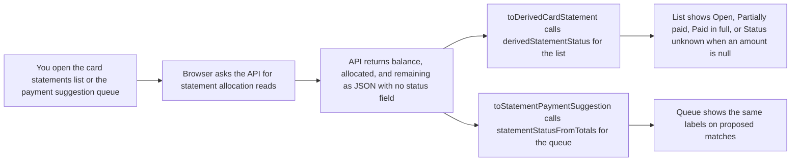
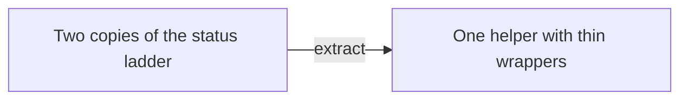

## Scenario

Two credit-card surfaces show a statement's status. The card statements list shows each derived statement with a label such as Open, Partially paid, Paid in full, or Status unknown; the payment suggestion queue shows proposed matches between a posted card payment and a statement using the same labels. When either screen loads, the browser asks the API for statement allocation reads, and the API replies with each statement's billed amount (`balance`), the total allocated to it (`allocated`), and the balance still owed (`remaining`) as JSON, a text format for structured data. The statement read deliberately carries no status field, so the frontend domain layer — plain functions in `frontend/src/domain/` that shape server data for display — derives the label in the browser before any text is drawn.

A derived statement is one statement reconstructed from a recorded cycle end; the backend owns the amounts and leaves the labeling to the client. The status ladder is the ordered rule that maps those amounts to a label: a remaining balance of zero or less means paid in full, a positive allocation means partially paid, and otherwise the statement is open. `statementStatusLabel` in `frontend/src/domain/statementPayment.ts` turns those statuses into the four visible strings. `derivedStatementStatus` in `frontend/src/domain/derivedStatement.ts` applies the ladder for the statements list and returns `unknown` when the billed amount, remaining, or allocated is null; a null guard is the check that refuses to treat a missing amount as zero. `statementStatusFromTotals` in `frontend/src/domain/statementPaymentAdapter.ts` repeats the same ladder for the suggestion queue. The screens reach these two functions through `toDerivedCardStatement` and `toStatementPaymentSuggestion` rather than calling them directly.

## Executive summary

The backend statement read does not return a status field, so the frontend derives it. It derives it twice: `derivedStatementStatus` maps remaining and allocated amounts to paid-in-full, partially-paid, or open with an `"unknown"` guard for missing amounts, while `statementStatusFromTotals` repeats the same ladder for the payment suggestion path. The two copies already handle nulls differently.

The cost is that any status-rule change needs two edits and two test updates, and the card-statements list and suggestion queue can drift apart. The single action is to extract one helper that returns the three concrete statuses and keep both exported entry points stable.

## Recommended action

Extract one helper that takes `remaining` and `allocated` and returns the three concrete statuses. Have `derivedStatementStatus` add only the null-to-`"unknown"` guard around it and have `statementStatusFromTotals` call the helper directly. Keep both exported entry points so callers and tests stay stable.

## Before and after

Before: two functions each implement the status ladder, and they already differ in null handling.

After: one helper owns the ladder, `derivedStatementStatus` wraps it with the null guard, and `statementStatusFromTotals` calls it directly. Both exported entry points remain.

## Expected improvement

Structural: one rule to change and one place where null handling is explicit, so the two surfaces can no longer disagree about the ladder. This is a maintainability gain, not a measured improvement in speed or size; no benchmarks were run.

## Alternatives considered

Leave as is: the current code works but keeps two ladders that already differ; rejected because a rule change needs two coordinated edits. Merge the exported entry points into one: would change callers and tests; the finding keeps both exports to avoid that churn. Fix only the null-handling difference: treats the symptom and leaves two copies of the ladder.

## Downside of rejecting

The card-statements list and the payment suggestion queue can show different statuses for the same balance as soon as one copy is edited. A new status rule would require two edits and two test updates, and a missed edit would show a wrong label on one surface.

## Verification

Verify that both status test sets pass unchanged, including the `"unknown"` cases. Confirm the statement list shows the right status for a known balance with `remaining = 0` and the suggestion queue keeps its open, partial, and paid labels.

References: `frontend/src/domain/derivedStatement.ts:27-42`; `frontend/src/domain/statementPaymentAdapter.ts:55-62,93`; `frontend/src/domain/statementPayment.ts:11-20`; `backend/internal/types/card_statement.go:116-125`.
