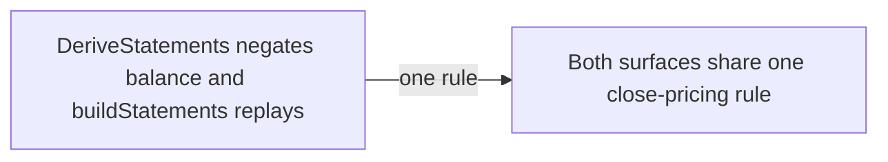

## Scenario

Two surfaces price a closed credit-card statement. The card statements API feeds the card statements list and the transfer-pair analysis; the Safe Spending summary feeds the spending-availability view. When you open either screen, the browser asks the API for statements or a Safe Spending summary, and the API builds them from recorded bank evidence rather than stored statement rows. The data crossing the boundary is a derived statement in JSON, a text format for exchanging structured data: a closing date, a balance amount that may be null, a kind of closed, estimated, or unknown, a due date, and a currency. For a cycle that has not closed there is no observed balance, so a replay engine named `cardStatementRows` exists to replay posted charges and payments from a saved balance snapshot—a checkpoint—at the last close and estimate the current amount. For a closed cycle the two paths diverge: `DeriveStatements` negates the bank balance observed inside the cycle into a positive debt amount, while `buildStatements` still runs the checkpoint replay. Both functions are internal and are called by the API handlers when the browser requests those screens. The doc comment on `DerivedStatement` describes the replay rule, but the closed-cycle path does not use it.

## Executive summary

Statements are no longer stored rows; both pricing paths derive them from recorded evidence. For a closed cycle `DeriveStatements` negates the bank balance observed inside the cycle, while `buildStatements` opens a checkpoint replay (replaying posted charges and payments from a saved balance at the first close) and carries them forward. They feed different surfaces — the card-statements API and transfer-pair analysis use the first, the Safe Spending summary the second — and nothing marks one authoritative. The `DerivedStatement` doc describes the replay rule that the function does not use for closed cycles.

The recommended action is to choose one close-pricing rule and have both surfaces consume it. This deletes one derivation path rather than extending a framework.

## Recommended action

Choose one close-pricing rule and make both surfaces consume it: have `buildStatements` call `DeriveStatements` or extract the shared close-pricing routine. Keep `cardStatementRows` as the single replay engine for estimated cycles and keep the `card_statements` drop-and-rekey migration body until every target verifies. This is deletion of one derivation path, not extension of a framework.

## Before and after

Before: two close-cycle pricing rules — balance negation and checkpoint replay — feed different surfaces, and the doc disagrees with the function for closed cycles.

After: one rule is authoritative and both surfaces call it. `cardStatementRows` remains only for estimated-cycle replay, and the migration body stays until every target verifies.

## Expected improvement

Structural: it removes a drift risk and leaves one rule to maintain and document rather than fixing an observed wrong balance. No divergent value was seen in the one run performed, and production checkpoint density is unknown, so the win is consistency and safety, not a measured correction. No speed or size savings were measured; no benchmarks were run.

## Alternatives considered

Leave as is: keeps two close-pricing rules and a doc that disagrees with the code; rejected because a future rule change can silently desynchronize the card-statements API from the Safe Spending summary. Make `buildStatements` the single owner by dropping `DeriveStatements` for closed cycles: viable, but the finding leaves which rule wins open since neither is proven wrong. Delete the `card_statements` migration body now: rejected; it must stay until every target verifies the drop-and-rekey.

## Downside of rejecting

The card-statements API and transfer-pair analysis can price a closed cycle by balance negation while Safe Spending prices the same cycle by replay, producing different closed balances on different screens. Because checkpoint density is unknown, the gap could widen unnoticed, and the doc will keep describing a rule the function does not use.

## Verification

Verify with a differential test asserting closed balances from both paths match across a fixture with a checkpoint at every close, one with gaps, and one with intra-cycle payments, then run the existing derive-statements, payday, and evidence tests. One run observed no divergent value; production checkpoint density is unknown, so treat this as a drift risk rather than a proven wrong balance.

References: `backend/internal/safespending/derive_statements.go:11-18,52-85`; `backend/internal/safespending/payday_statements.go:78-127,264-272`; `backend/internal/types/card_statement.go:5-18`; `backend/internal/api/model/safe_spending_summary.go:45`; `backend/internal/api/analyses/transfer_pair.go:112`.
