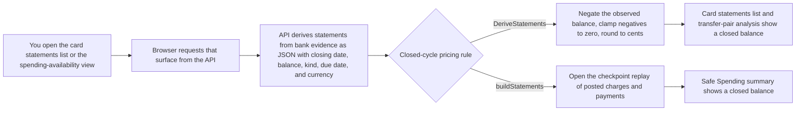
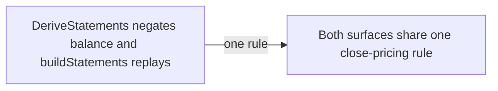

## Scenario

Two surfaces price a closed credit-card statement. The card statements API feeds the card statements list and the transfer-pair analysis; the Safe Spending summary feeds the spending-availability view. When the browser asks either surface for its data, the API builds the answer from recorded bank evidence rather than from stored statement rows. The derived statement crossing the boundary is JSON, a text format for structured data: it carries a closing date, a balance that may be null, a kind of closed, estimated, or unknown, a due date, and a currency.

A cycle is closed when its closing date has passed and a bank observation exists inside it; an estimated cycle has no observation yet, so no observed balance is available. A checkpoint is a saved balance snapshot the bank recorded at a timestamp. Replay means starting from that observed balance at the first close and applying posted charges and payments to price later closes. The replay engine `cardStatementRows` in `backend/internal/safespending/payday_statements.go` does that work for estimated cycles, and the handler calls it when the browser requests one of those surfaces.

For a closed cycle the two paths disagree. `DeriveStatements` in `backend/internal/safespending/derive_statements.go` takes the bank balance observed inside the cycle, negates it into a positive debt amount, clamps negatives to zero, and rounds to cents. `buildStatements` in `payday_statements.go` still opens the checkpoint replay for that same closed cycle. Both functions are internal and are called by the API handlers; nothing marks one authoritative. The doc comment on `DerivedStatement` in `backend/internal/types/card_statement.go` describes the replay rule — an observed checkpoint at the close, later closes replayed from posted activity — but the closed-cycle path in `DeriveStatements` does not use that replay.

## Executive summary

Statements are no longer stored rows; both pricing paths derive them from recorded evidence. For a closed cycle `DeriveStatements` negates the bank balance observed inside the cycle, while `buildStatements` opens a checkpoint replay (replaying posted charges and payments from a saved balance at the first close) and carries them forward. They feed different surfaces — the card-statements API and transfer-pair analysis use the first, the Safe Spending summary the second — and nothing marks one authoritative. The `DerivedStatement` doc describes the replay rule that the function does not use for closed cycles.

The recommended action is to choose one close-pricing rule and have both surfaces consume it. This deletes one derivation path rather than extending a framework.

## Recommended action

Use one closed-statement calculation for Safe Spending, the Statements tab, and transfer-pair analysis. Start from the latest eligible balance check in that statement's cycle and apply posted activity after the check through the close. Keep the statement balance unknown when there is no balance check in the cycle.

## Before and after

Before: two close-cycle pricing rules — balance negation and checkpoint replay — feed different surfaces, and the doc disagrees with the function for closed cycles.

After: both surfaces use the latest eligible balance check in the cycle plus posted activity through the close. The migration body stays until every target verifies.

## Expected improvement

Structural: it removes a drift risk and leaves one rule to maintain and document rather than fixing an observed wrong balance. No divergent value was seen in the one run performed, and production checkpoint density is unknown, so the win is consistency and safety, not a measured correction. No speed or size savings were measured; no benchmarks were run.

## Alternatives considered

Using the balance check alone would ignore any activity that posts after the check and before closing. Continuing to use separate calculations would allow the surfaces to disagree.

## Downside of rejecting

The card-statements API and transfer-pair analysis can price a closed cycle by balance negation while Safe Spending prices the same cycle by replay, producing different closed balances on different screens. Because checkpoint density is unknown, the gap could widen unnoticed, and the doc will keep describing a rule the function does not use.

## Verification

Verify with a differential test asserting closed balances from both paths match across a fixture with a checkpoint at every close, one with gaps, and one with intra-cycle payments, then run the existing derive-statements, payday, and evidence tests. One run observed no divergent value; production checkpoint density is unknown, so treat this as a drift risk rather than a proven wrong balance.

References: `backend/internal/safespending/derive_statements.go:11-18,52-85`; `backend/internal/safespending/payday_statements.go:78-127,264-272`; `backend/internal/types/card_statement.go:5-18`; `backend/internal/api/model/safe_spending_summary.go:45`; `backend/internal/api/analyses/transfer_pair.go:112`.

Implemented in commit `e9c8aaca`.
