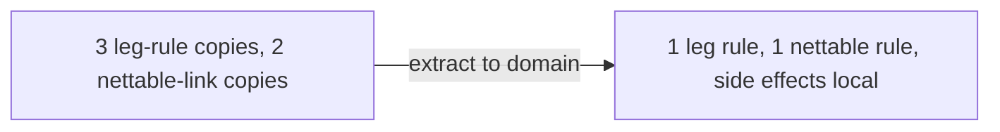

## Executive summary

The rule for matching opposite transfer legs — settled, USD, opposite sign, different accounts, equal cents, within seven days — is implemented in three places: the transfer detector, the payment-stream exclusion path, and the SQLite link validator, which carries its own copy of the seven-day constant with a comment that it mirrors the detector. A second rule, the nettable-link predicate of an external outflow plus an external inflow with equal rounded amounts, is implemented again in both the path netter and the flow-graph netter.

The cost is that a window or sign-rule change needs coordinated edits, and a missed one silently changes which payment evidence is excluded and which pairs net. The single action is to give each predicate one shared home in `domain` and keep the side effects local.

## Recommended action

Move the facts-level leg predicate and window constant into one domain helper called by the detector, `paymentTransferPairs` or `paymentLegKeyFacts`, and `invalidTransferPair`. Extract a separate shared nettable-link predicate used by both netters and by link validation. Keep scoring and netting side effects local and preserve the flow-graph netter's extra guard that the leg appears on no other edge. Keep the link table, membership uniqueness, and approval claims: they fix a real double count and are not duplicated by generic bank-row dedup.

## Before and after

Before: the leg rule lives in three places with three copies of the seven-day constant, and the nettable-link predicate lives in two netters.

After: one leg predicate and constant in `domain` are called by all three sites, and one nettable-link predicate is shared by both netters and link validation. Scoring, netting, and the flow-graph netter's extra edge guard stay local.

## Expected improvement

Structural: one place to change the window or sign rule, after which all paths agree by construction. This is deduplication, not a performance fix, and no measured change in behavior or speed is claimed; no benchmarks were run.

## Alternatives considered

Leave as is: each copy can drift, and the comment that the validator's constant mirrors the detector is a manual promise; rejected. Share only the seven-day constant: leaves the sign, account, and cents rule duplicated, which is the larger part of the predicate. Merge leg matching and nettable linking into one helper: rejected because they are different rules and the flow-graph netter has an extra guard, so the finding keeps them separate.

## Downside of rejecting

A change to the seven-day window or sign rule must be made in three files. Missing one silently changes which payment evidence gets excluded and which transfers net, so a double count or a dropped pair can reach analysis with no failing test to flag it.

## Verification

Verify with one boundary case — an eight-day gap, exact cents, opposite accounts — asserting all paths agree, then run transfer-detector, payment-incremental, link, and netting tests. The shared helper must live in `domain` to avoid an import cycle; partial-window clipping was not inspected.

References: `backend/internal/analysis/transfer.go:14-22,204-235`; `backend/internal/analysis/payment_transfers.go:11-100`; `backend/internal/store/adapters/sqlite/transfer_links.go:56-59,135-173`; `backend/internal/domain/path.go:161-215`; `backend/internal/domain/flowgraph.go:390-445`.
