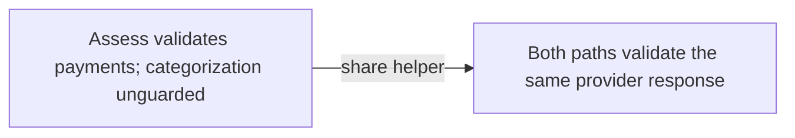

## Executive summary

Payments pass every provider batch through `judgment.Assess`, which rejects duplicate request IDs, missing or mismatched IDs, structurally impossible statuses, and reasons over 2000 bytes. The categorization learner calls `session.Evaluate` directly and accepts a row only when its status is `ready` with a strong supported decision, so a duplicate ID or overlong reason passes there and fails in payments. Both run live under the same `ML_JUDGMENT_URL`, so one provider contract has two enforcement points.

The recommended action is to extract the response validation from `Assess` into a reusable helper and call it from the classifier before its existing strong-supported filter. This is a correctness fix inside the judgment framework, not a framework removal.

## Recommended action

Extract the response validation from `Assess` into a reusable helper returning validated decisions plus the deferred error, and call it from `MLClassifier.Classify` before the existing strong-supported filter. Keep keyword-first composition and the rule that the learner may only add labels. If all-or-nothing rejection would drop valid category rows, apply the helper per 100-item batch. This is a correctness fix inside the judgment framework, not a framework removal.

## Before and after

Before: payment batches are validated by `Assess` for duplicate IDs, ID mismatches, impossible statuses, and reason length, while categorization accepts rows on the ready-plus-strong filter alone.

After: both paths run the same validation helper, and the classifier keeps its ready-plus-strong filter and keyword-first composition. If all-or-nothing rejection would drop valid rows, the helper runs per 100-item batch.

## Expected improvement

Structural: one validation rule for one provider contract, so a bad batch is rejected the same way in payments and categorization. This is a correctness gain, not a measured improvement in speed or size; no benchmarks were run.

## Alternatives considered

Leave as is: one provider URL with two different acceptance rules; rejected as a correctness gap. Give categorization its own validation copy: would create a third enforcement point and the same drift. Keep validation in `Assess` and route categorization through it wholesale: viable, but the classifier's ready-plus-strong filter and label-only rule must stay, so extracting the helper is the smaller change.

## Downside of rejecting

A malformed provider response — a duplicate request ID or a reason over 2000 bytes — can assign a category in the learner while the same batch is rejected in payments. That divergence stays invisible until the two surfaces disagree, leaving the product trusting labels drawn from a batch the other path considers invalid.

## Verification

Verify with a table-driven test containing a duplicate `RequestID`, an overlong reason, a ready decision with empty strength, and an unmatched ID: assert no category is assigned and that both paths reject identically. Whether partial batches occur is a product decision that affects the batching choice.

References: `backend/internal/judgment/assess.go:12-62`; `backend/internal/categorization/ml_classifier.go:82-109`; `backend/internal/analysis/payment_judgment.go:17-25`; `docs/analyses.md:188-195`.
