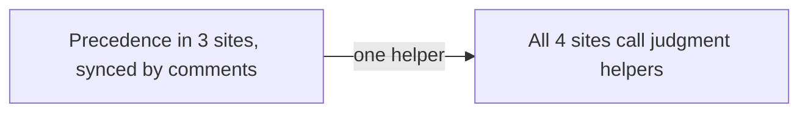

## Scenario

Payment analysis asks a machine-learning provider to judge candidates in batches of up to 100, and the provider can answer ready, pending, or unavailable. Pending means a later retry may produce an answer; unavailable means the provider could not answer at all. Because one batch can contain a mix, the backend must choose a single deferred error—a reason to report the result as not yet final—for the whole run, using the rule that unavailable outranks pending. When you open an analysis, or change settings enough to trigger a recompute, the browser requests the analysis and sees the chosen status only after the backend has aggregated every batch. The work is internal: `judgment.Assess` decides the error for one batch, `judgePayments` and `judgeSelectedPayments` combine batch errors during full recompute, the incremental path does the same for changed streams, and `scanPaymentJudgments` picks the final status from the resulting findings. The data involved is judgment status values carried in JSON, a text format for exchanging structured data. The precedence rule exists so a run containing any unavailable answer is reported as unavailable instead of being softened to pending.

## Executive summary

The precedence rule "unavailable outranks pending" is decided in three places: in `judgment.Assess`, again when `judgePayments` and `judgeSelectedPayments` aggregate 100-item batches, and again in `scanPaymentJudgments` when final findings are scanned. The comments on the incremental helpers say they match `judgment.Assess`, so the rule is currently kept consistent by prose rather than code.

The cost is that any change to error precedence needs three coordinated edits, and a missed one changes which error a batch reports. The single action is to put the precedence decision in one helper in the judgment package and call it from all four sites.

## Recommended action

Add one helper in the judgment package that maps a set of statuses to the deferred error and one that aggregates batch errors, then call it from all four sites. Keep the incremental path's reuse of carried-forward judgments; only the precedence decision moves.

## Before and after

Before: precedence is decided independently in `Assess`, in batch aggregation by two functions, and in `scanPaymentJudgments`, with comments claiming they match.

After: two judgment-package helpers own status-to-error mapping and batch aggregation, and all four sites call them. The incremental path's carried-forward reuse stays unchanged.

## Expected improvement

Structural: one definition of precedence, comments replaced by code so the rule cannot drift, and full recompute and incremental analysis deriving the same error. This is a maintainability gain, not a measured improvement in speed or size; no benchmarks were run.

## Alternatives considered

Leave as is: the comments work today but are a manual contract; rejected because a precedence change needs three coordinated edits. Put the helper in the analysis package: rejected because `judgment.Assess` lives in `judgment` and that would risk an import cycle; the finding places it there. Collapse batch aggregation and status mapping into one helper: they are distinct steps, and the finding keeps them separate.

## Downside of rejecting

A change to which error wins — for example changing the order of unavailable and pending — would have to be made in three places. A missed site leaves full recompute and incremental analysis reporting different deferred errors for the same batch, with only comments to explain why.

## Verification

Verify with a parameterized regression over full recompute, incremental with more than 100 candidates, and incremental with carried findings, using a mix of ready, pending, and unavailable statuses. The existing full-versus-incremental parity test must stay green unchanged. Whether a carried finding can change status without a new request was not checked; if it can, cache invalidation also needs review.

References: `backend/internal/judgment/assess.go:51-62`; `backend/internal/analysis/payment_judgment.go:15-27`; `backend/internal/analysis/payment_incremental.go:338-352,524-553`.
