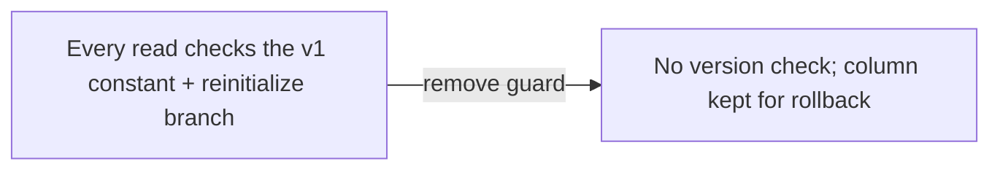

## Scenario

Forecast screens such as Outlook, Evaluations, and the purchase planner show a projection—the computed forecast result the app keeps for display. When you open one of these screens, the browser asks the API for the projection and the backend either serves stored results or recomputes them. The stored projection state crosses the internal boundary as JSON, a text format for exchanging structured data, carrying a revision counter, a dirty-from date marking where stored results must be rebuilt, a projection start and horizon, and an engine version that defaults to `v1`. On every read the handler compared that version with a Go constant—a fixed value defined in the source code—and, on a mismatch, reinitialized the state, bumped the revision, and set the dirty-from date to the projection start so cached results would be rebuilt. A cache is stored output kept so it can be reused instead of recomputed, and the version check exists to invalidate that cache when the calculation engine changes. The check is internal and runs whenever the projection handler reads or builds a projection. No second version exists or is proposed: commit `d82ce5b1` removed the dead recurrence pipeline and duplicate engine but left the version constant, so the mismatch branch can only be reached by manually editing a stored value. SimpleFIN protocol 2 is a separate data-import migration and is untouched by this finding.

## Executive summary

A projection — the computed forecast result kept for display — carries a schema column that defaults to `v1`, mirrored by a Go constant. That value is checked on every projection read and, on a mismatch, can reinitialize state, bump the revision, and set `dirty_from`. No `v2` exists or is proposed. Commit `d82ce5b1` removed the dead recurrence pipeline and duplicate engine but left `unifiedEngineVersion` untouched, so the check is machinery for invalidating a cache on a value that never changes.

The recommended action is to remove the read and build guard and its reinitialize branch while keeping the schema column for rollback compatibility. SimpleFIN's active protocol 2 migration must stay.

## Recommended action

Remove the read and build guard and its reinitialize branch, keeping the schema column for rollback compatibility until the next schema migration. Do not add a version enum while one implementation exists. This is deletion of framework residue; SimpleFIN v2 is an extension in flight and is untouched.

## Before and after

Before: every projection read checks the version constant, and a mismatch can reinitialize state, bump the revision, and set `dirty_from`. The schema column defaults to `v1`.

After: there is no version read/build guard or reinitialize branch. The schema column stays for rollback compatibility, no enum is added, and the SimpleFIN v2 migration is unchanged.

## Expected improvement

Structural: it removes a check that cannot fire as designed and a reinitialize path that can bump the revision and mark state dirty for no real reason. The code is smaller and has one fewer branch to reason about. No speedup, line savings, or bundle change was measured; no benchmarks were run.

## Alternatives considered

Leave as is: keeps a guard on a value that never changes and a reinitialize path that can dirty state; rejected as framework residue. Add a version enum: rejected because only one implementation exists, so an enum would be ceremony. Drop the schema column too: rejected, since it is kept for rollback compatibility until the next schema migration. Touch SimpleFIN v2: rejected, as that is a separate active migration.

## Downside of rejecting

Every projection read keeps paying for a check whose mismatch branch can only be reached by manually changing a value that has no second implementation behind it. That branch can still reinitialize state, bump the revision, and set `dirty_from`, so a stray `v1` mismatch would invalidate a projection cache with no corresponding engine change.

## Verification

Verify that no `EngineVersion` assignments remain, run projection builder and store tests, and run `deploy/migrations.test.mjs`. The external roadmap was not searched and the historical `dirty_from` bump may have served a one-time upgrade that was not inspected.

References: `backend/internal/api/projections/builder.go:23,98-103`; `backend/internal/store/adapters/sqlite/projection_unified.go:44-46,63-86`; `backend/internal/types/projection_unified.go:31,199`; `docs/unified-projection.md:20`.
