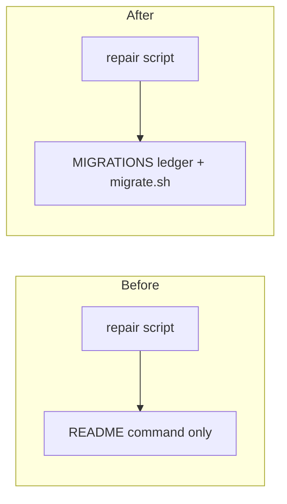

## Executive summary

`repair-claimed-posted-time` is a one-time script that fixes settled bank transactions whose posted time was zeroed when a pending refresh arrived while the transaction was claimed. A live guard in `writeBankValues` now stops that from happening again. The migration ledger (`MIGRATIONS.md`) requires every one-time script to be listed as pending and retired only after each target verifies, but this tool appears in no migration doc and in no `migrate.sh` step. An operator can only find it by reading its README by hand.

The maintenance cost is a repair tool that sits outside the system meant to track and retire it. The single recommended action is to record it in the ledger and wire it into the migration runner.

## Recommended action

Add a pending-table row in `deploy/MIGRATIONS.md` with the operator command and the postcondition that no settled rows have non-positive posted time. Wire the binary into `deploy/migrate.sh` using the same fail-closed candidate-copy execution as the other one-time tools — the script applies changes to a copy and only swaps it in after checks pass. Do not delete the script until targets verify. This extends the ledger, not the runtime.

## Before and after

| Before | After |
| --- | --- |
| Script exists but appears in no migration doc and no `migrate.sh` step; reachable only through its README command. | Script listed as pending in `MIGRATIONS.md` with command and postcondition, and invoked by `migrate.sh` with fail-closed candidate-copy execution. |

## Expected improvement

Structural. The repair becomes discoverable through the normal migration entry point and stops relying on an operator finding a README. No benchmarks were run, so no speed or size improvement is claimed.

## Alternatives considered

- Leave as is. Rejected because the ledger exists precisely so operators can find and retire one-time scripts; an undiscoverable tool is likely to be run ad hoc or missed.
- Delete the script now. Rejected because no live database was inspected and targets have not verified, so corrupt rows may still exist.

## Downside of rejecting

The script stays reachable only by manual README discovery, so it can be missed during an upgrade. The ledger also stays inconsistent with the rule that every one-time tool is tracked and retired only after verification.

## Verification

Run the script's tests, execute the migration body in verify mode against a fixture with a zeroed claimed row, and confirm the candidate copy has zero violating rows while the original is byte-identical. These are proposed acceptance checks. No live database was inspected, so whether any target still holds corrupt rows is unknown.

References: `backend/scripts/one-time/repair-claimed-posted-time/main.go:1-3,44-131`; `backend/scripts/one-time/repair-claimed-posted-time/README.md:1-18`; `backend/internal/store/adapters/sqlite/sync_pending.go:259-268`; `deploy/MIGRATIONS.md`.
