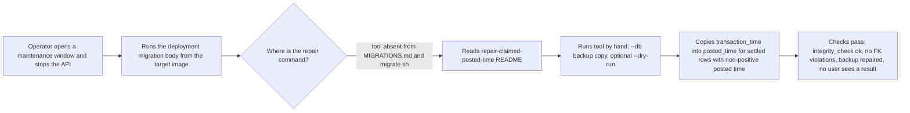
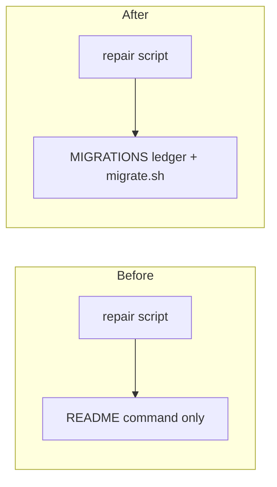

## Scenario

No screen starts the work. The work belongs to the operator workflow for upgrading an existing installation: an operator opens a maintenance window, stops the API, and runs the deployment migration body from the target image. The one-time repair tool `repair-claimed-posted-time` lives at `backend/scripts/one-time/repair-claimed-posted-time/main.go`. The operator runs the tool by hand, with the API stopped, against a verified backup copy of the SQLite database, the app's local store on disk. `backend/scripts/one-time/repair-claimed-posted-time/README.md` is the document that tells the operator the exact command. No user sees a result, because the upgraded API has not started.

The damage the tool repairs came from an older bug in the pending-refresh path. A bank transaction row in SQLite has a `posted_time`, the instant the bank payment actually settled, and a `pending` flag, meaning the bank reported only a temporary authorization. A claim is the link in `transaction_claims` between a bank transaction and one expected occurrence of a recurring payment such as a rent payment. The old code cleared `posted_time` to zero on a settled row (`pending = 0`, `void = 0`) when a pending refresh arrived for a transaction that was claimed. The live guard in `writeBankValues` at `backend/internal/store/adapters/sqlite/sync_pending.go:259-268` now keeps the stored posted time when a bank update arrives, so the bug cannot write new bad rows, but that guard does not repair rows the old code already wrote. The repair tool exists because the guard protects only future writes.

The operator supplies a `--db` control value, the path to the backup copy the tool should repair, and may add `--dry-run`, which makes the tool count repairable rows without writing. The tool refuses a path that is not a regular file or that has a hot SQLite rollback journal. In write mode the tool works inside one transaction: it copies `transaction_time` into `posted_time` for every settled row with a non-positive posted time, then checks that no settled row still lacks a posted time, that SQLite's `integrity_check` returns `ok`, and that no foreign-key violations exist. Any failed check rolls the transaction back and leaves the database file byte-identical.

`deploy/MIGRATIONS.md` is the migration ledger, the list operators use to find one-time tools and retire each one only after every supported target verifies the upgrade. `deploy/migrate.sh` is the single migration body that deployment adapters run from the target image, and it applies each conversion inside a candidate copy of a verified backup, publishing the candidate over the original only after the postconditions pass. `repair-claimed-posted-time` appears in neither `MIGRATIONS.md` nor `migrate.sh`, so an operator can learn that the tool must be run only by reading the tool's own README.

## Executive summary

`repair-claimed-posted-time` is a one-time tool that fixes settled bank transactions whose posted time was zeroed when a pending refresh arrived while the transaction carried a claim. A live guard in `writeBankValues` at `backend/internal/store/adapters/sqlite/sync_pending.go:259-268` now stops that write from happening again, but the guard does not rewrite rows already stored.

The migration ledger `deploy/MIGRATIONS.md` requires every one-time script to be listed as pending and retired only after each target verifies. The repair tool appears in no migration doc and in no `deploy/migrate.sh` step, so an operator can find the tool only by reading its README. The maintenance cost is a repair tool that sits outside the system meant to track and retire it. The single recommended action is to record the tool in the ledger and wire the tool into the migration runner.

## Recommended action

Add a pending-table row in `deploy/MIGRATIONS.md` with the operator command and the postcondition that no settled rows have non-positive posted time. Wire the binary into `deploy/migrate.sh` using the same fail-closed candidate-copy execution as the other one-time tools: the script applies changes to a copy and only swaps it in after checks pass. Do not delete the script until targets verify. The change extends the ledger, not the runtime.

## Before and after

| Before | After |
| --- | --- |
| Script exists but appears in no migration doc and no `migrate.sh` step; reachable only through its README command. | Script listed as pending in `MIGRATIONS.md` with command and postcondition, and invoked by `migrate.sh` with fail-closed candidate-copy execution. |

## Expected improvement

Structural. The repair becomes discoverable through the normal migration entry point and stops relying on an operator finding a README. No benchmarks were run, so no speed or size improvement is claimed.

## Alternatives considered

- Leave as is. Rejected because the ledger exists precisely so operators can find and retire one-time scripts; an undiscoverable tool is likely to be run ad hoc or missed.
- Delete the script now. Rejected because no live database was inspected and targets have not verified, so corrupt rows may still exist.

## Downside of rejecting

The script stays reachable only by manual README discovery, so it can be missed during an upgrade. The ledger also stays inconsistent with the rule that every one-time tool is tracked and retired only after verification.

## Verification

Run the repair tool's tests, execute the migration body in verify mode against a fixture with a zeroed claimed row, and confirm the candidate copy has zero violating rows while the original is byte-identical. Verify mode in `deploy/migrate.sh` builds and checks the candidate without publishing it over the original database. These are proposed acceptance checks. No live database was inspected, so whether any target still holds corrupt rows is unknown.

References: `backend/scripts/one-time/repair-claimed-posted-time/main.go:1-3,44-131`; `backend/scripts/one-time/repair-claimed-posted-time/README.md:1-18`; `backend/internal/store/adapters/sqlite/sync_pending.go:259-268`; `deploy/MIGRATIONS.md`.
