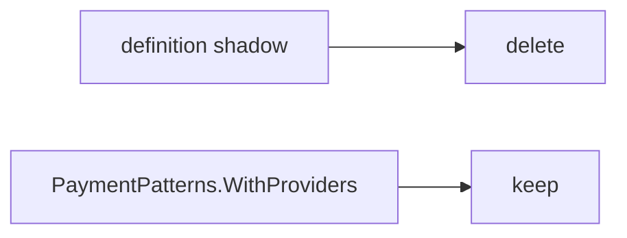

## Scenario

Payment-pattern analysis is the internal pass that examines a user's bank transactions for recurring payments; its output appears as findings on the Analyses screen. A developer also exercises the same detector offline with the evaluation harness at `backend/cmd/testing/evalharness/main.go:393-394`, which compares a baseline analysis against one with a provider catalog attached. A provider catalog is a lookup table that maps a normalized merchant name to a signal such as `utility-provider` or `insurance-provider`. The catalog stays out of always-loaded memory, so a resolver, meaning a helper that answers that lookup for one stream (a group of related transactions), is attached through an extension point: a deliberately narrow place where new behavior is plugged in. `PaymentPatterns.WithProviders` in `backend/internal/analysis/payment_provider_catalog.go:42-47` is that live extension point. The call happens in-process before analysis runs; the only things crossing here are the detector value and its resolver, not a request body or a network format.

`PaymentPatterns` is the detector type that runs one payment-pattern analysis. `NewPaymentPatterns` in `backend/internal/analysis/payment_provider.go:15-22` builds a `paymentProviderDefinition`, a prepared definition meaning the detector after it has opened a judgment session with the judgment provider and is ready to analyze. `Prepare` at `payment_provider.go:37-63` copies `Classifications` and `Providers` from the embedded `PaymentPatterns` into the base value it returns, so the returned base value already carries the resolver that `WithProviders` set on the detector.

The dead shadow lives on `paymentProviderDefinition` and carries the same name and comment as the live method. A reader following the extension seam can mistake the shadow for the real extension point. The shadow has no caller, is absent from the `Definition` interface in `backend/internal/analysis/runner.go:16` that the analyzer uses, and duplicates the copy that `Prepare` already performs into the base value. The payment-patterns doc at `docs/payment-patterns.md:118-124` reserves the catalog for later utility and insurance providers, so the live extension seam stays; only the extra method on the prepared definition is dead. Nothing a user does on the Analyses screen, and nothing the evaluation harness does, reaches the shadow.

## Executive summary

`PaymentPatterns.WithProviders` is the live extension seam used by the evaluation harness and tests. `paymentProviderDefinition.WithProviders` shadows the live `PaymentPatterns.WithProviders` seam on the prepared definition but has no caller, is absent from the `Definition` interface, and duplicates what `Prepare` already copies into the base value. A second copy of an extension seam invites drift between the two. The recommended action is to delete only the shadow method and its comment.

## Recommended action

Delete only the shadow method and its comment. Keep `ProviderResolver`, `MapProviderResolver`, `enrichStreamsWithProviders`, and the live `PaymentPatterns.WithProviders`: the payment-patterns doc reserves the catalog for later utility and insurance providers, and the evaluation harness exercises the seam.

## Before and after

| Before | After |
| --- | --- |
| Two `WithProviders` methods: the live one on `PaymentPatterns` and a dead shadow on the prepared definition. | One: the live `PaymentPatterns.WithProviders`; the shadow and its comment are gone. |

## Expected improvement

Structural. Removing the second implementation leaves a single extension seam that cannot drift from itself. No benchmarks were run, so no speed or size improvement is claimed.

## Alternatives considered

- Keep the shadow. Rejected because it has no caller, is absent from the interface, and can diverge from the live method.
- Delete the live `PaymentPatterns.WithProviders` too. Rejected because the harness and tests use it and the doc reserves the catalog for future providers.

## Downside of rejecting

The dead shadow stays and can drift from the live seam, leaving future readers unsure which extension point is real.

## Verification

A repo-wide `WithProviders` search should show only the live definition, the harness call, and test calls. Then run `go test ./internal/analysis/... ./cmd/testing/evalharness/...` from `backend/`. These are proposed acceptance checks.

References: `backend/internal/analysis/payment_provider.go:24-30,52-57`; `backend/internal/analysis/payment_provider_catalog.go:42-47`; `backend/cmd/testing/evalharness/main.go:393-394`; `docs/payment-patterns.md:118-124`.
