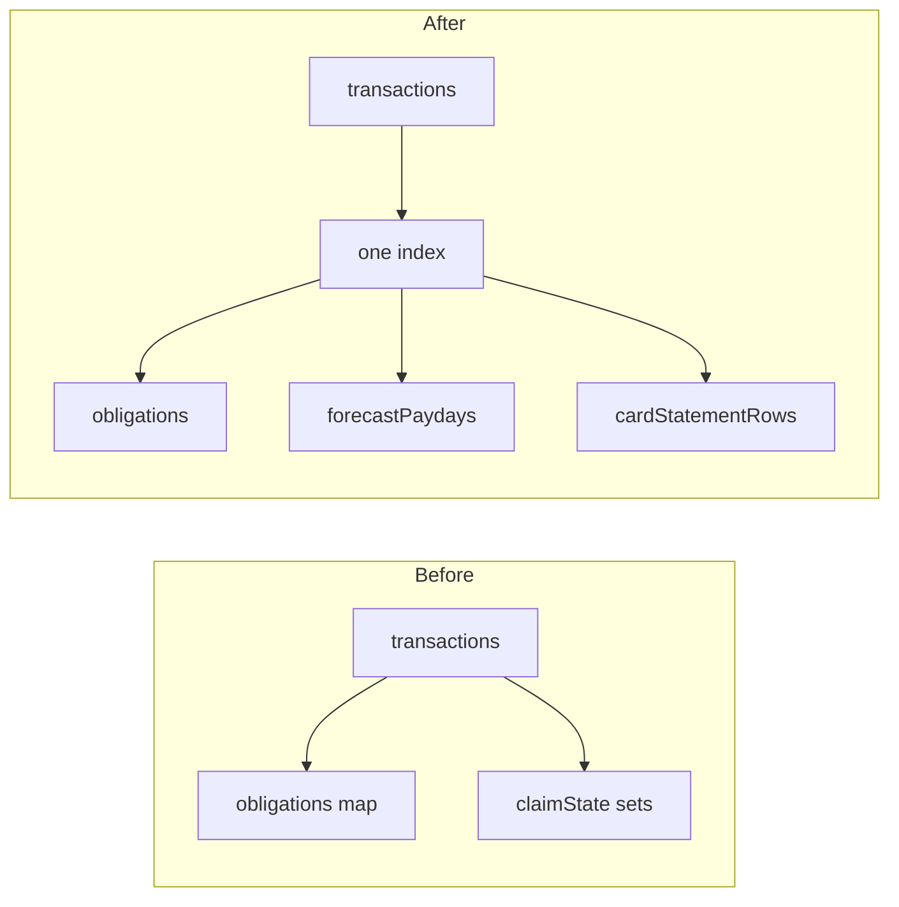

## Scenario

When you open the Safe Spending screen, the app asks the API to calculate how much more you can spend, which bills still need cover, and what the card statements will hold. The API reads your stored transactions and schedules and replays them to one evidence cut, meaning a fixed instant such as the close of a day, before the screen shows any amount. The request and reply cross the boundary as JSON, but the replay itself works on the stored financial model. Central to that replay is a claim: a link between a bank transaction and one expected occurrence of a recurring payment, such as a single rent payment. A claim decides whether that occurrence is already paid. Rows are either posted, meaning the payment actually settled, or pending, meaning only an authorization was seen. When two rows claim the same occurrence, the posted row wins over the pending one. To answer the three questions the replay builds claim indexes twice: `buildObligations` builds a claim-to-transaction map with that posted-beats-pending preference to work out bills, while `claimState` builds separate settled and pending sets from the same transactions at the same cut for the payday forecast and card statement rows. Both classify the same claim identities, so the rule can drift. The indexes exist because a replay must know which expected payments are already covered by evidence before it can forecast what cash is still needed.

## Executive summary

The claim and link mechanisms are sound and still needed: auto-claim writes the ordinary claim row, bank-row dedup uses provider keys, and canonical-payment IDs prevent one posted payment backing two allocations. The duplication is narrower. A claim associates a transaction with an expected payment occurrence, and "at a cut" means at one replay boundary. `buildObligations` builds a claim-to-transaction map with a posted-beats-pending preference, while `claimState` builds separate settled and pending sets over the same transactions at the same cut. Both classify the same claim identities, so their precedence can drift.

The recommended action is to compute one claim-state index and pass it to all three consumers instead of rebuilding the classification in each.

## Recommended action

Compute one claim-state index at the start of `BuildAtCut`, keep the posted-beats-pending rule in it, and pass it to `buildObligations`, `forecastPaydays`, and `cardStatementRows`. Leave the claim, reconcile, and canonical-payment paths untouched.

## Before and after

| Before | After |
| --- | --- |
| Two indexes over the same transactions at the same cut: an obligations map with posted-beats-pending, and separate settled/pending sets in `claimState`. | One shared claim-state index built once and consumed by obligations, payday forecast, and card statement rows. |

## Expected improvement

Structural. A single classification keeps the posted-beats-pending rule from drifting between the obligations view and the payday and statement views. No benchmarks were run, so no speed or size improvement is claimed.

## Alternatives considered

- Keep two indexes. Rejected because precedence can drift and the two return different shapes.
- Merge the claim, reconcile, and canonical-payment paths as well. Rejected as out of scope; those paths are sound and this finding targets only the duplicated classification.

## Downside of rejecting

Two indexes over the same data can classify the same claim differently, producing inconsistent obligations versus payday and statement results with no single place to fix the rule.

## Verification

Use a case with a pending and a posted row claiming the same occurrence and assert both consumers classify it identically, then run claim, auto-claim, payday, and pending-statement tests. These are proposed acceptance checks. No disagreement was observed; the risk is drift and the two indexes returning different shapes.

References: `backend/internal/safespending/obligations.go:132-158`; `backend/internal/safespending/payday_income.go:11-35`; `backend/internal/safespending/payday_statements.go:286,324-327`; `backend/internal/domain/auto_claim.go:184-301`.
