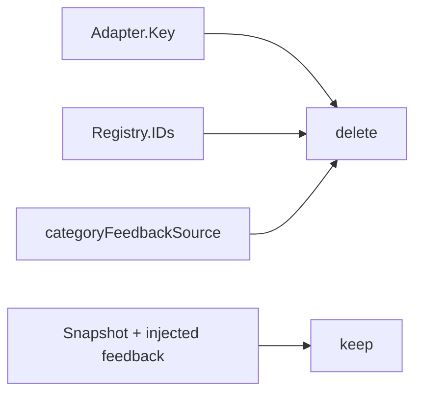

## Scenario

These paths are internal backend work with no single screen. Three workflows start them. When you open the Integrations screen, the browser requests the integrations list; the API asks the registry, meaning the in-memory list of connected bank providers, for a snapshot of each provider's status and returns a JSON list of provider IDs and connection state. A separate sync worker calls the ingest orchestrator with an adapter, meaning the provider-specific plugin, for each bank. The adapter fetches a provider-native snapshot, the raw bank response that only that adapter interprets, and the orchestrator translates it into checkpoints, meaning saved sync positions, and bank rows; the provider key is written directly at each checkpoint rather than read from the adapter. A third background worker categorizes uncategorized transactions and injects a journal-backed feedback source, meaning the store of matured user overrides used as training labels, so user corrections train the learner. Production always injects that source. Each of the three dead members is a leftover verb on these frameworks: `Adapter.Key` declares a provider key nobody reads, `Registry.IDs` duplicates the snapshot call, and `categoryFeedbackSource` is a nil fallback, meaning a branch taken only when no source is injected, inherited from the old version. Nothing a user does reaches them.

## Executive summary

Three small dead members remain in live frameworks. `ingest.Adapter.Key` is declared and documented as the provider key, but the orchestrator never reads it; its implementation returns the same literal written directly at every checkpoint, and a test fake carries an unread `key` field. `integrations.Registry.IDs` duplicates `Snapshot()` and is called only by two assertions in its own test. `categoryFeedbackSource` is a superseded v1 nil fallback: production always injects the journal source, so it is reachable only from direct unit tests, and the docs already record the supersession. Each is maintenance surface with no live caller. The recommended action is to delete all three and their fixtures and assertions.

## Recommended action

Delete `Adapter.Key` with its implementations and fixture assignments, delete `Registry.IDs` with its two assertions, and require a feedback source at construction or in `Classify` so `categoryFeedbackSource` and its stale comment can go. Keep the `var _ ingest.Adapter` assertion and the working snapshot and feedback paths.

## Before and after

| Before | After |
| --- | --- |
| Three dead members: `Adapter.Key`, `Registry.IDs`, and the `categoryFeedbackSource` nil fallback, plus their fixture and assertion support. | None of the three; the live snapshot and injected feedback paths are unchanged. |

## Expected improvement

Structural. The API surface shrinks, and there are no unread fixture fields or superseded fallback paths to maintain. No benchmarks were run, so no speed or size improvement is claimed.

## Alternatives considered

- Leave as is. Rejected because dead members invite use and ongoing maintenance.
- Keep `Adapter.Key` for a possible future multi-provider registry. Rejected because there is no current caller and the literal is already written directly at each checkpoint.

## Downside of rejecting

The dead verbs and superseded fallback stay, so future readers may wire into them, and the nil fallback keeps a v1 path alive that the docs already mark as superseded.

## Verification

A grep should confirm zero call sites for `Key()` and production-zero for `IDs()`, then run the ingest, SimpleFIN, integrations, and categorization package tests. These are proposed acceptance checks. A future multi-provider registry might want `Key`, but there is no current caller.

References: `backend/internal/ingest/ingest.go:38`; `backend/internal/simplefin/adapter.go:19-23,146`; `backend/internal/integrations/provider.go:61-71`; `backend/internal/api/integrations/routes.go:40,48`; `backend/internal/categorization/ml_classifier.go:10-19,78-81`; `docs/categories.md:81-83`.
