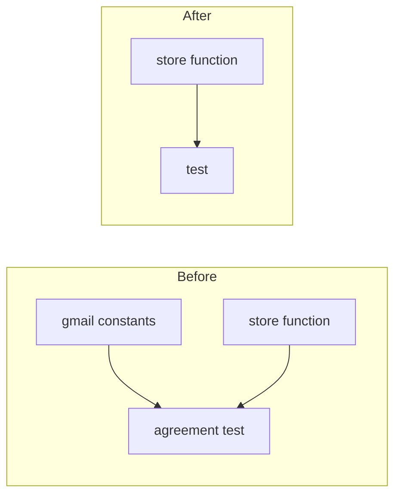

## Executive summary

The producer name and version string recorded on receipts exist in two places: as gmail constants and as the return value of `store.ReceiptProvenanceForEmail()`. Production writes use the store function; the gmail constants are referenced only by a test asserting the two agree. A version bump can therefore be half-applied with no signal. The recommended action is to delete the gmail constants and have the test compare against the store function.

## Recommended action

Delete the two gmail constants and have the test compare against `store.ReceiptProvenanceForEmail()`, leaving one source of truth for the versioned value.

## Before and after

| Before | After |
| --- | --- |
| Two sources for the version string: gmail constants and the store function, with a test checking they agree. | One source: the store function; the test compares against it directly. |

## Expected improvement

Structural. A single source means a version bump cannot be half-applied. No benchmarks were run, so no speed or size improvement is claimed.

## Alternatives considered

- Keep the constants and the agreement test. Rejected because a dual source still allows a half-applied bump, with a test as the only guard.
- Leave as is. Rejected for the same reason; the duplicate has no production use.

## Downside of rejecting

A version bump can be applied to one source only with no failure signal, producing inconsistent provenance on receipts.

## Verification

A `ReceiptProducer` search should show only the definition and one test line, then run `go test ./internal/gmail/... ./internal/store/...` from `backend/`. These are proposed acceptance checks.

References: `backend/internal/gmail/receipts.go:30-37,391,530`; `backend/internal/store/types.go:637-643`; `backend/internal/gmail/receipts_test.go:231-232`.
