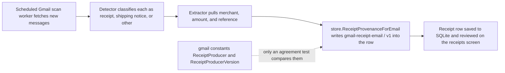
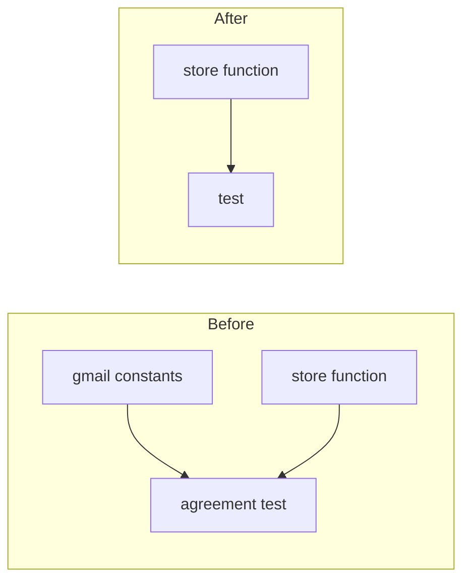

## Scenario

Gmail receipt discovery is a scheduled background scan, not a screen the user clicks. The scan worker in `backend/internal/gmail/receipts.go` fetches new Gmail messages, runs a detector that classifies each message as a receipt, a shipping notice, or another verdict, runs an extractor that pulls out the merchant, amount, and reference, and saves a receipt row before the user reviews receipts on the receipts screen. No request body crosses a boundary here; the worker writes the row straight into SQLite.

Each receipt row carries provenance, meaning a producer name and a version string recording which detector-and-extractor combination produced it. The producer name is `gmail-receipt-email` and the version is `v1`. The version matters for two reasons. Changing the detector or the extractor must invalidate cached review standing, meaning a previously reviewed receipt must be reviewed again rather than silently kept. The later receipt-matching step also consumes the same provenance identity to claim a receipt against a transaction. `store.ReceiptProvenanceForEmail()` in `backend/internal/store/types.go:637-643` is the store helper that writes the value at every save site, including the two calls in `receipts.go:391,530`.

The duplicate is a second declaration of the same producer name and version as the constants `ReceiptProducer` and `ReceiptProducerVersion` in `backend/internal/gmail/receipts.go:30-37`. Production writes use the store helper; the Gmail constants were referenced only by the assertion in `backend/internal/gmail/receipts_test.go:231-232` that the two sources agreed. A version bump applied to the store helper but not to the Gmail constants, or the other way round, saves two different provenance values on receipts with no failing signal. The test is the only thing that would catch the mismatch, so it is a guard rather than a single source of truth.

## Executive summary

The producer name and version string recorded on receipts exist in two places: as Gmail constants and as the return value of `store.ReceiptProvenanceForEmail()`. Production writes use the store function; the Gmail constants are referenced only by a test asserting the two agree. A version bump can therefore be half-applied with no signal. The recommended action is to delete the Gmail constants and have the test compare against the store function.

## Recommended action

Delete the two Gmail constants and have the test compare against `store.ReceiptProvenanceForEmail()`, leaving one source of truth for the versioned value.

## Before and after

| Before | After |
| --- | --- |
| Two sources for the version string: gmail constants and the store function, with a test checking they agree. | One source: the store function; the test compares against it directly. |

## Expected improvement

Structural. A single source means a version bump cannot be half-applied. No benchmarks were run, so no speed or size improvement is claimed.

## Alternatives considered

- Keep the constants and the agreement test. Rejected because a dual source still allows a half-applied bump, with a test as the only guard.
- Leave as is. Rejected for the same reason; the duplicate has no production use.

## Downside of rejecting

A version bump can be applied to one source only with no failure signal, producing inconsistent provenance on receipts.

## Verification

A `ReceiptProducer` search should show only the definition and one test line, then run `go test ./internal/gmail/... ./internal/store/...` from `backend/`. These are proposed acceptance checks.

References: `backend/internal/gmail/receipts.go:30-37,391,530`; `backend/internal/store/types.go:637-643`; `backend/internal/gmail/receipts_test.go:231-232`.
