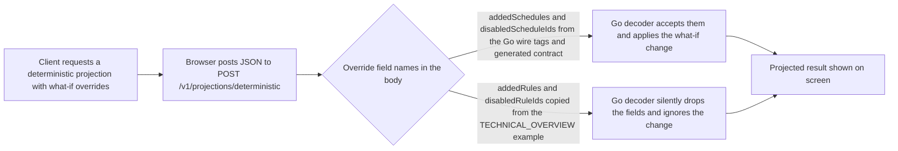
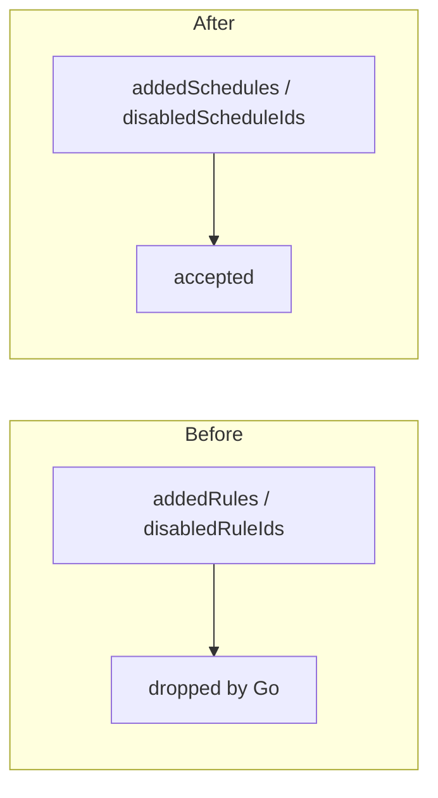

## Scenario

When a client requests a deterministic projection, meaning a forecast whose result is fixed by its inputs, it can supply what-if overrides to see how added or disabled schedules would change the result. These are hypothetical changes that leave the saved financial model untouched. The browser posts the request to `POST /v1/projections/deterministic` as a JSON body carrying an optional `model`, an `overrides` object, and `settings`; the API decodes the body and returns the projected result for the screen. The reference example for this endpoint is the deterministic projection section of `TECHNICAL_OVERVIEW.md:142-159`.

The names a JSON field must use to be accepted are called wire tags, declared on the Go struct `ModelOverrides` in `backend/internal/types/model.go:350,353`. Go's decoder silently ignores body fields whose names do not match a wire tag, so a field with the wrong name has no effect and raises no error. The what-if allow-list in `backend/internal/domain/evaluation_whatif.go:13-16` names the same set of keys. The generated TypeScript contract, meaning the client types produced from the API description so browser and server agree, lives in `frontend/src/api/generated/model/modelOverrides.ts:15,21`. The frontend client generator produces that file from `frontend/openapi.snapshot.json`, the API description exported from the running API. The generated contract uses the same two schedule keys as the Go wire tags, `addedSchedules` and `disabledScheduleIds`.

The reference example instead documented `overrides.addedRules` and `overrides.disabledRuleIds`. A client copying the example sends JSON fields that the Go decoder drops, so the projection looks correct while ignoring the intended what-if change. `TECHNICAL_OVERVIEW.md` section 2 already owns the request shape and defers to the OpenAPI snapshot as the authority, so the example is the only thing wrong: the Go wire tags, the allow-list, the generated contract, and the API all already use `addedSchedules` and `disabledScheduleIds`.

## Executive summary

The deterministic projection example documents `overrides.addedRules` and `overrides.disabledRuleIds`, but the Go wire tags, the JSON field names the API actually accepts, are `addedSchedules` and `disabledScheduleIds`. A client copying the example sends fields Go silently drops, so the override does nothing while looking canonical. `TECHNICAL_OVERVIEW.md` section 2 already owns this shape and defers to the OpenAPI snapshot, meaning the spec-derived contract is the authority. The recommended action is to replace both keys in the example.

## Recommended action

Replace both keys in the example with `addedSchedules` and `disabledScheduleIds`. Keep section 2 as the sole owner of the shape; do not duplicate the schema elsewhere.

## Before and after

| Before | After |
| --- | --- |
| Example uses `addedRules` and `disabledRuleIds`. | Example uses `addedSchedules` and `disabledScheduleIds`, matching the wire tags and generated contract. |

## Expected improvement

Structural and documentation-only. The example matches the contract, so copied requests actually apply their overrides. No runtime behavior changes, and no benchmarks were run, so no speed or size improvement is claimed.

## Alternatives considered

- Change the Go wire tags to match the example. Rejected because section 2 defers to the OpenAPI snapshot, the generated contract already uses the correct keys, and changing the API would be breaking.
- Leave as is. Rejected because copied overrides are silently ignored.

## Downside of rejecting

Readers who copy the example send overrides that are silently ignored, so their projections do not reflect the intended changes and no error is raised.

## Verification

Read `ModelOverrides` and the generated contract; both must agree on the two correct keys. These are proposed acceptance checks. Huma's problem-JSON behavior for unknown fields was inferred, not exercised by a request.

References: `TECHNICAL_OVERVIEW.md:150,153`; `backend/internal/types/model.go:350,353`; `backend/internal/domain/evaluation_whatif.go:14-15`; `frontend/src/api/generated/model/modelOverrides.ts:15,21`.
