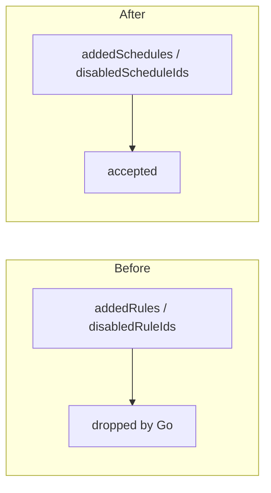

## Scenario

When you open a deterministic projection, meaning a forecast whose result is fixed by its inputs, you can supply what-if overrides to see how added or disabled schedules would change it. These are hypothetical changes that leave the saved financial model untouched. The browser sends them in a JSON request body to the deterministic projection endpoint; the API decodes that body into override fields and returns the projected result for the screen. The names a JSON field must use to be accepted are called wire tags, and Go's decoder silently ignores fields whose names do not match a tag, so a misnamed override has no effect and raises no error. The reference example documented the two schedule overrides as `addedRules` and `disabledRuleIds`, but the wire tags are `addedSchedules` and `disabledScheduleIds`, and the generated TypeScript contract, meaning the client types produced from the API spec so browser and server agree, uses those same two names. A reader copying the example therefore sends fields the API drops, and the projection looks correct while ignoring the intended change. The example is the only thing wrong here; the API contract already uses the right keys.

## Executive summary

The deterministic projection example documents `overrides.addedRules` and `overrides.disabledRuleIds`, but the Go wire tags, the JSON field names the API actually accepts, are `addedSchedules` and `disabledScheduleIds`. A client copying the example sends fields Go silently drops, so the override does nothing while looking canonical. `TECHNICAL_OVERVIEW.md` section 2 already owns this shape and defers to the OpenAPI snapshot, meaning the spec-derived contract is the authority. The recommended action is to replace both keys in the example.

## Recommended action

Replace both keys in the example with `addedSchedules` and `disabledScheduleIds`. Keep section 2 as the sole owner of the shape; do not duplicate the schema elsewhere.

## Before and after

| Before | After |
| --- | --- |
| Example uses `addedRules` and `disabledRuleIds`. | Example uses `addedSchedules` and `disabledScheduleIds`, matching the wire tags and generated contract. |

## Expected improvement

Structural and documentation-only. The example matches the contract, so copied requests actually apply their overrides. No runtime behavior changes, and no benchmarks were run, so no speed or size improvement is claimed.

## Alternatives considered

- Change the Go wire tags to match the example. Rejected because section 2 defers to the OpenAPI snapshot, the generated contract already uses the correct keys, and changing the API would be breaking.
- Leave as is. Rejected because copied overrides are silently ignored.

## Downside of rejecting

Readers who copy the example send overrides that are silently ignored, so their projections do not reflect the intended changes and no error is raised.

## Verification

Read `ModelOverrides` and the generated contract; both must agree on the two correct keys. These are proposed acceptance checks. Huma's problem-JSON behavior for unknown fields was inferred, not exercised by a request.

References: `TECHNICAL_OVERVIEW.md:150,153`; `backend/internal/types/model.go:350,353`; `backend/internal/domain/evaluation_whatif.go:14-15`; `frontend/src/api/generated/model/modelOverrides.ts:15,21`.
