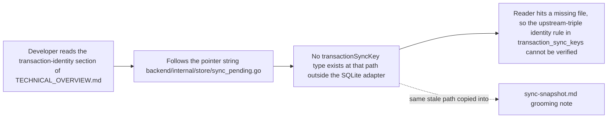
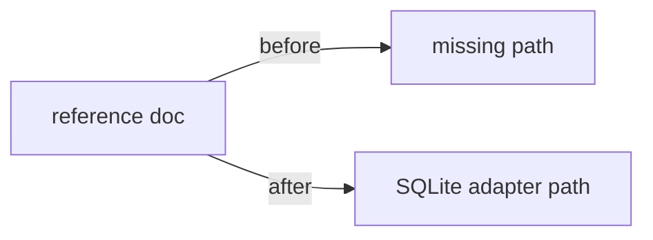

## Scenario

This is a documentation lookup, not a user screen. A developer reading the transaction-identity section of `TECHNICAL_OVERVIEW.md:323-328` wants to see how a bank transaction keeps the identity it had at the provider when it is saved locally. The section points the developer to a Go helper named `transactionSyncKey` by file path, so the format crossing here is only a path string in a document leading to source code. The helper lives in `backend/internal/store/adapters/sqlite/sync_pending.go:12,17,34`, inside the SQLite adapter, the package that talks to the application's local database file. The helper stores the exact upstream triple, meaning the provider name plus the provider's account ID and transaction ID, in the `transaction_sync_keys` table, separate from the canonical UUID, the app's own stable ID assigned to the row.

The pointer named `backend/internal/store/sync_pending.go`, a path outside the SQLite adapter where no `transactionSyncKey` type exists, so a reader following the pointer lands on a missing file. The same stale path was copied into a grooming note, a planning note for later cleanup work under `tasks/to-groom/long-chaining/sync-snapshot.md` that inventories the SimpleFIN snapshot call chain. The pointer exists to make the identity rule verifiable in code; a stale path defeats that purpose.

## Executive summary

The transaction-identity section points at `backend/internal/store/sync_pending.go`, which does not exist; the type lives under the SQLite adapter. The same stale path is propagating into a grooming note. A reader following the pointer hits a missing file. The recommended action is to correct the pointer in both places.

## Recommended action

Correct the pointer to `backend/internal/store/adapters/sqlite/sync_pending.go` in the transaction-identity section and in the grooming note.

## Before and after

| Before | After |
| --- | --- |
| Pointer to the non-existent `backend/internal/store/sync_pending.go`. | Pointer to `backend/internal/store/adapters/sqlite/sync_pending.go`, where the type actually lives. |

## Expected improvement

Structural and documentation-only. The reference resolves to a real file, so readers can follow it. No runtime behavior changes, and no benchmarks were run, so no speed or size improvement is claimed.

## Alternatives considered

- Leave as is. Rejected because readers following the pointer hit a missing file and the error is spreading to new notes.
- Move the source file to the documented path. Rejected because that changes the runtime layout to fix a documentation error.

## Downside of rejecting

The pointer stays broken and continues propagating into new notes, wasting reader time.

## Verification

Run an existence check over backticked repository paths in the five reference documents. This was the only stale path; `/app/...` paths and bare filenames are intentional. This is a proposed acceptance check.

References: `TECHNICAL_OVERVIEW.md:328`; `tasks/to-groom/long-chaining/sync-snapshot.md`; actual file at `backend/internal/store/adapters/sqlite/sync_pending.go:12,17,34`.
