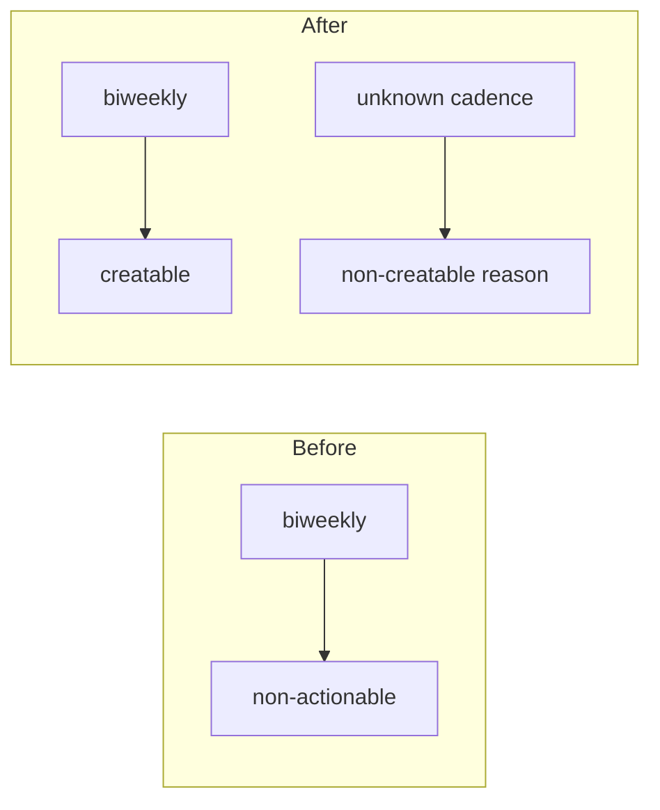

## Scenario

When you open an analysis finding for a recurring payment pattern and ask to preview a schedule from it, the API describes the schedule it would create and whether it is creatable before you accept it. A cadence, meaning how often the pattern repeats, is mapped to a recurrence rule, a schedule frequency made of a unit and an interval such as every two weeks. The preview crosses the boundary as JSON carrying the proposed schedule, a creatable flag, and a reason when creation is not allowed. The mapping already turns daily, weekly, biweekly, monthly, quarterly, and annual patterns into creatable rules, and only an unknown cadence gets the non-creatable reason; a regression asserts that a biweekly preview is creatable. The analyses guide instead told readers that biweekly patterns were non-actionable because no biweekly schedule existed. The guided-model-setup guide lists a similar gap but pins itself to a specific older Komodo revision, so its statement describes that snapshot rather than current source. The docs matter here because readers decide whether to ask for a feature based on them; the runtime already supports the case.

## Executive summary

The analyses guide says biweekly patterns stay non-actionable because no biweekly schedule exists yet. In fact `recurringCadenceRecurrence` maps biweekly to a creatable `Recurrence{Week, Interval: 2}` and daily to a creatable daily rule; only unknown cadences receive the non-creatable reason. A regression already asserts that a biweekly preview is creatable. The recommended action is to delete the false limitation and state the real rule, while framing the guided-model-setup note if its pinned snapshot is intentional.

## Recommended action

Delete the limitation in the analyses guide and state that daily, weekly, biweekly, monthly, quarterly, and annual patterns are creatable while only unknown cadences get the reason. The guided-model-setup guide lists the same gap but pins itself to a Komodo revision, so frame it as a snapshot rather than deleting it if that pin is intentional.

## Before and after

| Before | After |
| --- | --- |
| Guide says biweekly patterns are non-actionable for lack of a biweekly schedule. | Guide says all known cadences are creatable and only unknown cadences get the non-creatable reason; the pinned guide is framed as a historical snapshot. |

## Expected improvement

Structural and documentation-only. The guide matches the recurrence mapping and the regression test, so readers no longer act on a false limitation. No runtime behavior changes, and no benchmarks were run, so no speed or size improvement is claimed.

## Alternatives considered

- Add a biweekly schedule. Rejected because the behavior already supports biweekly; no code change is needed.
- Delete both mentions outright. Rejected for guided-model-setup because it is pinned to a Komodo revision and may be an intentional snapshot.

## Downside of rejecting

The guide keeps telling readers biweekly is non-actionable when it is creatable, contradicting both the recurrence mapping and the regression test.

## Verification

Run the biweekly preview test and grep `docs/` and `frontend/src` for `no biweekly` after the edit. These are proposed acceptance checks.

References: `docs/analyses.md:227-230`; `backend/internal/analysis/pattern_to_new_rule.go:40-43,44-63,255`; `backend/internal/analysis/pattern_to_new_rule_test.go:108-128`; `frontend/src/domain/recurringPatterns.test.ts:96`; `docs/guided-model-setup.md:24,28-30`.
