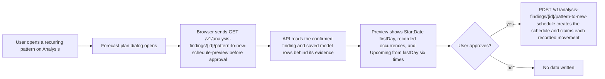
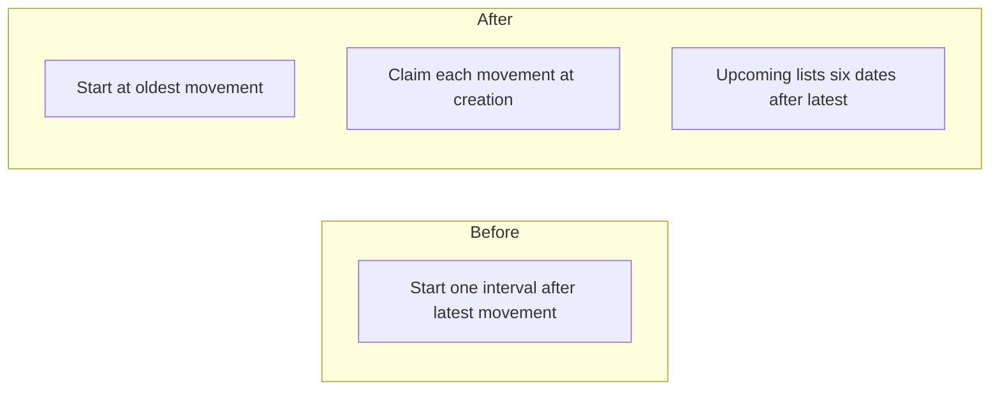

## Scenario

On the Analysis screen, the system lists recurring patterns it found in a person's bank movements, such as a monthly salary or a biweekly subscription. When the user opens one pattern to turn it into a forecast rule, a "Forecast plan" dialog appears. The browser then sends a `GET /v1/analysis-findings/{id}/pattern-to-new-schedule-preview` request, carrying the analysis finding's ID in the URL path, as soon as the dialog opens and before the user approves anything. The API reads the confirmed finding and the saved model rows behind its evidence, then returns a preview as a JSON object. JSON is a plain-text format for structured data that the browser reads directly. The preview object carries the proposed rule (its name, amount, and recurrence, where recurrence is the repeating rule such as every two weeks), the start date, each recorded occurrence (one instance of the recurring movement tied to its bank transaction), and an `Upcoming` list of future dates.

The preview request exists so the user can review the proposal without writing any data. Approval is a separate, later request, `POST /v1/analysis-findings/{id}/pattern-to-new-schedule`, that creates the schedule. A "recorded movement" is one bank transaction already present in the model. To "claim" a recorded movement means to mark that transaction as already represented by a schedule occurrence, so approving the schedule does not add the same bank fact a second time as a forecast movement.

The analyses guide, the Markdown file `docs/analyses.md` that a developer or reviewer reads to understand this flow, currently says the start is moved forward by one full interval past the latest movement to prevent duplication. The code does not advance the start. The preview builder sets the proposed rule's `StartDate` to `firstDay`, the oldest recorded movement's day, and builds `Upcoming` by advancing from `lastDay`, the latest recorded movement's day, six times. At creation the API claims every recorded movement onto its occurrence. Claim-at-creation is what prevents duplication, not the start date.

## Executive summary

The analyses guide `docs/analyses.md` explains how a schedule generated from a recurring pattern starts and claims recorded bank movements so approving the schedule never duplicates those facts. The guide currently says the schedule starts one full interval after the latest movement for that purpose, but the code sets the start date to the oldest movement while the `Upcoming` list advances from the latest movement. The source comment records the real mechanism: creation claims each recorded movement onto its occurrence, and `Upcoming` then lists six dates after the latest movement. The single fix is to correct the sentence in the guide.

## Recommended action

Rewrite the sentence in the analyses guide to match the existing code. No code change is needed. Say that the schedule starts on the oldest movement, that each recorded movement is claimed onto its occurrence at creation, and that `Upcoming` lists six dates after the latest movement. Drop the claim that the start is advanced by one interval to prevent duplication; claim-at-creation is what prevents duplication.

## Before and after

| | Description in the guide |
|---|---|
| Before | Schedule starts one full interval after the latest recorded movement so approval never duplicates bank facts |
| After | Schedule starts at the oldest movement, each recorded movement is claimed at creation, and "Upcoming" lists six dates after the latest |

## Expected improvement

The guide stops describing behavior the code does not have, so a reader approving a generated schedule will expect the dates the system actually produces. This is a documentation-accuracy improvement rather than a measured speed or size gain; no benchmarks were run for this finding.

## Alternatives considered

- Leave as is. This keeps a description that contradicts the code and misleads readers about where the schedule begins. Rejected.
- Change the code to match the guide. That would alter how schedules start and how movements are claimed, a behavior change far beyond a documentation correction. Rejected.

## Downside of rejecting

The guide keeps stating that the start advances past the latest movement. A reader relying on that will misjudge which dates the schedule covers and will look for duplication protection in the start date, when the protection actually comes from claim-at-creation.

## Verification

Check that the proposed rule's `StartDate` is assigned `firstDay`, the oldest recorded movement's day, rather than an advanced `lastDay`, and that `CreatePatternSchedule` claims each recorded movement onto its occurrence. These are proposed acceptance checks against the code and its test, not recorded results.

References: `docs/analyses.md:243-245`; `backend/internal/analysis/pattern_to_new_rule.go:183-187,227-228,264,269-274`; `backend/internal/analysis/pattern_to_new_rule_test.go:122`.
