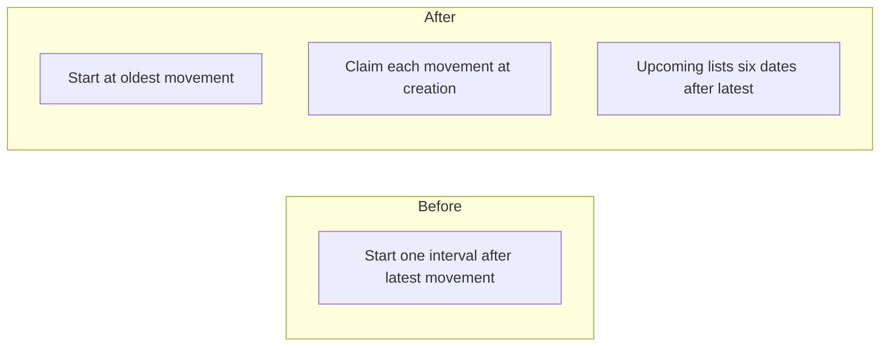

## Executive summary

The analyses guide explains how a generated schedule starts and claims recorded bank movements so that approving the schedule never duplicates those facts. It currently says the schedule starts one full interval after the latest recorded movement for that purpose. The code does not do that. It sets `StartDate` to `firstDay`, the oldest movement, while the `Upcoming` list advances from `lastDay`. The source comment records the real mechanism: creation claims each recorded movement onto its occurrence, and `Upcoming` then lists six dates after the latest movement. The single fix is to correct the sentence in the guide.

## Recommended action

Rewrite the sentence in the analyses guide to match the existing code. No code change is needed. Say that the schedule starts on the oldest movement, that each recorded movement is claimed onto its occurrence at creation, and that `Upcoming` lists six dates after the latest movement. Drop the claim that the start is advanced by one interval to prevent duplication; claim-at-creation is what prevents duplication.

## Before and after

| | Description in the guide |
|---|---|
| Before | Schedule starts one full interval after the latest recorded movement so approval never duplicates bank facts |
| After | Schedule starts at the oldest movement, each recorded movement is claimed at creation, and `Upcoming` lists six dates after the latest |

## Expected improvement

The guide stops describing behavior the code does not have, so a reader approving a generated schedule will expect the dates the system actually produces. This is a documentation-accuracy improvement rather than a measured speed or size gain; no benchmarks were run for this finding.

## Alternatives considered

- Leave as is. This keeps a description that contradicts the code and misleads readers about where the schedule begins. Rejected.
- Change the code to match the guide. This would alter how schedules start and how movements are claimed, a behavior change far beyond a documentation correction. Rejected.

## Downside of rejecting

The guide keeps stating that the start advances past the latest movement. A reader relying on that will misjudge which dates the schedule covers and will look for duplication protection in the start date, when it actually comes from claim-at-creation.

## Verification

Check that `StartDate` binds `firstDay` rather than an advanced `lastDay`, and that the claim path runs in `CreatePatternSchedule`. These are proposed acceptance checks against the code and its test, not recorded results.

References: `docs/analyses.md:243-245`; `backend/internal/analysis/pattern_to_new_rule.go:183-187,227-228,264,269-274`; `backend/internal/analysis/pattern_to_new_rule_test.go:122`.
