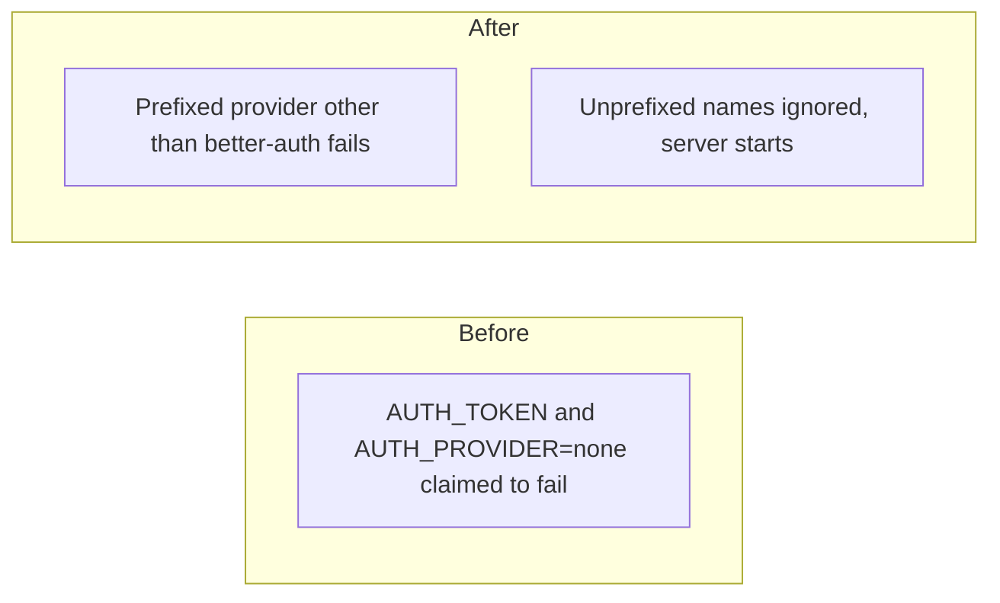

## Executive summary

`TESTING.md` says that setting `AUTH_TOKEN` and `AUTH_PROVIDER=none` makes server startup fail. Neither name drives startup. `AUTH_TOKEN` appears nowhere in application code, and the real variable is `NET_WORTH_ESTIMATOR_AUTH_PROVIDER`, where only a value other than `better-auth` causes failure. Setting the two names as written is ignored and the server starts normally. The claim is false and invites wrong deployment configuration, so it should be removed.

## Recommended action

Drop the clause from `TESTING.md`. The preceding sentence already states the bearer rule, so no replacement text is required. If the condition is worth keeping, state the real one, a `NET_WORTH_ESTIMATOR_AUTH_PROVIDER` value other than `better-auth`, and point to the auth guide as the owner. No code change is needed.

## Before and after

| | Statement in the test matrix |
|---|---|
| Before | `AUTH_TOKEN` and `AUTH_PROVIDER=none` cause server startup to fail |
| After | Remove the clause; if kept, the real condition is a `NET_WORTH_ESTIMATOR_AUTH_PROVIDER` value other than `better-auth`, owned by the auth guide |

## Expected improvement

The test matrix no longer tells operators to set variables that the server ignores, so deployment configuration guidance stops pointing at names that do nothing. This is a documentation-accuracy improvement rather than a measured speed or size gain; no benchmarks were run for this finding.

## Alternatives considered

- Leave as is. Readers may configure deployments with names that have no effect, and the false failure claim persists. Rejected.
- Add support for the unprefixed names in code. That would create new configuration behavior to satisfy a documentation error, which is the wrong direction for this finding. Rejected.

## Downside of rejecting

The false claim remains in the matrix, so an operator following it sets variables that are ignored and believes startup will fail when it will not. The real condition, a non-`better-auth` value on the prefixed variable, stays undocumented at this site.

## Verification

Grep for `AUTH_TOKEN` and `NET_WORTH_ESTIMATOR_AUTH_PROVIDER` across source and docs. Confirm the startup-fail path reads only the prefixed variable. These are proposed acceptance checks, not recorded results.

References: `TESTING.md:338`; `backend/internal/identity/config.go:52,64-69`; `backend/internal/identity/config_test.go:21-23`.
