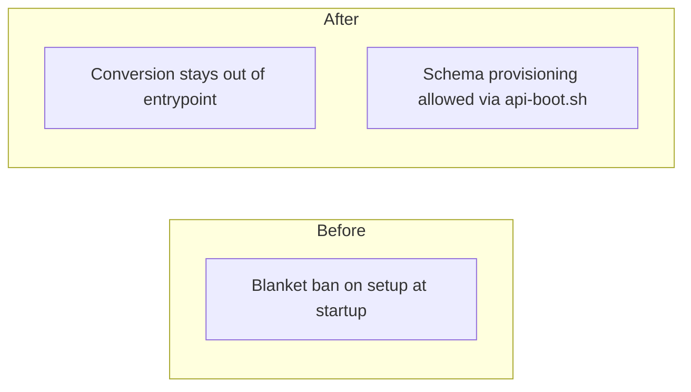

## Executive summary

The shared-database guide says not to put setup in the server entrypoint or an automatic startup dependency. Here setup means database schema provisioning, and the entrypoint is the script that starts the server. In practice `deploy/api-boot.sh` runs `setupdb` on every boot for diskless hosts, which are hosts without a persistent data disk, and the migration SOP separates that fresh-schema provisioning from the conversion hook that upgrades existing data. A reader following the blanket ban would remove the wrapper that makes the Northflank boot work. The fix is to scope the sentence to conversion only.

## Recommended action

Narrow the sentence in the shared-database guide. State that version upgrades and data conversion stay out of the entrypoint, while fresh or current schema provisioning may run through `api-boot.sh` as the migration SOP describes. No code change is needed.

## Before and after

| | Guidance in the guide |
|---|---|
| Before | Do not put setup in the server entrypoint or an automatic startup dependency |
| After | Keep version upgrades and data conversion out of the entrypoint; fresh or current schema provisioning may run through `api-boot.sh` as the SOP describes |

## Expected improvement

The guide matches the documented boot path, so a reader will not strip out `setupdb` from the startup wrapper. This is a documentation-accuracy improvement rather than a measured speed or size gain; no benchmarks were run for this finding.

## Alternatives considered

- Leave as is. The blanket ban conflicts with the boot wrapper and the SOP, and a reader may break the Northflank boot by following it. Rejected.
- Change `api-boot.sh` to stop provisioning at boot. That would break diskless hosts that rely on it and is a behavior change, not a documentation fix. Rejected.

## Downside of rejecting

The blanket prohibition stays, so operators may remove the `setupdb` call from the boot wrapper and leave diskless hosts without the schema they need to start.

## Verification

Re-read the revised sentence against `api-boot.sh` and the migration SOP to confirm no blanket prohibition remains. This is a proposed acceptance check, not a recorded result.

References: `docs/shared-database.md:78-84`; `deploy/api-boot.sh:8-9`; `deploy/README.md:20`; `deploy/MIGRATIONS.md:31-33`.
