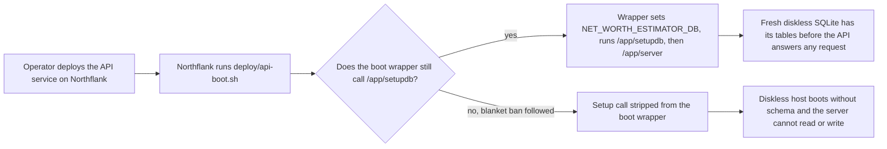
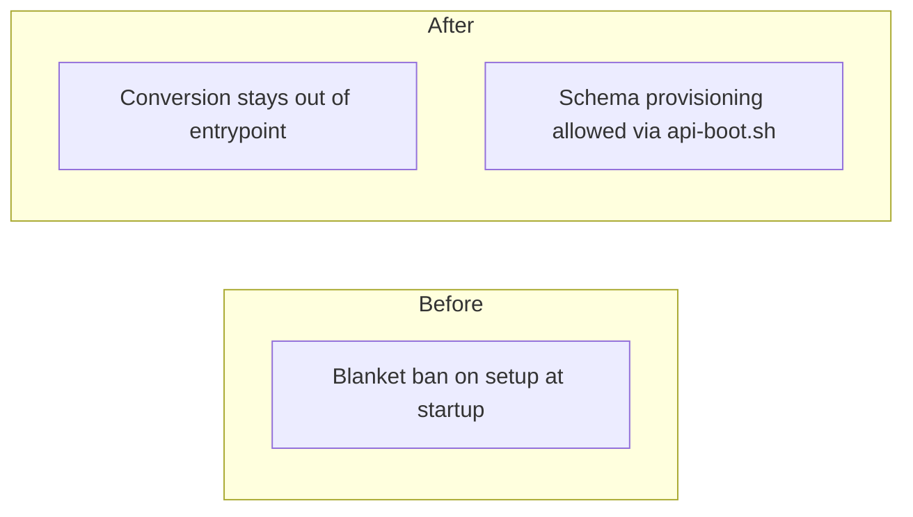

## Scenario

Startup on Northflank is not a user screen. Northflank starts the API service by running the boot script `deploy/api-boot.sh`, the small wrapper that prepares the process before the server itself starts. That wrapper sets the required `NET_WORTH_ESTIMATOR_DB` variable and runs the schema setup tool `/app/setupdb` before handing control to `/app/server`. On a diskless host, a machine without a persistent data disk, the SQLite database file is fresh on every boot, so its tables must be created again before the server can read or write them. The work happens at boot, before the API answers any request, so a reader never sees a failure message from it. "Setup" here means provisioning the database schema, the set of tables the app needs, not upgrading an existing database. The migration SOP `deploy/MIGRATIONS.md` keeps those jobs separate: fresh or current schema setup may run at boot, while version upgrades and data conversion of existing data run as a one-time operator step. The shared-database guide `docs/shared-database.md` is what an operator reads to decide where setup belongs.

The shared-database guide currently says not to put setup in the server entrypoint or an automatic startup dependency. Read as a blanket ban, that sentence tells the operator to remove the `api-boot.sh` wrapper that makes the diskless boot work. The fix is to scope the sentence to conversion.

## Executive summary

The shared-database guide `docs/shared-database.md` says not to put setup in the server entrypoint or an automatic startup dependency. Setup here means database schema provisioning, and the entrypoint is the script that starts the server. In practice the boot wrapper `deploy/api-boot.sh` runs the schema setup tool on every boot for diskless hosts, and the migration SOP `deploy/MIGRATIONS.md` separates that fresh-schema provisioning from the conversion hook that upgrades existing data. A reader following the blanket ban would remove the wrapper that makes the Northflank boot work. The fix is to scope the sentence to conversion only.

## Recommended action

Narrow the sentence in the shared-database guide. State that version upgrades and data conversion stay out of the entrypoint, while fresh or current schema provisioning may run through the boot wrapper as the migration SOP describes. No code change is needed.

## Before and after

| | Guidance in the guide |
|---|---|
| Before | Do not put setup in the server entrypoint or an automatic startup dependency |
| After | Keep version upgrades and data conversion out of the entrypoint; fresh or current schema provisioning may run through the boot wrapper as the SOP describes |

## Expected improvement

The guide matches the documented boot path, so a reader will not strip out the schema setup call from the startup wrapper. This is a documentation-accuracy improvement rather than a measured speed or size gain; no benchmarks were run for this finding.

## Alternatives considered

- Leave as is. The blanket ban conflicts with the boot wrapper and the SOP, and a reader may break the Northflank boot by following it. Rejected.
- Change the boot wrapper to stop provisioning at boot. That would break diskless hosts that rely on it and is a behavior change, not a documentation fix. Rejected.

## Downside of rejecting

The blanket prohibition stays, so operators may remove the schema setup call from the boot wrapper and leave diskless hosts without the schema they need to start.

## Verification

Re-read the revised sentence against `api-boot.sh` and the migration SOP to confirm no blanket prohibition remains. This is a proposed acceptance check, not a recorded result.

References: `docs/shared-database.md:78-84`; `deploy/api-boot.sh:8-9`; `deploy/README.md:20`; `deploy/MIGRATIONS.md:31-33`.
