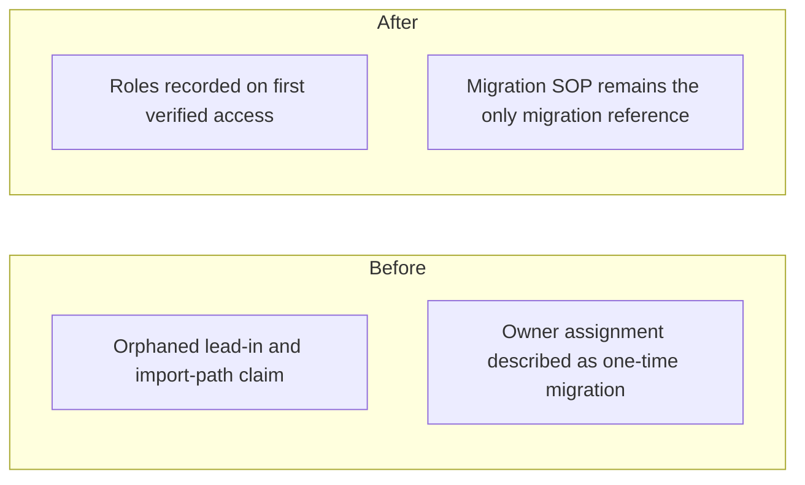

## Executive summary

The authorization guide ends a sentence with a colon that introduces no list, then says no import path remains and that owner assignment is a one-time data migration rather than signup role selection. The code does neither: it records `member` or `viewer` on first verified access, and the migration SOP contains no owner-assignment migration. A nearby line also claims a migration preserves existing behavior. The fix is to delete the stale lead-in and import-path claim and bring the owner-assignment text in line with the current first-access rule.

## Recommended action

Edit the authorization guide. Delete the dangling lead-in and the import-path sentence. Replace the owner-assignment sentence with the current first-access rule and a pointer to the Casbin section, where Casbin is the authorization library. Reword the preservation line into a durable statement that roles stay beside the data. No code change is needed.

## Before and after

| | Content in the guide |
|---|---|
| Before | Colon with no list, claim that no import path remains, owner assignment as a one-time data migration, and a line saying a migration preserves behavior |
| After | No dangling lead-in or import-path claim, first-access role rule pointing to the Casbin section, and a durable statement that roles stay beside the data |

## Expected improvement

The guide stops implying a data migration that does not exist, so readers will not look for an owner-assignment step in the SOP. This is a documentation-accuracy improvement rather than a measured speed or size gain; no benchmarks were run for this finding.

## Alternatives considered

- Leave as is. Readers will expect a one-time owner-assignment migration that the SOP does not contain. Rejected.
- Add an owner-assignment migration to the SOP. That would create work the code does not need, since roles are already recorded on first verified access. Rejected.

## Downside of rejecting

The orphaned checklist and the owner-assignment-as-migration claim remain, so operators may expect a migration step that is absent from the SOP and misread how roles are assigned.

## Verification

Confirm a migration grep in the guide returns only the SOP link, and that no code path performs one-time owner assignment. These are proposed acceptance checks, not recorded results.

References: `docs/authorization.md:51,137-148`; `backend/internal/authorization/client.go:119-135`; `backend/internal/authorization/setup.go:55-61`; `deploy/MIGRATIONS.md`.
