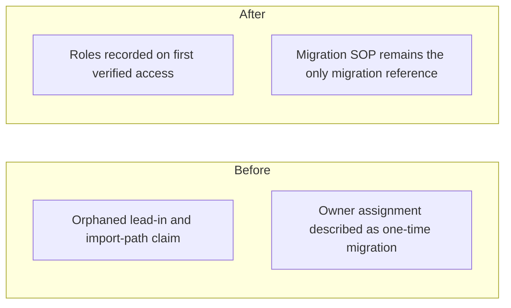

## Scenario

Signing in is the starting action. When a person first reaches the app with a verified identity from the authentication provider, the authorization client `Resolve` in `backend/internal/authorization/client.go` receives that identity, which is an issuer-and-subject pair, and records a role for it. A role is a label that decides which actions the user may take: `member` for a normal user, `viewer` for the provisioned guest selected by `NET_WORTH_ESTIMATOR_GUEST_SUBJECT`. This happens on first verified access, before the person can use their workspace, and writes the role into the policy database that Casbin, the authorization library, reads to decide what each user may do. An administrator can later change a role, including to `none`, and that explicit decision stays authoritative so a revocation is never undone by a later login. A role of `none` blocks automatic re-enrollment; a role of `viewer` is kept authoritative on every later login.

The authorization guide `docs/authorization.md` is the reference an operator or reviewer reads to understand how roles are assigned and what migrations exist. It currently suggests owner assignment is a one-time data migration, a separate operator task rather than something that happens at sign-in. The code does not perform such a migration, and the migration SOP `deploy/MIGRATIONS.md` contains no owner-assignment migration. The guide also ends a sentence with a colon that introduces no list, then says no import path remains and that a nearby migration preserves existing behavior. Those claims describe steps that do not exist in the current path.

## Executive summary

The authorization guide `docs/authorization.md` ends a sentence with a colon that introduces no list, then says no import path remains and that owner assignment is a one-time data migration rather than signup role selection. The code does neither: the authorization client records `member` or `viewer` on first verified access, and the migration SOP `deploy/MIGRATIONS.md` contains no owner-assignment migration. A nearby line also claims a migration preserves existing behavior. The fix is to delete the stale lead-in and import-path claim and bring the owner-assignment text in line with the current first-access rule.

## Recommended action

Edit the authorization guide. Delete the dangling lead-in and the import-path sentence. Replace the owner-assignment sentence with the current first-access rule and a pointer to the Casbin section, where Casbin is the authorization library. Reword the preservation line into a durable statement that roles stay beside the data. No code change is needed.

## Before and after

| | Content in the guide |
|---|---|
| Before | Colon with no list, claim that no import path remains, owner assignment as a one-time data migration, and a line saying a migration preserves behavior |
| After | No dangling lead-in or import-path claim, first-access role rule pointing to the Casbin section, and a durable statement that roles stay beside the data |

## Expected improvement

The guide stops implying a data migration that does not exist, so readers will not look for an owner-assignment step in the SOP. This is a documentation-accuracy improvement rather than a measured speed or size gain; no benchmarks were run for this finding.

## Alternatives considered

- Leave as is. Readers will expect a one-time owner-assignment migration that the SOP does not contain. Rejected.
- Add an owner-assignment migration to the SOP. That would create work the code does not need, since roles are already recorded on first verified access. Rejected.

## Downside of rejecting

The orphaned checklist and the owner-assignment-as-migration claim remain, so operators may expect a migration step that is absent from the SOP and misread how roles are assigned.

## Verification

Confirm a migration grep in the guide returns only the SOP link, and that no code path performs one-time owner assignment. These are proposed acceptance checks, not recorded results.

References: `docs/authorization.md:51,137-148`; `backend/internal/authorization/client.go:119-135`; `backend/internal/authorization/setup.go:55-61`; `deploy/MIGRATIONS.md`.
