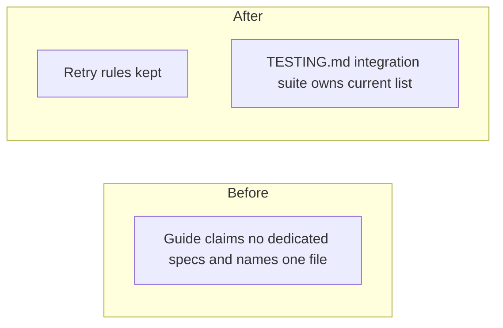

## Scenario

On the Outlook screen, the browser sends `GET /v1/accounts/balances` and `GET /v1/safe-spending-summary` as the page loads, before the forecast and Safe spending card appear. A JSON error body crosses the boundary when a request fails: a short structured text message describing what failed, such as HTTP 422 for balances or HTTP 500 for evidence. In that case the page shows a local alert, a box holding the error message and a Retry button, instead of the affected content; the Retry button sends the same request again, and when the retry succeeds the alert disappears. A spec is an automated test file that drives a real browser. Two integration specs deliberately intercept those requests with a route handler that substitutes a synthetic failure, a fake error response produced by the test rather than the API, then assert the alert text and the Retry button so a failed prerequisite cannot leave the forecast disabled forever.

The two specs are `frontend/tests/integration/outlookLoading.spec.ts`, which intercepts `GET /v1/accounts/balances` with a 422 and asserts a named alert with a Retry button and its disappearance after retry, and `frontend/tests/integration/safeSpendingEvidence.spec.ts`, which intercepts `GET /v1/safe-spending-summary` with a 500 and asserts a failure message and a `Retry evidence` button. The error-feedback guide `docs/error-feedback.md` is where the rules for this presentation live. That guide closes by saying no dedicated error-feedback specs exist and that the only current spec is `selectLabels.spec.ts`. The claim is stale: the two named specs directly exercise the retry presentation the guide owns. The fix is to remove the inventory claims rather than keep a count that goes out of date with each added spec.

## Executive summary

The error-feedback guide `docs/error-feedback.md` closes by saying no dedicated error-feedback specs exist and that the only current spec is `selectLabels.spec.ts`. A spec is an automated test file. There are twelve spec files at this HEAD, and two directly exercise the presentation this guide owns: `outlookLoading.spec.ts` asserts a named alert with a Retry button and its disappearance after retry, and `safeSpendingEvidence.spec.ts` asserts a failure message and a `Retry evidence` button after a server error. This reopens territory finding 029 (`audit-findings/029-current-error-feedback-docs.md`) partly addressed, since that finding removed obsolete references but left an inventory that later additions made stale. The fix is to remove both inventory claims.

## Recommended action

Remove both inventory claims from the error-feedback guide. Keep the single-channel and failed-edit retry rules as they are. Point to the integration-suite section of the testing guide `TESTING.md` for current policy instead of maintaining a local count. No code change is needed.

## Before and after

| | Closing inventory in the guide |
|---|---|
| Before | No dedicated error-feedback specs; only current spec is `selectLabels.spec.ts` |
| After | No inventory claims; keep the retry rules and point to the testing guide's integration-suite section for current policy |

## Expected improvement

The guide no longer carries a count that goes stale whenever a spec is added. This is a documentation-accuracy and maintenance improvement rather than a measured speed or size gain; no benchmarks were run for this finding.

## Alternatives considered

- Leave as is. The inventory is already stale at this HEAD and will drift again with each added spec. Rejected.
- Update the count to twelve and name the two retry specs. That fixes it only until the next addition and recreates the same maintenance burden. Rejected.

## Downside of rejecting

The guide keeps claiming no dedicated specs exist while two named tests directly cover its retry presentation, so readers may treat those behaviors as untested and the count will keep drifting.

## Verification

List `*.spec.ts` files to confirm there are twelve, and check that the two named tests contain the retry assertions. These are proposed acceptance checks, not recorded results.

References: `docs/error-feedback.md:25-27`; `frontend/tests/integration/outlookLoading.spec.ts:3-5,22-33`; `frontend/tests/integration/safeSpendingEvidence.spec.ts:801-826`; `audit-findings/029-current-error-feedback-docs.md:8-10,14`.
