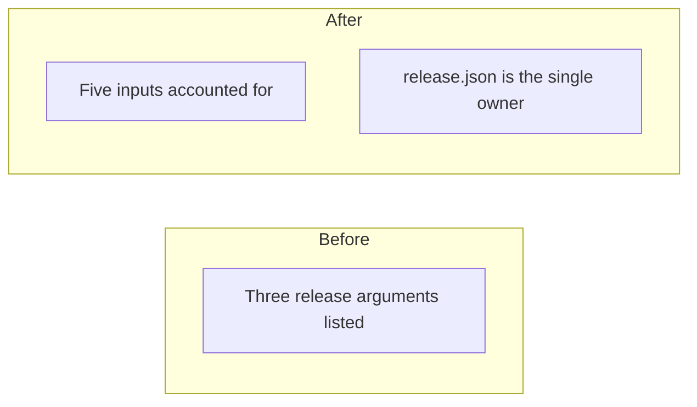

## Scenario

A release is not a user screen. It starts when a GitHub workflow or an operator requests the Northflank release workflow, which deploys pinned images, holds API writers behind a maintenance marker, runs the database migration, and restarts the API. The request is a webhook, an HTTP call that carries its inputs in the URL query string as name-and-value arguments rather than in a request body. Those arguments include the commit SHA, the API image, and the identity image. Two more are prepared Northflank IDs, the identifier of the identity service and of its database addon, the managed database that is dumped, meaning copied to a backup, before deployment. The gated workflow, the CI workflow that requires approval, supplies all five automatically. An operator re-releasing a failed target from the Northflank UI or API must supply them explicitly, or the pre-deploy dump and the identity image deploy fail. The Northflank guide is what that operator reads.

That guide lists only three arguments in both its overview and its incident-recovery override procedure. The release configuration declares five. The fix is to account for both IDs in the guide.

## Executive summary

The Northflank guide lists exactly three release query arguments, `RELEASE_SHA`, `API_IMAGE`, and `IDENTITY_IMAGE`, in both the overview and the incident-recovery override procedure. The release configuration declares five: the identity service and database-addon IDs drive the pre-deploy dump, a database backup taken before deployment, and the identity image deploy. An operator re-releasing a failed target from the UI or API submits an incomplete set and fails at the identity steps. The fix is to account for both IDs in the guide.

## Recommended action

Add both IDs to each list in the guide. State that they are prepared Northflank IDs supplied automatically by the gated workflow, the CI workflow with approval gates, and needed explicitly only for a manual run. Defer to the release configuration file as the single owner rather than re-enumerating the values in prose. No code change is needed.

## Before and after

| | Argument list in the guide |
|---|---|
| Before | Three arguments: `RELEASE_SHA`, `API_IMAGE`, `IDENTITY_IMAGE` |
| After | Those three plus the identity service and database-addon IDs, with the release configuration file as the single owner |

## Expected improvement

An operator re-running a failed release from the UI or API has the full input set, so the identity steps no longer fail for missing IDs. This is a documentation-accuracy improvement rather than a measured speed or size gain; no benchmarks were run for this finding.

## Alternatives considered

- Leave as is. Manual re-releases keep failing at the identity steps because two required inputs are missing. Rejected.
- Duplicate all five values into the prose lists. That creates a second source of truth that will drift from the release configuration file. Rejected.

## Downside of rejecting

The guide keeps listing an incomplete set, so any operator overriding a failed release manually will omit the prepared IDs and the release will fail at the pre-deploy dump or identity image deploy.

## Verification

Confirm each prose list matches the release configuration file and that the two IDs appear in the guide and the migration doc after the edit. These are proposed acceptance checks, not recorded results.

References: `deploy/northflank/README.md:67-69,103-105`; `deploy/MIGRATIONS.md:174-175`; `deploy/northflank/release.json:5,23,73`; `.github/workflows/northflank-release.yml:152-153,163,176-177`.
