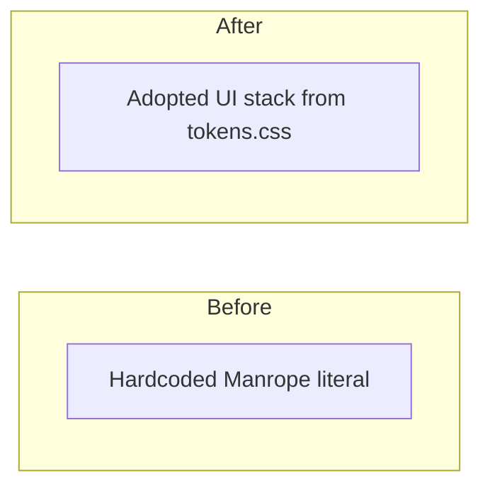

## Scenario

The primitives page is a documentation artifact, not a product screen. A developer opens the static HTML file in a browser to see the project's UI building blocks and the styles applied to them. Because it is a static file, the browser loads it directly and no API request takes place. The style that matters is a CSS font-family declaration, a rule that tells the browser which typeface to use for text. A typeface is the design of the lettering, and a font stack is the preferred typeface followed by fallback choices. The page should show the adopted UI typeface, Geist, with Merriweather for display headings, as the controlling typography rules define. It instead still names the retired typeface Manrope, which no current style or controlling document uses, so a reader sees typography the project no longer ships. The UI principles and token styles are the sources of truth here, which is why the one literal on the page is the thing to change.

## Executive summary

The typography decision to use Geist and Merriweather was applied to the controlling docs and CSS, but this documentation artifact still names a retired font in its font-family rule. A repo-wide search finds the name only here and in the historical finding 011 record. A reader using the primitives page, which shows the project's UI building blocks, sees a font the project no longer uses. The fix is to swap the one literal to the adopted UI stack.

## Recommended action

Swap the single retired font literal on the primitives page to the adopted UI font stack matching the token styles. Do not add a new font definition. No CSS or code change beyond that literal is needed.

## Before and after

| | Font literal in the artifact |
|---|---|
| Before | A font-family rule naming the retired Manrope font |
| After | The adopted UI stack from the token styles, with no new font definition |

## Expected improvement

The primitives page reflects the current typography decision, so readers no longer see a retired font. This is a documentation-accuracy improvement rather than a measured speed or size gain; no benchmarks were run for this finding.

## Alternatives considered

- Leave as is. The artifact keeps showing a font that no other doc or CSS file uses. Rejected.
- Reintroduce the retired font as a supported font. That would reverse the documented typography decision for the sake of one artifact. Rejected.

## Downside of rejecting

The retired font stays on the primitives page, and a repo-wide search will keep returning a live artifact alongside the historical record, which can confuse a reader about what the project uses.

## Verification

Confirm a `Manrope` search returns only the historical 011 record. No browser render was performed, so the visual result is unverified. This is a proposed acceptance check, not a recorded result.

References: `docs/primitives.html:62`; `docs/UI_UX_PRINCIPLES.md:276-278`; `frontend/src/styles/tokens.css:10-12`; `audit-findings/011-typography-decision.md:10,14-16`.
