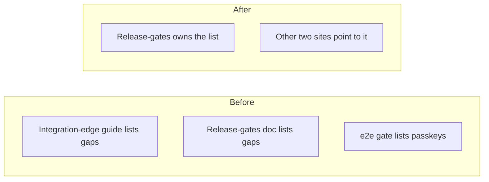

## Scenario

Preparing a release is a documentation workflow rather than a runtime path. An engineer checks the gate docs to see which behaviors automation, meaning automated tests, actually covers and which gaps stay manual. A seam is the boundary where a test substitutes a fake for a real service, such as the mail OAuth fetch boundary or the local stand-in for image extraction, a test double that mimics the OCR, meaning text recognition from an image, step. Physical passkeys, a sign-in method that uses a device key, are another gap. These gaps are recorded as lists in several Markdown docs: the release-gates doc owns the shared "Uncovered by automation" list, while the integration-edge guide keeps a copy of several of the same items and the e2e gate repeats the passkey item. No runtime request starts this work; a maintainer edits the lists whenever a coverage gap changes. The release-gates doc is the intended owner, which is why repeating the gaps elsewhere creates a maintenance cost.

## Executive summary

The integration-edge guide cedes the ship-or-no-ship checklist to the release-gates doc but keeps its own "Uncovered by automation" list, which records gaps not covered by automated tests. The mail OAuth seam, the boundary of the mail OAuth integration, and the image-extraction stand-in, a test double for image extraction, appear in both lists. Passkeys appear in both plus the e2e gate. A maintenance change to any one gap must be applied in several docs. The fix is to give the release-gates section sole ownership.

## Recommended action

Make the release-gates section the sole owner. Replace the edge-tier section in the integration-edge guide with a pointer that retains only tier-specific gaps, and link to the manual checklist instead of restating the passkey item. No code change is needed.

## Before and after

| | Location of the gaps |
|---|---|
| Before | Integration-edge guide and release-gates doc both list the gaps; passkeys also in the e2e gate |
| After | Release-gates section is the single owning list; other two sites become pointers with the same heading |

## Expected improvement

A change to a coverage gap is made in one place instead of several, so the lists cannot drift apart. This is a documentation-maintenance improvement rather than a measured speed or size gain; no benchmarks were run for this finding.

## Alternatives considered

- Leave as is. Each gap change still has to be applied in multiple docs, and the lists can disagree. Rejected.
- Keep the edge-tier list as a full copy and only sync it manually. That preserves the duplication and the drift risk. Rejected.

## Downside of rejecting

The three sites keep overlapping, so a gap update applied in one doc but not the others leaves editors with conflicting guidance on what is covered by automation.

## Verification

Confirm one owning list remains and the other two sites are pointers with the same heading. This is a proposed acceptance check, not a recorded result.

References: `docs/integration-edge-gates.md:3-4,156-166`; `docs/release-gates.md:111-131,121-127`; `docs/e2e-gate.md:35`.
